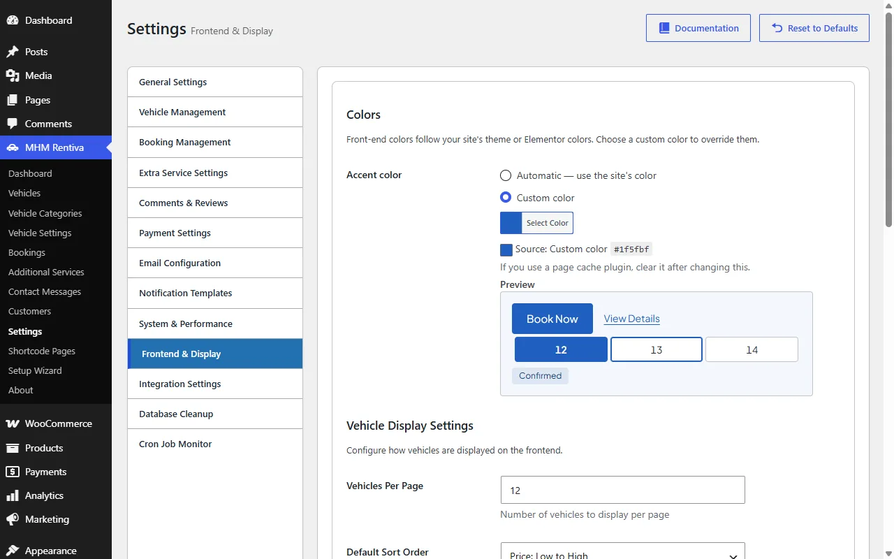

  

The Frontend & Display tab is a comprehensive administration area where you customize the plugin's user-facing appearance, button labels, alert messages, and page URLs. Access it via **MHM Rentiva > Settings > Frontend & Display**.

---

## 🎨 Colors

The **Colors** section comes first on the tab. It sets the single accent (main) color the plugin uses on your site: primary buttons, links, selected calendar days, and the soft tinted page background of the booking screens. Rentiva's front end also uses the Plus Jakarta Sans font, served from the plugin's own files (no request to Google), and 4 px corners on cards, buttons and booking boxes.

Under **Accent color** you choose a mode:

- **Automatic — use the site's color:** Rentiva reads the color from your site. It checks these sources in order and uses the first real color it finds:
  1. **Theme setting:** the main color of a supported theme (Thembay themes, Avanam, listeo, politic, upstudy and Astra). If you never changed it, the theme's own default is used and the source line says "theme default".
  2. **Elementor global color:** the **Accent** global color, then **Primary**. Elementor's factory colors are ignored, so only a color you set counts.
  3. **Theme color palette (theme.json):** the button color of a block theme, then the `primary` and `accent` palette colors.
  4. **Rentiva default:** a blue (`#2271b1`) when nothing above gives a color.
- **Custom color:** pick your own color with the color picker. It overrides the automatic result.

Below the picker you see:

- **Source:** which source the current color comes from, with a swatch and the hex code, for example "Source: theme setting (Astra)".
- **Preview:** a small sample (button, link, three calendar days, "Confirmed" tag) that repaints as you change the color.
- **Two readability notices**, shown only when needed:
  - "This color is too light for text on the page..." The accent stays as the button fill, but links and text use a darker shade so they remain readable. The hover shade is derived automatically; with a very dark accent it opens lighter instead of darker.
  - "This light color is hard to tell from a white background."

:::tip Clear your page cache
Colors are printed into the page. If you use a page cache plugin or your host caches pages, clear that cache after changing the color, as the section itself reminds you.
:::

:::info Changed in 6.4.0
Colors now follow your site automatically. In earlier versions the front end always used a fixed blue.
:::

### For developers
Three filters let a theme or custom plugin take part. `mhmrentiva_accent_color` receives the hex color and the source id and returns the final color (it has the last word, even in Custom mode, and then the source line reads "developer filter"). `mhmrentiva_accent_sources` changes the ordered list of automatic sources, and `mhmrentiva_theme_adapters` adds support for another theme.

---

## 🖼️ Core Vehicle Display Settings

Control the visual hierarchy on vehicle listing pages:

- **Vehicles Per Page:** The maximum number of vehicles listed on a single page (e.g., 12).
- **Default Sort Order:** The criterion by which the listing page is ordered on first load (ascending by price, descending by year, etc.).

:::note Removed Settings (v4.22.1)
The **Show Vehicle Images** (`mhmrentiva_vehicle_show_images`), **Show Features** (`mhmrentiva_vehicle_show_features`), and **Show Availability** (`mhmrentiva_vehicle_show_availability`) settings present in earlier versions were removed in v4.22.1 because they were unused in the codebase. These display controls are now managed directly through shortcode parameters (`show_features`, `show_badges`, etc.).
:::

---

## ✍️ Custom Labels & Text

Change any button or form text in the plugin to match your language or brand voice in seconds. This section is accordion-structured:

- **General Buttons:** Button labels such as "Rent Now", "View Details", "Make a Booking".
- **Notification Messages:** Instant alerts such as "Added to favorites", "You must be logged in", "Processing...".
- **Form Labels:** Field names on the booking form such as "First Name", "Last Name", "Phone".
- **Payment & Validation:** Critical system messages such as "Calculating...", "Payment successful", "Invalid date selection".

---

*Settings > Frontend & Display tab, label groups and display settings*

---

## 🔗 Permalinks & Page URL Structure

Manually define the page paths that are critical for the plugin to function correctly:

- **Booking Form URL:** The full address of the page containing the `[rentiva_booking_form]` shortcode.
- **Login & Registration Page:** The custom login and sign-up pages customers are redirected to.

:::tip Auto-Detection
If you leave these fields empty, the system will automatically scan the database to find the pages containing the relevant shortcodes. However, if you have a custom page structure, entering the full URL here is recommended.
:::

---

### Section Summary
- **Customize all buttons** to match your target audience's language for a better user experience.
- **Align the visual layout** of listing pages with your site's design.
- **Set page URLs** to ensure the booking flow works without interruption.

### Changelog
| Date | Version | Note |
| :--- | :--- | :--- |
| 18.11.2026 | 6.4.0 | Colors section added (automatic site color, custom color, notices, filters). |
| 23.04.2026 | 4.27.2 | English translation added. |
| 27.03.2026 | 4.22.1 | Added note about removal of unused display control settings (`show_images`, `show_features`, `show_availability`). |
| 19.03.2026 | 4.21.2 | Frontend & Display documentation created with all label groups and URL configuration. |
