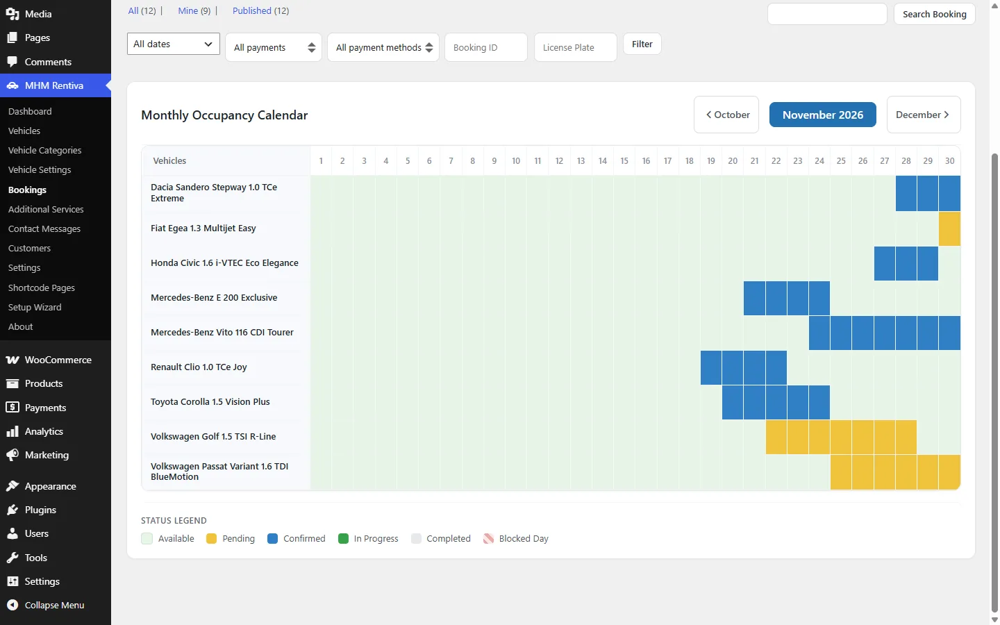
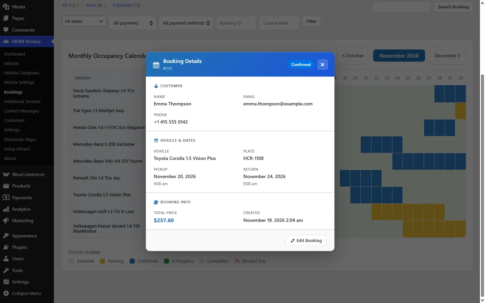

  

Bookings are the operational and financial core of the MHM Rentiva system. Use **MHM Rentiva > Bookings** to monitor all booking traffic, create new records, and manage financial flows.

For the cart and checkout pages the customer sees (the "Pay now" and deposit labels, guest accounts, why an unpaid order cannot be paid), see [Payments](../02-core-configuration/payments.md).

---

## 📊 Booking List and Filters

At the top of the page, four cards show the current state of your fleet:
- **Total Bookings:** Every booking that is not in the Trash, with how many were created this month.
- **Pending:** Bookings still waiting for approval or payment, with how many were created this week.
- **Completed:** Rentals that have concluded, with how many this month.
- **Bookings Value This Month:** The booked price (not cash collected) of confirmed, in-progress and completed bookings created this month, and the change against last month.

Below the cards, a row of status chips filters the list: **All**, **Pending**, **Confirmed**, **In Progress**, **Completed** and **Cancelled** are always shown, each with its count. Other statuses (for example Refunded) appear only when at least one booking has them.

Next to the chips, the dropdowns **All payments** and **All payment methods**, plus the **Booking ID** and **License Plate** boxes, narrow the list further.
- The payment filter offers the same statuses the **Payment** column shows: Unpaid, Pending, Paid, Partially paid, Partially refunded, Refunded, Cancelled and so on. Only statuses that at least one booking has are listed.
- **Paid** does not return deposit bookings that still owe a balance; those are under **Partially paid**.
- The payment filter narrows together with the status chip and also works in the Trash view.

**List columns:** Customer, Booking ID, Vehicle, Dates, Total, Deposit Amount, Remaining Amount, Payment, Status and Booking Type. A small **M** next to the type marks a booking entered by hand. In the Payment column the badge reads Unpaid or Pending (yellow), Paid (green), Partially paid (blue), or Refunded / Failed / Cancelled (red).

On a **Pending** booking the row has an **Approve** link that confirms it without opening the booking.

### Calendar view

The **List** / **Calendar** switch above the table shows the same bookings as a fleet calendar: one row per vehicle, one column per day of the selected month. Use the month arrows to move between months; the status chips and filters apply to the calendar too.

**Cell colors (legend):**
- ● **Pending**
- ● **Confirmed**
- ● **In Progress**
- ● **Completed** (light gray)
- Red diagonal stripes: **Blocked Day** (a day closed in the vehicle's edit screen)
- White: **Available**

Cancelled and refunded bookings do not occupy a vehicle, so they are not painted. If you pick the **Cancelled** chip on the calendar, the page tells you to switch to the List view.

Click a painted cell to open a summary with the customer, vehicle, plate, pickup and return times, total price and an **Edit Booking** button. When several bookings fall on the same day, all of them are listed.

---

## ➕ New Booking

Use **Add New Booking** to enter requests received by phone or in person. The page header reads "← Bookings · New record · added by an administrator". The form has these sections:

1.  **Vehicle & Customer:** Select the vehicle, then an existing customer, or choose **+ Create New Customer** and fill in first name, last name, email and phone.
2.  **Dates & Duration:** Pickup and return date and time. The return must be after the pickup.
3.  **Additional Services:** Tick the extras the customer asked for and set quantities. A service priced per day is shown multiplied by the number of rental days.
4.  **Payment & Notes:** Choose the **Payment Type** (**Full Payment** or **Deposit**; Deposit is preselected), the **Payment Method** (**Offline** is preselected, or **Online**), the **Status** (**Pending** or **Confirmed**; Confirmed is preselected) and any notes. Under **Online** a note says the payment link is sent separately.

Click **Calculate Price**. The price panel shows the vehicle total, add-ons and grand total; with a deposit it also shows the **Deposit** and **Remaining** lines. Then click **Create Booking**. There is no guest count field.

**Country and state of a new customer.** The new-customer card has optional **Country** and state fields. The country list comes from WooCommerce (the countries your shop sells to, with the shop's own country preselected). For a country with a state list you pick from it; for a country without one you type the region; for a country that does not use states, or whose checkout hides the state field (for example Cyprus, Bosnia and Herzegovina, Botswana), the field is not shown. The values are saved to the customer's WooCommerce billing country and state.

**Customer account.** When a new customer is created here, the customer receives an email to set their own password, and the success message says so.

### Bookings that are paid outside the site

A booking you enter by hand with the **Offline** payment method (cash or card at pickup, a transfer you check yourself) has no payment deadline. It is not cancelled automatically when the payment window runs out or the pickup day passes, and the customer is not sent a "payment period expired" email. A hand-entered booking with the **Online** method, and every booking made on the website, keeps its payment deadline (**Payment Deadline (Minutes)** under **Settings › Booking**, used with **Enable Auto Cancel**).

:::info Changed in 6.4.0
Offline bookings entered by hand used to be cancelled by the automatic sweep. On upgrade, older ones that had been cancelled that way hold their vehicle again. If another customer took those dates in the meantime, the booking is left as it is and a warning linked to that booking appears in **Logs**.
:::

---

## 📝 Edit Booking (Screen Layout)

Open a booking from the list to edit it. The header reads "← Bookings · Customer, vehicle and payment details". The default layout is:

**Right column**
- **Booking Status:** a short summary (vehicle, days, total), the **Cancel Booking** button with the note "Cancelling starts the refund of the amount paid and sends the customer a notification.", and the usual **Update** and **Move to Trash** buttons.
- **Customer Account:** the customer's name, email, a **View customer profile** link and a **Country / state** line (the customer's WooCommerce billing country and state). If no account is linked and the booking has an email, **Create Customer Account** creates one and the customer receives an email to set their password. The box also shows the **Rental agreement** line: **Accepted** with the date and version of the text, or "No acceptance (admin booking)" for a booking you entered by hand.
- **Payment Receipt:** shown only when the customer has uploaded a bank transfer receipt. See [Customer receipt](#customer-receipt).
- **Refund:** the refund state and refund actions. See [Cancellation and Refund](#cancellation-and-refund).
- **Send Email to Customer:** see [Send Email to Customer](#send-email-to-customer).

**Left column**
- **Edit Booking Details:** booking reference and type, vehicle, pickup and return date and time, status, additional services with quantities, and special notes. There is no guest count field (a value already stored is kept).
- **Payment Management:** amounts, payment status, deadlines, payment history, booking history and note entry (below).

The boxes can be dragged and the layout is remembered per user; the order above applies until you rearrange them.

**Payment status badges** in the Payment Management box: Paid is green; Partially paid, Pending and Pending Verification are yellow; Unpaid, Failed and Cancelled are red; Refunded and Partially refunded are blue.

### The vehicle is in the Trash

If the booking's vehicle was moved to the Trash or is no longer published, the vehicle list still shows it as selected with "— In Trash" next to its name, and a note below says customers can no longer open its page and that you can restore it from the Vehicles list or pick another vehicle. Choosing another vehicle hides the note.

### Dates and closed days

The return date and time must be after the pickup. If they are not, the browser stops the save, and if a bad range still reaches the server it is not saved and the dates stay unchanged. If the vehicle has closed days in the period, the booking is saved and a notice names them.

### Customer receipt

When the customer uploaded a bank transfer receipt, the **Payment Receipt** box shows the file (**View / Download**), its status (Submitted, Approved or Rejected), an **Admin Note** and the buttons **Approve Receipt** and **Reject Receipt**.

---

## 🔄 When the Price Is Recalculated

**Update** recalculates the price only when something that affects it changed: the vehicle, pickup or return date or time, or the additional services and their quantities. If you only change the status or a note on a paid booking, its total and add-on lines stay as they are.

When the price does change:
- **The amount already collected is kept.** If you extend or make a paid booking more expensive, it becomes a deposit booking: what was paid is the deposit, the difference is the **Remaining Amount**, and you collect it with **Process Remaining Amount** or by sending a payment link.
- **A new total below what was collected is not saved.** The vehicle, dates and add-ons stay as stored (notes and other fields are saved) and a message tells you to cancel the booking, refund the payment and create a new booking.
- **The total cannot be changed** while a remaining-payment link exists for the booking, when a refunded booking would get a higher total, when the booking was paid in more than one currency or a currency other than the shop's, or when it was paid in an order that also holds other bookings or products. The message says which case applies; to change the price in these cases, cancel the booking and create a new one.

For a deposit booking that has not been paid at all (no payment collected, no WooCommerce order), a percentage deposit follows the new total at the rate the booking was made with: a 10% deposit stays 10% of the new total, and the remaining amount is written accordingly. Today's deposit rate in the settings is not applied to an existing booking. A fixed-amount deposit, a booking linked to an order, or a booking with a payment keeps its deposit as it is; only the remaining amount follows the new total.

---

## 💰 Deposit and Remaining Payment

The **Payment Management** box shows the **Payment Type** (Deposit or Full Payment), **Payment Method** (Online or Offline), **Total Amount**, **Deposit Amount**, **Remaining Amount**, **Rental Days** and **Deposit Type**, followed by the payment status, the **Cancellation Policy** (the deadline and whether the booking can still be cancelled) and the **Payment Deadline**.

A deposit booking whose deposit is paid but which still owes a balance shows **Partially paid** in the box and in the list. A booking made before the deposit system existed shows a note that deposit information is not available.

**Buttons:**
- **Mark Payment Received:** for a booking that is Pending or Confirmed and not yet paid (for example a bank transfer you have checked). It marks the payment received and confirms the booking.
- **Process Remaining Amount:** for a deposit booking whose deposit is paid and a balance remains. It records the balance as collected; the booking becomes Confirmed, or Completed if the rental has already ended.
- **Send Payment Link:** emails the customer a payment link for the remaining amount. It is not offered when the deposit was paid outside WooCommerce; use **Process Remaining Amount** there.

### Customer pays the remaining amount

For a deposit booking, the customer can click **Pay Remaining Amount** in **My Account**, on the booking detail. A small WooCommerce order is created for the outstanding amount and the customer pays it with any payment method active on your site. If the deposit was paid outside the website, the page says you will contact the customer to collect the balance instead.

- Only the booking's current payment link takes a payment. An older link says the amount is no longer current and the customer should ask for a new one. A card that was declined can be retried on the same link.
- If the remaining-payment order fails or is cancelled, the booking is not cancelled. If a paid remaining order is cancelled later, the money stays on that order; refunding or restoring it is up to you.
- If a payment arrives for an amount that is no longer current, the remaining amount is not zeroed. A warning stays on the booking's edit screen with the order number, the amount collected and the remaining amount, until you click **I have checked it**; correct the balance by hand.

:::info Changed in 6.4.0
A remaining-payment link created before upgrading may be refused at checkout because of tax or currency differences. The customer then asks for a new link.
:::

---

## 🧾 Booking History

The **Payment Management** box ends with the **Booking History**.

- **Add Note:** write a note, choose the **Type** (**Note** or **Customer Contact**) and click **Add Note**. An empty note is refused without blocking **Update**, and the result is shown inside the box. Rentiva writes the status, payment and system rows itself.
- **History:** newest first, each row with its type (Note, Status Change, Payment Update, Customer Contact, System), date and "By" name. Rows written by the automatic jobs show **System**. Only the latest five are open; the rest sit behind "+ N more entries".
- Every payment change is one row, for example "Payment: Pending → Partially paid". Deposit approval, remaining payment, a WooCommerce order, a refund, an automatic cancellation, a re-price on **Update** and a payment type change all write such a row.
- Other rows: the hand transfer of a refund being closed, the reason when no refund is due, an email sent to the customer, and the remaining-payment link being created or emailed.
- The notes are included in the customer's personal data export. The customer's My Account timeline does not show payment rows.

---

## ❌ Cancellation and Refund {#cancellation-and-refund}

**Cancel Booking** in the **Booking Status** box cancels a Pending or Confirmed booking. It starts the refund of what was paid and sends a notification to the customer and to the administrator. A rental that has started cannot be cancelled here.

Choosing **Cancelled** in the **Status** list and pressing **Update** does exactly the same. Other changes made in the form at the same time are not saved, and the screen says so ("edit the booking first, then cancel"). A user without money rights does not see **Cancelled** in the status list.

**Cancellation deadline.** The deadline counts back from pickup (**Settings › Booking › Cancellation Deadline (Hours)**). A customer cannot cancel after it. The administrator's cancellation ignores the deadline and refunds the whole refundable balance. In the Payment Management box the sentences "This booking can be cancelled." and "Cancellation period expired." appear only on open bookings; cancelled, completed and refunded ones keep only the deadline lines.

**Refund box.** Its first line is **Refund status:** (for example Refund in progress, Awaiting hand transfer, Hand transfer confirmed, Refunded through the payment gateway, No refund was due).
- **Process Refund** appears for a cancelled booking with a refundable balance; it completes the refund or retries it. If part of the money already went back, it offers the rest.
- A paid WooCommerce booking that is not cancelled shows "It can be refunded from the WooCommerce order screen."
- For offline money the box lists **Channel**, **Paid**, **Already refunded** and **Remaining refundable**.

**Hand transfer (cash, bank transfer).** When the refund is paid back by hand, the status reads **Awaiting hand transfer**. Once you have handed the money over, type an optional **Payment reference (optional)** and click **Confirm hand transfer**. The booking history records it and, when a reference is entered, the customer receives an email saying the refund has been transferred with that reference. For a refund paid back by hand, the customer receives Rentiva's "refund will be transferred to you manually" email and not WooCommerce's "order refunded" email; when Rentiva's email is off or there is no address, WooCommerce's stays. A refund returned through the payment gateway keeps WooCommerce's email.

**Needs review.** When an automatic cancellation finds a paid order and no money moved, the status reads **Needs review**. **Cancel and start the refund** cancels and starts the refund. **No refund is due** closes the review; you must write the reason in **Why is no refund due?**, and it is recorded in the history. If the booking is already cancelled, refund the paid order from the WooCommerce order screen first.

**Refund from the WooCommerce order screen.** If an order is refunded in full there:
- A booking that has not started (Pending, Pending Payment, Confirmed) is cancelled and its dates are freed; the payment status becomes Refunded.
- A completed rental stays as **Refunded**.
- A rental in progress keeps its dates, because the vehicle is with the customer; you close it yourself.
- The customer receives a single refund email, and no separate "booking cancelled" email.

---

## ✉️ Send Email to Customer {#send-email-to-customer}

The **Send Email to Customer** box shows the customer name and email, then:
1.  **Email type:** **Booking confirmation**, **Booking reminder**, **Booking cancellation** or **Custom message**.
2.  **Subject** and **Message:** picking a type fills both from the matching template in **Settings → E-mail templates**; you can edit them before sending (changing the type again asks before replacing your edits). **Custom message** starts empty and needs both a subject and a message.
3.  **Send email.**

The **Booking cancellation** type fills the subject and message and sends. If the customer turned off automatic notifications, the box says so; an email you send here still goes out. A sent email is written to the booking history.

---

## 🆔 Display ID

Booking lists and widgets show the WooCommerce order number when the WooCommerce integration is active; otherwise they show the booking's own number. This keeps the number the customer sees the same as the one in the admin panel.

---

### Section Summary
- Filter the **list** by status, payment, method, booking ID or plate, or switch to the **Calendar**.
- **New Booking** enters phone and walk-in requests; offline bookings you enter are never auto-cancelled.
- **Update** re-prices only when a price input changes and never lowers the amount collected.
- Track deposits and balances in **Payment Management**; use **Process Remaining Amount** or **Send Payment Link**.
- **Cancel Booking** and **Cancelled + Update** do the same thing and start the refund.
- The **Booking History** records every payment, status and email change.

### Changelog
| Date | Version | Note |
| :--- | :--- | :--- |
| 18.11.2026 | 6.4.0 | Booking list cards, filters and fleet calendar; new booking and edit screen layout; Payment Management box with history; re-pricing rules; cancellation and refund from the edit screen; hand transfer confirmation; offline manual bookings no longer auto-cancelled. |
| 23.04.2026 | 4.27.2 | Documentation synchronized with the current plugin release. |
| 27.03.2026 | 4.23.0 | Calendar popup time info, Display ID, and status hooks documented. |
| 19.03.2026 | 4.21.2 | Booking list, calendar, manual entry, and payment management rewritten against the real interface. |
| 18.03.2026 | 4.21.0 | Initial version created. |
