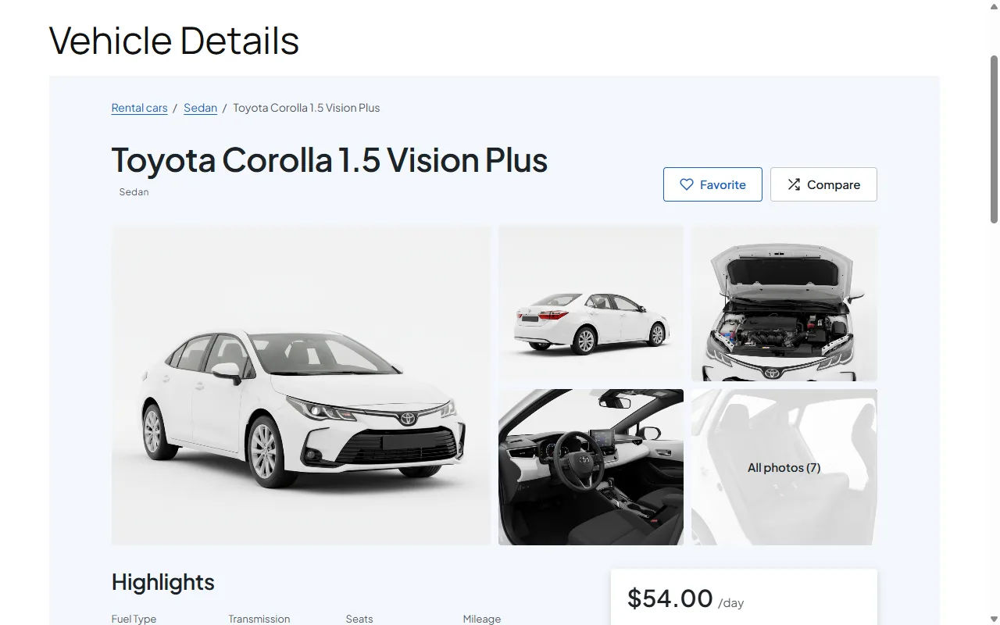

  

:::info Purpose
This page describes the Vehicle Details module as a standard reference, covering both technical and operational aspects.
:::

# 🚗 Vehicle Details

## Contents
- Usage
- Features
- Developer Notes

The Vehicle Details module is designed to manage and present **vehicle** detail information to visitors on the Rentiva platform.

## Usage



To add this module to any page or post, use the shortcode below:

```shortcode
[rentiva_vehicle_details vehicle_id=""]
```

You can also insert it visually from the Gutenberg block editor by selecting **"MHM Rentiva → Vehicle Details"**.

### Parameters

The following parameters are available inside the shortcode:

| Parameter | Default | Description |
| :--- | :--- | :--- |
| `vehicle_id` | `(empty)` | Controls the module's **feature** filter behavior. |
| `show_gallery` | `1` | Visibility toggle. `1` (on) or `0` (off). |
| `show_features` | `1` | Controls the module's **general** display behavior. |
| `show_pricing` | `1` | Controls the module's **general** display behavior. |
| `show_booking` | `1` | Visibility toggle. `1` (on) or `0` (off). |
| `show_calendar` | `1` | Visibility toggle. `1` (on) or `0` (off). |
| `show_price` | `1` | Controls the module's **general** display behavior. |
| `show_booking_button` | `1` | Controls the module's **general** display behavior. |
| `show_favorite_button` | `1` | Controls the module's **general** display behavior. |
| `show_compare_button` | `1` | Controls the module's **general** display behavior. |
| `class` | `(empty)` | Controls the module's **general** layout behavior. |


## Features

### 📱 Responsive Design
- **Mobile:** Single-column layout.
- **Tablet (under 782px):** Optimized view.
- **Desktop:** Full view at the configured column count or width.

### 🚀 Performance-Focused
- **Smart Caching:** Database queries are optimized and cached by the system.
- **Conditional Loading:** Static assets are only enqueued on pages where the module is used.

## Good to know

- **Taken dates:** if the page is opened with dates that are already booked (for example from a search), the booking card shows the daily price instead of a total or deposit, and under "Alternative Vehicles" it suggests up to two similar vehicles that are free on those dates. Each has a **Select This Vehicle** button that opens that vehicle's page with the same dates. When the customer changes the dates, availability and price refresh at once.
- **Past or invalid dates:** a pickup time that has passed or a return before pickup is not priced; the card shows the reason ("The pickup time has already passed. Please choose a later date or time." / "Return date must be after pickup date.").
- **Phone:** the availability legend (Selected, Partly available, Booked, Closed) wraps to a second line instead of overflowing.
- **Number format:** mileage and engine size follow the page language ("18,500 km" and "1.6 L" in English, "18.500 km" and "1,6 L" in Turkish).
- **Several languages:** on a Polylang or WPML site the availability message appears in each visitor's own language.

## Developer Notes

- **HTML Structure:** All containers start with the `.mhm-rentiva-vehicle-details-wrapper` class.
- **Customization:** CSS variables (`--mhm-color-primary`, etc.) are inherited from the global `css-variables.css` file.

## Section Summary
- The Vehicle Details page has been aligned to the standard documentation structure with consistent reference headings.

## Changelog
| Date | Version | Note |
|---|---|---|
| 18.11.2026 | 6.4.0 | Taken-date suggestions, date messages, number format and multilingual availability message. |
| 23.04.2026 | 4.27.2 | English translation added. |
| 19.03.2026 | 4.21.0-docs | Page alphabetized and image placeholder added. |
