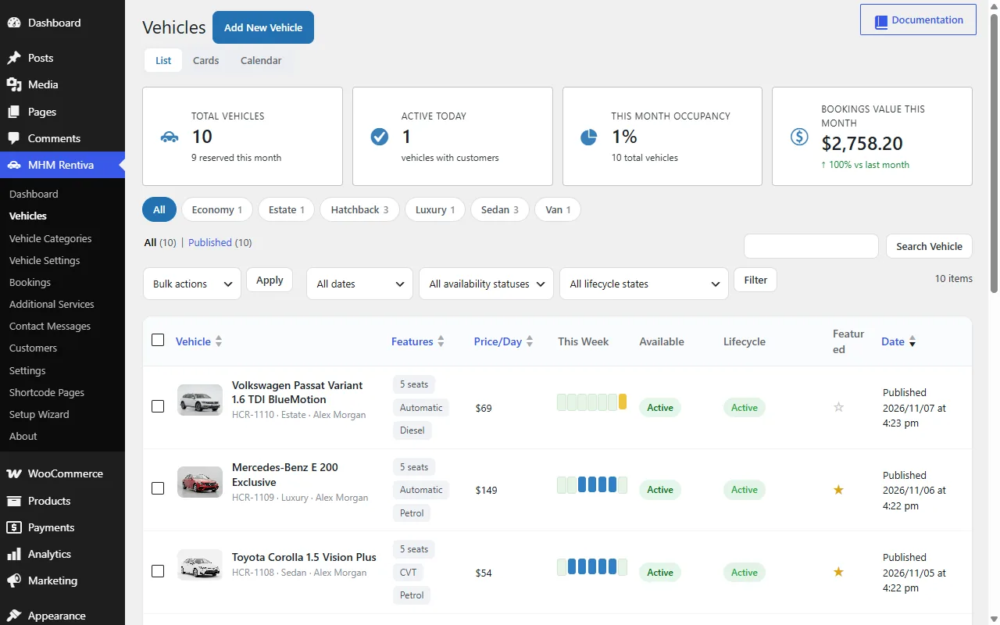

  

Vehicles are the fundamental building blocks of the MHM Rentiva system. **MHM Rentiva > Vehicles** is the main management screen where all vehicles in your fleet are listed, their statuses are tracked, and new vehicle entries are made.

---

## Vehicle List and Quick Actions

The vehicle list provides a general overview of your fleet. Four cards sit above it: **Total Vehicles** (with how many are reserved this month), **Active Today** (vehicles currently with customers), **This Month Occupancy** and **Bookings Value This Month** (compared with last month). The **List / Cards / Calendar** switch changes how the fleet is shown.

- **List Columns:** Vehicle (photo, title, then plate, category and the author's name underneath), Location (only when the Locations feature is active), Features (seats, transmission and fuel), Price/Day, This Week (a 7-day availability strip), Available, Lifecycle and Featured.
- **Quick Edit:** Use the **"Quick Edit"** row action to update plate, price, availability and the other quick fields without reloading the page.
- **Filtering:** Filter vehicles by category, availability status, location (when active) or lifecycle state (Active, Paused, Expired, Withdrawn, or Archive).
- **Bookings Value:** The "Bookings Value This Month" card adds up the price of this month's confirmed, in-progress and completed bookings. It is the booked amount, not money collected, and cancelled or refunded bookings are not counted.

---

## Adding and Editing Vehicles

The vehicle edit screen has a **"← Vehicles"** link and the vehicle name under the page title. The main column holds, from top to bottom, the **Vehicle Gallery**, the **Vehicle Details** and the **Blocked Dates** boxes. The side column holds **Publish**, **Featured**, **Vehicle Categories** and **Vehicle Image**, followed by the (Pro) boxes **Lifecycle Status**, **Vehicle Documents** and **Transfer Settings (VIP Module)**. If you drag the boxes into your own order, your order is kept.

When adding a new vehicle or editing an existing one, it is recommended to fill in all fields in the **"Vehicle Details"** box. Which fields appear there is set under **Vehicle Settings** (see [Vehicle Settings](./vehicle-settings.md)).

You can drag details, features and equipment into the order you want; the order is saved with **Update**, separately for each vehicle.

### 1. Core Technical Data
- **Availability:** Whether the vehicle is active or passive in the system.
- **Location:** Which office or vendor region the vehicle belongs to.
- **Price and Finance:** Daily rental fee and Deposit amount.
- **Identity Information:** Plate, Make, Model, and Model Year.
- **Capacity:** Seat Count and Door Count.
- **Mechanical:** Transmission Type (Automatic/Manual), Fuel Type (Petrol, Diesel, Hybrid, Electric, LPG, CNG or Hydrogen), and Engine Displacement.

---

## Features and Equipment

Two main checklists are available for each vehicle that customers can use for filtering:

### Vehicle Features
Air Conditioning, Power Steering, ABS, Airbags, Central Locking, Electric Windows/Mirrors, Fog Lights, Cruise Control, Bluetooth, Navigation, Sunroof, and Heated Seats.

### Vehicle Equipment
Spare Tire, First Aid Kit, Fire Extinguisher, Warning Triangle, Car Cover, Child Seat, GPS Tracker, Dashboard Camera, and Cleaning Kit.

---

## Transfer Settings (VIP Module) (Pro)

> The Transfer Settings box is part of **MHM Rentiva Pro**.

MHM Rentiva Pro supports VIP Transfer operations in addition to standard rentals. Configure the following settings in the **Transfer Settings (VIP Module)** box in the side column of the vehicle:

- **Service Type:** Rental Only, Transfer Only, or Both.
- **Passenger Capacity:** Maximum number of passengers.
- **Luggage Limits:** Maximum large and small luggage capacities (for point-based calculation).
- **Price Multiplier:** Assign a price multiplier specific to certain vehicles (e.g. 1.2x for VIP vehicles).

---

## Gallery and Image Management

- **Vehicle Image:** The main profile photo shown in search results.
- **Vehicle Gallery:** Up to 10 photos showing the interior and exterior details of the vehicle.

---

## Vehicle Documents (v4.23.1)

The vehicle submission form (`[rentiva_vehicle_submit]`) contains two document upload fields:

### Vehicle Registration Document
The vendor uploads the vehicle registration document via the form. It is reviewed by the admin for verification.

### Vehicle Insurance Document
Added in v4.23.1. This section, which appears immediately after the registration document, allows uploading the vehicle's insurance document.

- **Meta key:** `_mhmrentiva_vehicle_insurance_doc`
- **Processing:** Handled by the `VehicleSubmit.php` AJAX handler and stored in the WordPress Media Library.
- **History:** This field was previously in the vendor application form. In v4.23.1, it was moved to the vehicle submission form so that an insurance document can be uploaded per vehicle.

---

## Blocked Dates

Use the **Blocked Dates** box to close a vehicle on specific dates. Click days on the calendar to close them; closed days are shown in red and a badge shows **"N days blocked"**. Each closed day is listed under **Blocked Days** with an optional note (**"Add note... (optional)"**), and **Clear All** reopens every day of this vehicle. The changes are saved with **Update**.

- **Apply to All Vehicles:** replaces the closed days of every other published vehicle with this vehicle's closed days.
- **Remove from All Vehicles:** removes only this vehicle's closed days from every other published vehicle; their other closed days stay.

(Pro) Days that a vendor's cancellation penalty has closed are neither copied nor removed by these buttons; they lift on their own after 30 days. Dates you closed by hand are kept.

Both buttons work on the whole fleet, so they are available only to users who may edit other people's content (administrators).

Notes can contain any characters, including Turkish letters and quotation marks.

### Quick block from the Monthly Reservation Calendar (v4.61.0)

You can also block or open a single day directly from the **Monthly Reservation Calendar**, without opening the vehicle for editing:

- **Click an empty day** to close it for new reservations.
- **Click a blocked day** to re-open it.

Days that already have a booking are unchanged — they keep their reservation popup and cannot be blocked this way.

---

## Trashing and Restoring a Vehicle

You can move a vehicle to the Trash from the row action, the bulk action or the edit screen. A vehicle that still has upcoming bookings is not refused: the bookings keep the vehicle, but customers can no longer open the vehicle's page. So when you trash such a vehicle, the Vehicles list shows a warning with the number of upcoming bookings, a link to each booking (the first five, then "and N more") and a **Restore vehicle** button.

**Restore vehicle** (and **Restore** in the Trash) brings the vehicle back in the status it had before it was trashed, so a published vehicle is published again and its page opens again.

---

## AssetManager Admin Scope

As of v4.22.0, `AssetManager::enqueue_admin_assets()` runs only on Rentiva admin pages (guarded by `is_rentiva_admin_page()`). In v4.22.1, the `mhmrentiva_vehicle`, `mhmrentiva_booking`, and `mhmrentiva_addon` post types were also added to the guard. This ensures that CSS variables (`css-variables.css`) load correctly and KPI cards are not broken.

---

### Section Summary
- Vehicles are stored as a **CPT** (Custom Post Type) and each vehicle has its own set of meta fields.
- Gain operational speed with **Quick Edit**.
- Manage transfer capacities and price multipliers with the **VIP Module**.
- **Blocked Dates** now uses a JSON payload for the "Apply to All" function.

### Changelog
| Date | Version | Note |
| :--- | :--- | :--- |
| 18.11.2026 | 6.4.0 | Vehicle list cards and columns, the new vehicle edit screen layout, Blocked Dates box, and trash warning with Restore vehicle documented. |
| 29.06.2026 | 4.61.0 | "Added by" (vendor/operator) vehicle-list column and quick day block from the Monthly Reservation Calendar documented. |
| 23.04.2026 | 4.27.2 | Documentation synchronized with the current plugin release. |
| 28.03.2026 | 4.23.1 | Vehicle insurance document upload section added. City selection converted to SelectWoo. |
| 27.03.2026 | 4.23.0 | Blocked Dates "Apply to All" fix and AssetManager admin guard documented. |
| 19.03.2026 | 4.21.2 | Vehicle details, features, equipment, and VIP module updated against the real interface. |
| 26.02.2026 | 4.21.0 | Initial version created. |
