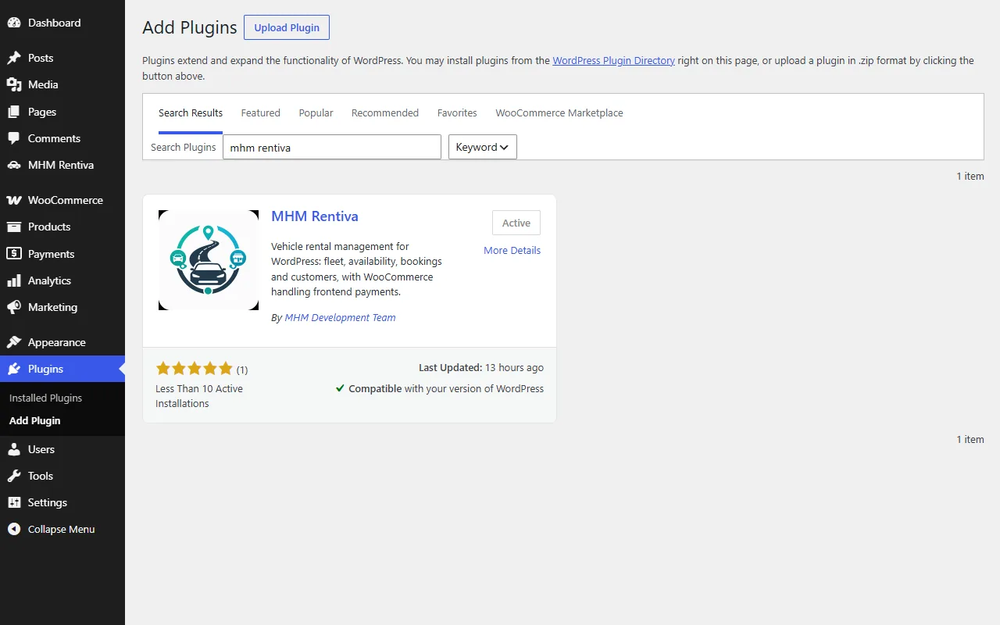
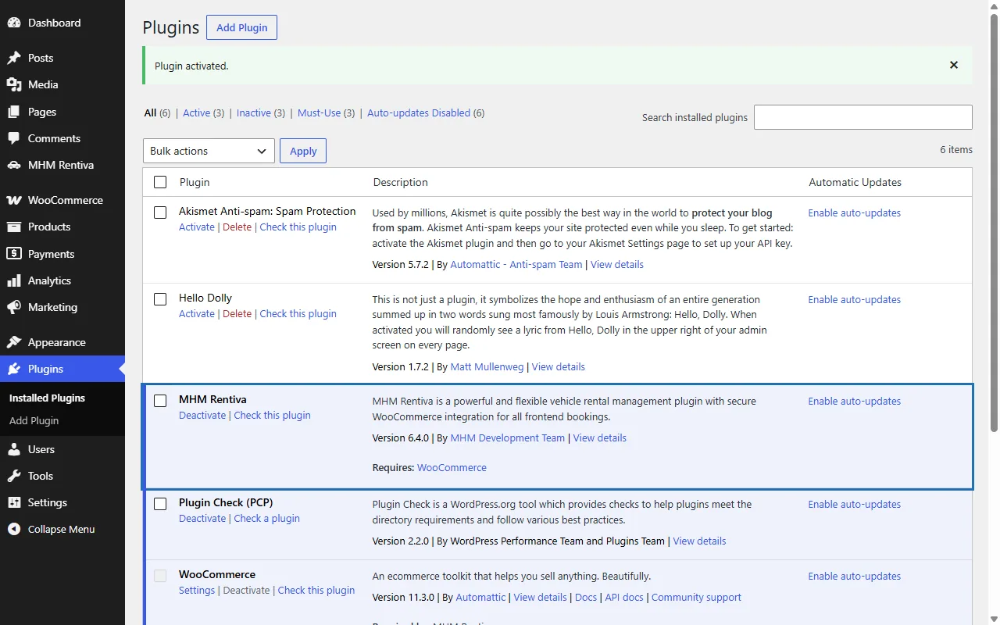

  

MHM Rentiva ist ein professionelles Plugin, das deine WordPress-Website in eine leistungsstarke Plattform für die Fahrzeugvermietung verwandelt. Diese Anleitung führt dich durch die Installation des Plugins von Grund auf und durch die ersten Konfigurationsschritte.

:::tip Video-Tutorial
Klicke auf das Videofeld unten, um dir eine Schritt-für-Schritt-Anleitung zur Installation anzusehen.

  
<strong>🎥 Video-Tutorial in Kürze verfügbar</strong>

  <small>Es wird hier verfügbar sein, sobald es auf unserem offiziellen YouTube-Kanal veröffentlicht wurde.</small>

:::

---

## 1. Systemanforderungen

Für einen stabilen Betrieb müssen dein Server und deine WordPress-Installation die folgenden Mindestanforderungen erfüllen:

| Anforderung | Mindestversion | Hinweise |
| :-- | :-- | :-- |
| **WordPress** | 7.0+ | Die neueste stabile Version wird empfohlen. |
| **PHP** | 8.1+ | Erforderlich für Sicherheit und Leistung. |
| **WooCommerce** | Aktiv, aktuelle Version | **Erforderlich** für alle Zahlungsabläufe im Frontend. Ohne WooCommerce lässt sich das Plugin nicht aktivieren. |
| **Rentiva Pro** (optional) | MHM Rentiva 6.4.0+ | Pro 6.5.0 benötigt MHM Rentiva 6.4.0 oder neuer; mit einer älteren Version von MHM Rentiva deaktiviert sich Pro selbst und zeigt einen Hinweis im Adminbereich an. |
| **SSL-Zertifikat** | HTTPS | Erforderlich, damit Zahlungs-Gateways (Stripe, iyzico usw.) funktionieren. |
| **Permalink-Struktur** | Beitragsname | `%postname%` wird für SEO und Routing empfohlen. |

---

## 2. Installation Schritt für Schritt

MHM Rentiva ist im [WordPress.org-Plugin-Verzeichnis](https://wordpress.org/plugins/mhm-rentiva/) veröffentlicht, daher ist der übliche Weg der, den WordPress selbst anbietet. Die beiden anderen Methoden dienen dazu, einen **bestimmten Build** statt der aktuellen Version zu installieren.

### Methode A: Aus dem WordPress.org-Verzeichnis (empfohlen)
1. Gehe in deinem WordPress-Dashboard zu **Plugins > Neu hinzufügen**.
2. Suche nach **MHM Rentiva**.
3. Klicke auf **Jetzt installieren** und nach Abschluss des Vorgangs auf **Aktivieren**.

Von nun an hält WordPress das Plugin auf dem neuesten Stand, so wie jedes andere Plugin aus dem Verzeichnis – du musst nichts mehr manuell herunterladen.

---

*Screenshot der Suchergebnisse unter Plugins > Neu hinzufügen mit MHM Rentiva in der Liste*

---

### Methode B: Hochladen einer ZIP-Datei
Nutze diese Methode, wenn du einen bestimmten Build benötigst – zum Beispiel eine Version von der [GitHub-Releases-Seite](https://github.com/MaxHandMade/mhm-rentiva/releases) – statt der aktuell im Verzeichnis verfügbaren Version.

1. Gehe zu **Plugins > Neu hinzufügen** und klicke auf die Schaltfläche **Plugin hochladen**.
2. Wähle die ZIP-Datei aus und klicke auf **Jetzt installieren**.
3. Klicke nach Abschluss des Vorgangs auf **Plugin aktivieren**.

---

*Der Bildschirm mit der Schaltfläche „Plugin aktivieren“ nach einem erfolgreichen Upload*

---

### Methode C: Per FTP/SFTP
1. Entpacke die ZIP-Datei des Plugins in einen Ordner auf deinem Computer.
2. Verbinde dich mit einem FTP-Client (z. B. FileZilla) mit deinem Server.
3. Lade den entpackten Ordner in das Verzeichnis `/wp-content/plugins/` hoch.
4. Aktiviere das Plugin in deinem WordPress-Dashboard.

---

## 3. Automatische Aktionen nach der Installation

Bei der Aktivierung des Plugins werden die folgenden Aktionen automatisch im Hintergrund ausgeführt:

1. **Datenbanktabellen:** Funktionstabellen wie `payment_log`, `sessions` und `transfer_routes` werden erstellt.
2. **CPT-Registrierung:** Die benutzerdefinierten Inhaltstypen `mhmrentiva_vehicle`, `mhmrentiva_booking` und `mhmrentiva_addon` sowie die zugehörigen Taxonomien werden registriert.
3. **Kundenrolle:** Eine benutzerdefinierte Benutzerrolle namens `mhmrentiva_customer` wird hinzugefügt.
4. **Rewrite-Regeln:** Die Permalinks für Fahrzeugseiten werden automatisch aktualisiert.

---

## 4. Einrichtungsassistent

Wenn du das Plugin zum ersten Mal aktivierst, leitet dich das System automatisch zum **Einrichtungsassistenten** weiter. Dieser Assistent:
- Prüft deinen Server (PHP, WordPress, WooCommerce, HTTPS, WP-Cron, E-Mail-Versand).
- Erstellt automatisch die erforderlichen Seiten (Buchungsformular, Suche, Suchergebnisse, Fahrzeugdetails, Fahrzeugliste, Kontaktformular).
- Legt die Absenderdaten für E-Mails sowie die grundlegenden Standardwerte für Anzeige und Miettage fest.

:::info Manueller Aufruf
Falls sich der Assistent nicht automatisch öffnet, kannst du ihn im WordPress-Adminmenü manuell über **MHM Rentiva > Einrichtungsassistent** starten.
:::

---

## Technische Details (für Entwickler)

Bei der Aktivierung verwendet das Plugin `register_activation_hook`, um die Funktion `mhmrentiva_single_site_activation()` auszuführen. Diese Funktion hält das Datenbankschema über die Klasse `DatabaseMigrator` auf dem neuesten Stand.

Wenn `WP_DEBUG` während der Entwicklung aktiviert ist, erscheinen Installationsfehler in den PHP-Logs oder in den Fehlerhinweisen oben auf dem Bildschirm.

---

## Aktualisierung

WordPress aktualisiert MHM Rentiva wie jedes andere Plugin aus dem Verzeichnis. Wenn du auch **Rentiva Pro** verwendest, aktualisiere zuerst MHM Rentiva (Lite) und danach Pro.

:::info Geändert in 6.4.0
MHM Rentiva erfordert jetzt WordPress 7.0 oder neuer (bisher 6.7). **Leere nach dem Update deinen Seiten-Cache** (bei deinem Hoster, LiteSpeed Cache, WP Rocket usw.): Eine von 6.3.x zwischengespeicherte Seite enthält weiterhin das alte Markup von Buchungsformular und Kalender, und die neuen Skripte laufen darauf nicht. Der eigene kurzlebige Cache von Rentiva aktualisiert sich von selbst.
:::

---

### Zusammenfassung des Abschnitts
- **WordPress 7.0+**, **PHP 8.1+** und **WooCommerce** sind erforderlich.
- Der **Einrichtungsassistent** muss nach der Installation abgeschlossen werden.
- Datenbanktabellen werden bei der Aktivierung automatisch erstellt.

### Änderungsprotokoll
| Datum | Version | Hinweis |
| :--- | :--- | :--- |
| 18.11.2026 | 6.4.0 | Mindestversion von WordPress auf 7.0 angehoben; Pro-Anforderung und Hinweise zur Aktualisierung (Seiten-Cache) hinzugefügt; Beschreibung des Assistenten aktualisiert. |
| 23.08.2026 | 6.0.7 | Die Installation beginnt jetzt im WordPress.org-Verzeichnis; Bezeichner nach der Aktivierung an die Umbenennungen in 6.0.0 angepasst. |
| 23.04.2026 | 4.27.2 | Dokumentation mit der aktuellen Plugin-Version synchronisiert. |
| 18.03.2026 | 4.21.2 | Design überarbeitet und Inhalte erweitert. |
| 26.02.2026 | 4.21.0 | Erste Version erstellt. |
