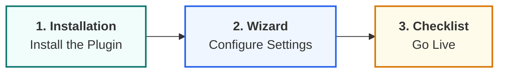

import Link from '@docusaurus/Link';

  

# 🚀 Einstiegsleitfaden & Roadmap

Willkommen in der Dokumentation von MHM Rentiva! Wir empfehlen dir, die folgenden Schritte der Reihe nach durchzugehen, um das Plugin so effizient wie möglich zu installieren und zu konfigurieren.

:::tip SCHNELLEINRICHTUNG
Über die Karten unten gelangst du schnell zu den wichtigsten Einstiegsdokumenten: Installation, Assistent und Checkliste.
:::

---

  

    

      <h3 className="cardTitle">📦 1. Installation & Voraussetzungen</h3>
      
Prüfung der Serverkompatibilität, Installation des Plugins und Schritte zur Lizenzaktivierung.

      <Link className="button button--secondary button--block" to="/docs/getting-started/installation">Installationsanleitung</Link>
    

  

  

    

      <h3 className="cardTitle">🧙 2. Einrichtungsassistent</h3>
      
Eine Schritt-für-Schritt-Anleitung zum Einrichtungsassistenten, mit dem dein System in wenigen Minuten einsatzbereit ist.

      <Link className="button button--secondary button--block" to="/docs/getting-started/setup-wizard">Assistenten starten</Link>
    

  

  

    

      <h3 className="cardTitle">✅ 3. Checkliste vor dem Livegang</h3>
      
Führe eine abschließende Prüfung durch, um sicherzustellen, dass alles bereit ist, bevor du live gehst.

      <Link className="button button--secondary button--block" to="/docs/getting-started/post-install-checklist">Checkliste</Link>
    

  

---

## 📈 Visuelle Prozessübersicht

---

### Zusammenfassung des Abschnitts
- Dieser Leitfaden ist darauf ausgelegt, dein System so schnell wie möglich startklar zu machen.
- Jeder Schritt baut auf der Konfiguration des vorherigen auf.

## Änderungsprotokoll
| Datum | Version | Hinweis |
|---|---|---|
| 23.04.2026 | 4.27.2 | Englische Übersetzung hinzugefügt. |
| 19.03.2026 | 4.21.2 | Premium-Roadmap im Kartenstil für den Einstiegsleitfaden erstellt. |
