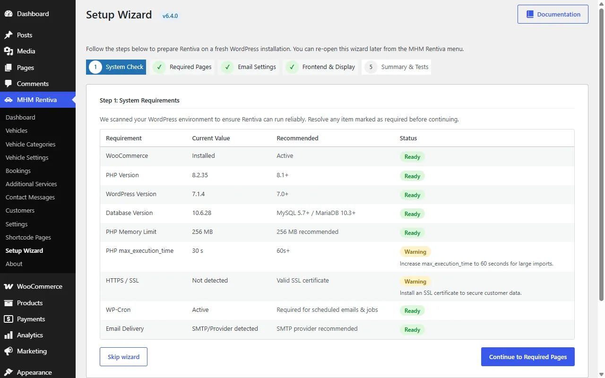

  

Wenn du MHM Rentiva zum ersten Mal aktivierst, führt dich ein interaktiver **Einrichtungsassistent** durch die wesentlichen Konfigurationsschritte. Mit dem Assistenten schließt du die wichtigen Einstellungen ab, die nötig sind, damit das Plugin reibungslos mit deiner Website zusammenarbeitet – und das in wenigen Minuten. Jeder Schritt ist eine nummerierte Karte; die Schritte werden oben auf dem Bildschirm aufgelistet.

---


*Ein breiter Screenshot mit den nummerierten Schritten und der Karte „Systemprüfung“*

---

## Schritte des Assistenten

Der Einrichtungsassistent besteht aus 5 Schritten:

### 1. Systemprüfung
Im ersten Schritt wird geprüft, ob dein Server bereit ist, MHM Rentiva auszuführen.
- WooCommerce-Status, **PHP-Version**, **WordPress-Version**, Datenbankversion, PHP-Speicherlimit, `max_execution_time`, HTTPS, WP-Cron und E-Mail-Zustellung werden geprüft.
- Die angezeigten Mindestversionen von PHP und WordPress sind diejenigen, die das Plugin selbst voraussetzt. Ist eine Anforderung nicht erfüllt, erhältst du eine Warnung, bevor du fortfährst.
- Mit **Assistent überspringen** kannst du den Assistenten jederzeit verlassen.

### 2. Erforderliche Seiten
Das Plugin benötigt eigene Seiten für Funktionen wie Fahrzeugsuche, Auflistung, Details und Buchung.
- Mit **einem einzigen Klick** (**Fehlende Seiten erstellen**) kannst du alle erforderlichen Seiten samt ihren Shortcodes automatisch erstellen. Insgesamt werden **6 erforderliche Seiten** geprüft: Buchungsformular, einheitliche Suche, Suchergebnisse, Fahrzeugdetails, Fahrzeugliste und Kontaktformular.
- Wenn diese Seiten bereits existieren, erkennt der Assistent sie und markiert sie als „Vorhanden“.
- **Notiz:** Die Seiten Fahrzeugraster (`rentiva_vehicles_grid`) und Fahrzeugvergleich (`rentiva_vehicle_comparison`) sind optional und werden vom Assistenten nicht vorausgesetzt.

### 3. E-Mail-Einstellungen
Lege deine Absenderdaten für Buchungsbestätigungen und die Kommunikation mit Kunden fest.
- **Absendername**, **Absender-E-Mail-Adresse** und **Antwortadresse (Reply-To)** werden hier konfiguriert.
- Der **Testmodus** sendet jede E-Mail ausschließlich an die **Test-E-Mail-Adresse**, bis du bereit bist, live zu gehen.
- **Automatisierung:** Schalte den E-Mail-Versand, den automatischen Versand und das E-Mail-Protokoll ein oder aus.
- **SMTP-Hinweis:** Die Verwendung eines externen SMTP-Plugins (WP Mail SMTP oder Fluent SMTP) wird dringend empfohlen, um Probleme bei der E-Mail-Zustellung auf deiner Website zu vermeiden.

### 4. Frontend & Darstellung
Lege Standardwerte für Buchungsformulare und Fahrzeugkarten auf deiner Website fest.
- **Währung und Währungsposition:** Ist WooCommerce installiert, werden diese von WooCommerce verwaltet und nur zur Information angezeigt; ändere sie in den WooCommerce-Einstellungen. Der Assistent ändert die Währung nicht.
- **Standard-, Mindest- und Höchstanzahl an Miettagen:** Die Mietdauern, die in Formularen und für Begrenzungen verwendet werden.
- **Akzentfarbe:** Dieselbe Einstellung wie unter **Einstellungen > Frontend & Darstellung > Farben** (Automatisch oder Benutzerdefiniert).

### 5. Zusammenfassung & Tests
Eine abschließende Checkliste zeigt den Status jedes Schritts an.
- Wenn deine WordPress-Permalinks auf „Einfach“ eingestellt sind, fordert dich eine Warnung auf, zu einer Struktur wie „Beitragsname“ zu wechseln, da die Frontend-Seiten dies benötigen.
- Nutze **Einstellungen öffnen**, **Shortcode-Seiten prüfen** oder **Test-E-Mail senden** für eine letzte Kontrolle und klicke dann auf **Einrichtung abschließen** (oder **Zum Dashboard**).

:::info Lizenz
Der Assistent enthält keinen Lizenzschritt. Wenn du Rentiva Pro verwendest, aktiviere deinen Schlüssel auf der Seite **Lizenz**.
:::

---

## Assistenten erneut starten

Wenn du glaubst, dass du nach Abschluss des Assistenten einen Fehler in den Einstellungen gemacht hast, oder wenn du fehlende Seiten neu erstellen möchtest:

1. Gehe im WordPress-Adminbereich zu **MHM Rentiva > Einrichtungsassistent**.
2. Folge den Schritten erneut von Anfang an, um die Konfiguration zu aktualisieren.

:::important Warnung zu Datenverlust
Das erneute Ausführen des Assistenten löscht deine vorhandenen Daten (Fahrzeuge, Buchungen) **nicht** – es aktualisiert nur allgemeine Einstellungen und Seitenzuordnungen.
:::

---

## Technischer Hinweis: Automatische Weiterleitung (für Entwickler)

Bei der Erstinstallation des Plugins wird die Option `mhmrentiva_setup_redirect` auf `1` gesetzt. Der Hook `admin_init` prüft diese Option, leitet den Benutzer zum Assistenten weiter und löscht die Option. Die Weiterleitung wird übersprungen, wenn mehrere Plugins gleichzeitig aktiviert werden.

So prüfst du den Status des Assistenten programmgesteuert:
```php
$is_completed = get_option('mhmrentiva_setup_completed'); // '1' means completed
```

---

### Zusammenfassung des Abschnitts
- Der Einrichtungsassistent besteht aus **5 Schritten**.
- Die Funktion zur **automatischen Seitenerstellung** beschleunigt die Einrichtung.
- Der Assistent kann geschlossen werden, sobald die Konfiguration abgeschlossen ist.

### Änderungsprotokoll
| Datum | Version | Hinweis |
| :--- | :--- | :--- |
| 18.11.2026 | 6.4.0 | Neues Erscheinungsbild mit nummerierten Schritten; Akzentfarbe zum Schritt „Frontend & Darstellung“ hinzugefügt; Schalter für Fahrzeugkarten entfernt; Schritte wie im Plugin aufgeführt (kein Lizenzschritt). |
| 23.04.2026 | 4.27.2 | Englische Übersetzung hinzugefügt. |
| 27.03.2026 | 4.22.1 | Liste der erforderlichen Seiten aktualisiert: `rentiva_vehicle_details` hinzugefügt, `rentiva_vehicles_grid` und `rentiva_vehicle_comparison` entfernt (jetzt optional). 7 → 6 Seiten. |
| 18.03.2026 | 4.21.2 | Inhalt auf hybrides Modell aktualisiert (Benutzer + Technik). |
| 26.02.2026 | 4.21.0 | Erste Version erstellt. |
