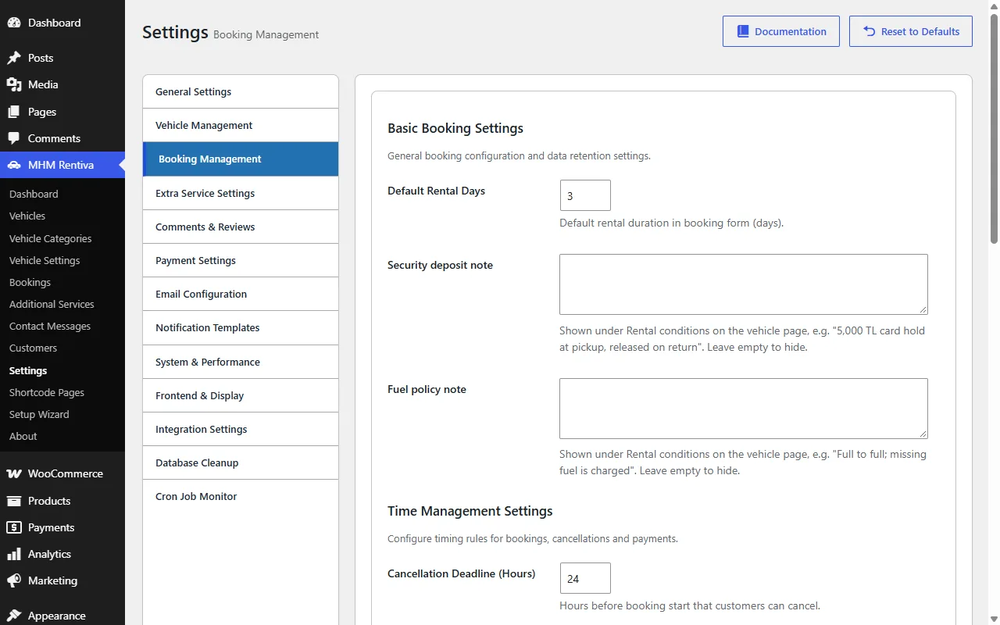

  

Im Tab „Buchungsverwaltung“ legst du die zeitlichen Regeln des Mietprozesses, die automatischen Stornierungsmechanismen und die Einstellungen für E-Mail-Benachrichtigungen fest. Du erreichst ihn über **MHM Rentiva > Einstellungen > Buchungsverwaltung**.

---

## 📋 Grundlegende Buchungseinstellungen

- **Standard-Miettage:** Die standardmäßige Mietdauer, die im Buchungsformular im Frontend vorausgewählt ist, bevor ein Datum gewählt wird (z. B. 1 Tag).

---

## ⏳ Einstellungen zur Zeitverwaltung

Hier werden der Lebenszyklus und die betrieblichen Vorlaufzeiten von Buchungen verwaltet.

- **Stornierungsfrist (Stunden):** Legt fest, bis wie viele Stunden vor Beginn der Buchung der Kunde das Recht zur Stornierung behält (z. B. 24 Stunden).
- **Zahlungsfrist (Minuten):** Die Zeit, die nach dem Erstellen einer Buchung zum Abschließen der Zahlung zur Verfügung steht. Wenn du `0` einträgst, wird die Zeitbegrenzung deaktiviert.
- **Automatische Stornierung aktivieren:** Setzt Buchungen, deren Zahlungsfrist abgelaufen ist, automatisch auf den Status „Storniert“.
- **Pufferzeit (Minuten):** Eine Lücke zur „Vorbereitung und Reinigung“, die zwischen zwei Buchungen eingefügt wird. Während dieses Zeitraums wird das Fahrzeug im Kalender als belegt angezeigt.

---

*Einstellungen > Tab Buchungsverwaltung, Felder für Stornierungs- und Zahlungsfrist*

---

## 🔔 Benachrichtigungseinstellungen

Steuert die automatischen E-Mail-Benachrichtigungen, die bei wichtigen Schritten im Ablauf versendet werden.

- **Bestätigungs-E-Mails senden:** Sendet dem Kunden eine automatische Benachrichtigung, wenn eine Buchung bestätigt wird.
- **Erinnerungs-E-Mails senden:** Sendet dem Kunden vor Beginn der Buchung eine Erinnerungs-E-Mail.
- **Admin-Benachrichtigungen:** Sendet dem Website-Administrator eine E-Mail-Benachrichtigung, wenn eine neue Buchung erstellt wird.
- **E-Mail bei automatischer Stornierung senden:** Benachrichtigt den Kunden, wenn eine Buchung wegen Überschreitung der Zahlungsfrist automatisch storniert wird.

---

## 📜 Mietvertrag

Ein Vertrag, den der Kunde im Buchungsformular vor der Buchung liest und akzeptiert.

- **Mietvertrag erforderlich:** Wenn aktiviert, müssen Kunden den Vertrag vor der Buchung akzeptieren. Der Zeitpunkt und die Version des akzeptierten Textes werden mit der Buchung gespeichert. Standardmäßig deaktiviert, damit bei einer Website, die aktualisiert wird, das Buchungsformular unverändert bleibt.
- **Vertragstext:** Lass das Feld leer, um die integrierte Vorlage zu verwenden (sieben Abschnitte, für türkische Websites übersetzt). Die Vorlage ist ein Ausgangspunkt, keine Rechtsberatung: Prüfe sie und passe sie an dein Unternehmen und das geltende lokale Recht an. Formatierung: `# Heading`, `**bold**`, `- list item`, `---` Zeile.

Was passiert, wenn die Option aktiviert ist:

- Das Buchungsformular zeigt unterhalb der Zusatzleistungen ein scrollbares Feld **Mietvertrag** mit dem Kontrollkästchen „Ich habe den Mietvertrag gelesen und akzeptiere ihn.“ an. Eine Buchung ohne Häkchen wird abgelehnt, sowohl im Browser als auch auf dem Server. Siehe [Buchungsformular](../03-features-usage/shortcodes/booking-form.md).
- Wenn du den Text änderst, wird ein Kunde, dessen Seite vor der Änderung geöffnet oder zwischengespeichert war, aufgefordert, die Seite neu zu laden und den neuen Text zu prüfen.
- Auf dem Bearbeitungsbildschirm der Buchung zeigt das Feld **Kundenkonto** „Mietvertrag: Akzeptiert“ mit Datum und Version an. Bei einer Buchung, die du manuell eingetragen hast, wird „Keine Zustimmung (Admin-Buchung)“ angezeigt.
- Die Zustimmung ist im Export personenbezogener Daten enthalten (als „Mietvertrag akzeptiert“).
- Bei Transfer-Buchungen wird der Vertrag nicht angezeigt.

---

## 💡 Technische Hinweise

:::important Cron-Abhängigkeit
Die Funktionen „Automatische Stornierung“ und „Erinnerungs-E-Mails“ setzen voraus, dass das WordPress-Cron-System aktiv ist. Du kannst diese Aufgaben im Tab **Einstellungen > Cronjob-Monitor** überwachen.
:::

---

### Zusammenfassung des Abschnitts
- Nutze die **Zeitverwaltung**, um Zahlungs- und Stornierungsregeln klar festzulegen.
- Nutze die **Pufferzeit**, um Zeit für die betriebliche Vorbereitung einzuplanen.
- Nutze die **automatischen Benachrichtigungen**, um die Kommunikation zwischen Kunden und Administratoren zu automatisieren.

### Änderungsprotokoll
| Datum | Version | Hinweis |
| :--- | :--- | :--- |
| 18.11.2026 | 6.4.0 | Abschnitt „Mietvertrag“ hinzugefügt. |
| 23.04.2026 | 4.27.2 | Englische Übersetzung hinzugefügt. |
| 19.03.2026 | 4.21.2 | Dokumentation zur Buchungsverwaltung anhand eines Screenshots des Panels und einer Codeanalyse aktualisiert. |
