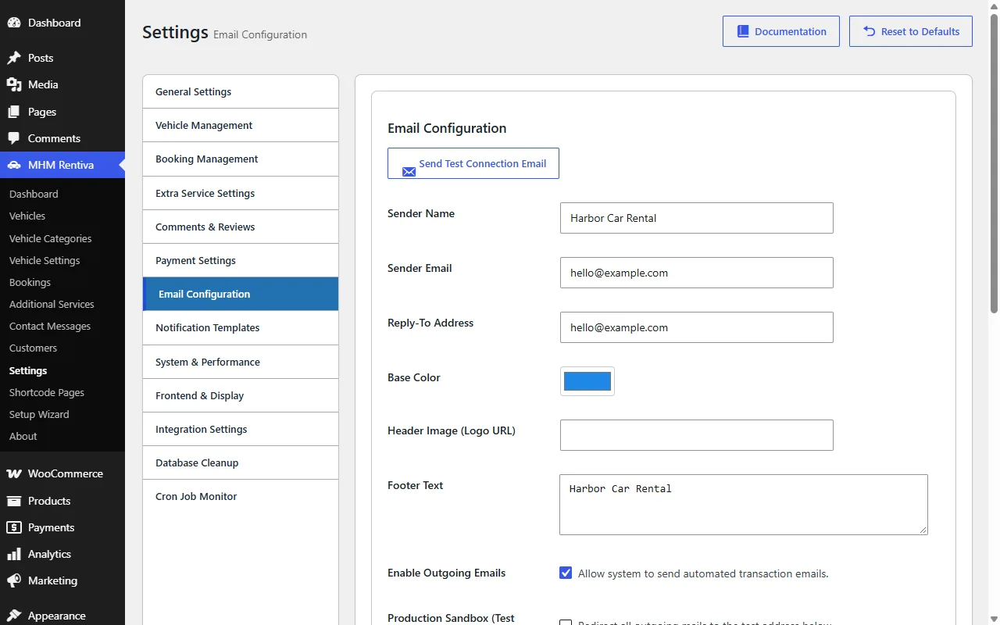

  

Im Tab „E-Mail-Konfiguration“ legst du die Absenderidentität, Designdetails und Versandmodi der automatischen Benachrichtigungen fest, die das System verschickt. Du erreichst ihn über **MHM Rentiva > Einstellungen > E-Mail-Konfiguration**.

:::info WooCommerce-Integration
Wenn WooCommerce installiert ist, werden die wichtigsten Transaktions-E-Mails (Bestellbestätigungen usw.) über WooCommerce verwaltet. Die Einstellungen hier gelten für plugin-spezifische interne Benachrichtigungen (Admin-Hinweise, individuelle Kundennachrichten usw.).
:::

---

## 📧 Absender- & Design-Einstellungen

Lege fest, wie E-Mails für Kunden aussehen:

- **Absendername:** Der Name, der im Feld „Von“ der E-Mails angezeigt wird (z. B. Rentiva Fleet).
- **Absender-E-Mail:** Die Adresse, von der E-Mails gesendet werden (z. B. info@site.com).
- **Antwortadresse (Reply-To):** Die Adresse, an die Antworten gehen, wenn ein Kunde auf eine E-Mail antwortet.
- **Grundfarbe:** Legt die Farben für Buttons, Überschriften und Akzente in den E-Mail-Vorlagen fest.
- **Header-Bild (Logo-URL):** Das Logo, das oben in den E-Mails angezeigt wird.
- **Footer-Text:** Der Copyright- und Kontakthinweis, der unten in allen E-Mails erscheint.

---

## 🛠️ Versand- & Testwerkzeuge

- **Test-Verbindungs-E-Mail senden:** Sendet dir sofort eine Testnachricht, damit du prüfen kannst, ob deine Konfiguration korrekt funktioniert.
- **Ausgehende E-Mails aktivieren:** Schaltet die Berechtigung des Systems zum Versand automatischer E-Mails ein oder aus.
- **Produktions-Sandbox (Testmodus):** Wenn aktiv, werden keine E-Mails an Kunden zugestellt – alle Nachrichten werden an die festgelegte „Test-E-Mail-Adresse“ umgeleitet.

---

## ⚙️ Erweiterte technische Einstellungen

- **Pfad für Vorlagen-Überschreibungen:** Der Ordnerpfad, der verwendet wird, wenn du E-Mail-Designs über dein Theme anpassen möchtest (Standard: `mhm-rentiva/emails/`).
- **Automatischer Hintergrundversand:** Sendet automatische E-Mails im Hintergrund, damit die Ladegeschwindigkeit der Seite nicht beeinträchtigt wird.
- **Kommunikationsprotokolle aktivieren:** Speichert eine Kopie aller gesendeten E-Mails in der Datenbank.
- **Aufbewahrung der Protokolle (Tage):** Legt fest, nach wie vielen Tagen Einträge automatisch gelöscht werden (z. B. 30 Tage).

---

*Einstellungen > Tab „E-Mail-Konfiguration“, Bereich für Absender- und Protokolleinstellungen*

---

### Zusammenfassung des Abschnitts
- Passe Absendername und Farben an deine **Markenidentität** an.
- Nutze den **Testmodus**, um Benachrichtigungen vor dem Livegang sicher zu prüfen.
- Nutze den **Hintergrundversand**, um die Performance deiner Website zu erhalten.

### Änderungsprotokoll
| Datum | Version | Hinweis |
| :--- | :--- | :--- |
| 23.04.2026 | 4.27.2 | Englische Übersetzung hinzugefügt. |
| 19.03.2026 | 4.21.2 | Dokumentation zur E-Mail-Konfiguration auf Basis eines Panel-Screenshots und einer Code-Analyse erstellt. |
