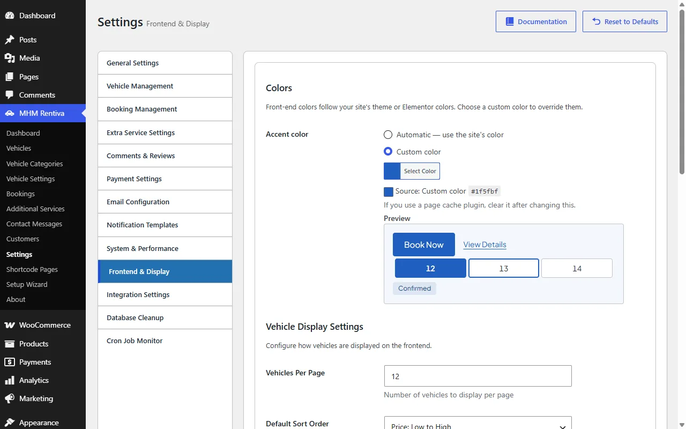

  

Der Tab „Frontend & Darstellung“ ist ein umfassender Verwaltungsbereich, in dem du das für Benutzer sichtbare Erscheinungsbild des Plugins, Button-Beschriftungen, Hinweismeldungen und Seiten-URLs anpasst. Du erreichst ihn über **MHM Rentiva > Einstellungen > Frontend & Darstellung**.

---

## 🎨 Farben

Der Abschnitt **Farben** steht an erster Stelle des Tabs. Er legt die eine Akzentfarbe (Hauptfarbe) fest, die das Plugin auf deiner Website verwendet: primäre Buttons, Links, ausgewählte Kalendertage und den dezent getönten Seitenhintergrund der Buchungsbildschirme. Das Frontend von Rentiva verwendet außerdem die Schriftart Plus Jakarta Sans, die aus den eigenen Dateien des Plugins geladen wird (keine Anfrage an Google), sowie 4-px-Ecken bei Karten, Buttons und Buchungsboxen.

Unter **Akzentfarbe** wählst du einen Modus:

- **Automatisch – Farbe der Website verwenden:** Rentiva liest die Farbe von deiner Website aus. Es prüft diese Quellen der Reihe nach und verwendet die erste echte Farbe, die es findet:
  1. **Theme-Einstellung:** die Hauptfarbe eines unterstützten Themes (Thembay-Themes, Avanam, listeo, politic, upstudy und Astra). Wenn du sie nie geändert hast, wird der Standardwert des Themes verwendet und die Quellzeile zeigt „Theme-Standard“.
  2. **Globale Elementor-Farbe:** die globale Farbe **Akzent**, danach **Primär**. Die Werksfarben von Elementor werden ignoriert, es zählt also nur eine Farbe, die du selbst festgelegt hast.
  3. **Farbpalette des Themes (theme.json):** die Button-Farbe eines Block-Themes, danach die Palettenfarben `primary` und `accent`.
  4. **Rentiva-Standard:** ein Blau (`#2271b1`), wenn keine der obigen Quellen eine Farbe liefert.
- **Eigene Farbe:** Wähle deine eigene Farbe mit dem Farbwähler. Sie überschreibt das automatische Ergebnis.

Unterhalb des Farbwählers siehst du:

- **Quelle:** aus welcher Quelle die aktuelle Farbe stammt, mit einem Farbmuster und dem Hex-Code, zum Beispiel „Quelle: Theme-Einstellung (Astra)“.
- **Vorschau:** ein kleines Beispiel (Button, Link, drei Kalendertage, Kennzeichnung „Bestätigt“), das sich beim Ändern der Farbe neu einfärbt.
- **Zwei Hinweise zur Lesbarkeit**, die nur bei Bedarf angezeigt werden:
  - „Diese Farbe ist zu hell für Text auf der Seite …“ Der Akzent bleibt als Button-Füllung erhalten, aber Links und Text verwenden einen dunkleren Farbton, damit sie lesbar bleiben. Der Hover-Farbton wird automatisch abgeleitet; bei einem sehr dunklen Akzent wird er heller statt dunkler.
  - „Diese helle Farbe ist kaum von einem weißen Hintergrund zu unterscheiden.“

:::tip Leere deinen Seiten-Cache
Farben werden direkt in die Seite geschrieben. Wenn du ein Seiten-Cache-Plugin verwendest oder dein Hoster Seiten zwischenspeichert, leere diesen Cache nach dem Ändern der Farbe, wie dich auch der Abschnitt selbst erinnert.
:::

:::info Geändert in 6.4.0
Farben richten sich jetzt automatisch nach deiner Website. In früheren Versionen verwendete das Frontend immer ein festes Blau.
:::

### Für Entwickler
Über drei Filter kann ein Theme oder ein eigenes Plugin mitwirken. `mhmrentiva_accent_color` erhält die Hex-Farbe und die Quell-ID und gibt die endgültige Farbe zurück (er hat das letzte Wort, selbst im Modus „Eigene Farbe“, und die Quellzeile lautet dann „Entwickler-Filter“). `mhmrentiva_accent_sources` ändert die geordnete Liste der automatischen Quellen, und `mhmrentiva_theme_adapters` fügt Unterstützung für ein weiteres Theme hinzu.

---

## 🖼️ Grundlegende Einstellungen zur Fahrzeuganzeige

Steuere die visuelle Hierarchie auf den Fahrzeug-Listenseiten:

- **Fahrzeuge pro Seite:** Die maximale Anzahl an Fahrzeugen, die auf einer einzelnen Seite aufgelistet werden (z. B. 12).
- **Standard-Sortierung:** Das Kriterium, nach dem die Listenseite beim ersten Laden sortiert wird (aufsteigend nach Preis, absteigend nach Baujahr usw.).

:::note Entfernte Einstellungen (v4.22.1)
Die in früheren Versionen vorhandenen Einstellungen **Fahrzeugbilder anzeigen** (`mhmrentiva_vehicle_show_images`), **Ausstattung anzeigen** (`mhmrentiva_vehicle_show_features`) und **Verfügbarkeit anzeigen** (`mhmrentiva_vehicle_show_availability`) wurden in v4.22.1 entfernt, da sie im Code nicht verwendet wurden. Diese Anzeigeoptionen werden jetzt direkt über Shortcode-Parameter (`show_features`, `show_badges` usw.) gesteuert.
:::

---

## ✍️ Eigene Beschriftungen & Texte

Ändere jeden Button- oder Formulartext im Plugin in Sekundenschnelle, passend zu deiner Sprache oder zum Ton deiner Marke. Dieser Abschnitt ist als Akkordeon aufgebaut:

- **Allgemeine Buttons:** Button-Beschriftungen wie „Jetzt mieten“, „Details anzeigen“, „Buchung vornehmen“.
- **Benachrichtigungen:** Sofortige Hinweise wie „Zu den Favoriten hinzugefügt“, „Du musst angemeldet sein“, „Wird verarbeitet …“.
- **Formularbeschriftungen:** Feldnamen im Buchungsformular wie „Vorname“, „Nachname“, „Telefon“.
- **Zahlung & Validierung:** Wichtige Systemmeldungen wie „Wird berechnet …“, „Zahlung erfolgreich“, „Ungültige Datumsauswahl“.

---

*Einstellungen > Tab „Frontend & Darstellung“, Beschriftungsgruppen und Anzeigeeinstellungen*

---

## 🔗 Permalinks & URL-Struktur der Seiten

Lege die Seitenpfade manuell fest, die für die korrekte Funktion des Plugins entscheidend sind:

- **URL des Buchungsformulars:** Die vollständige Adresse der Seite, die den Shortcode `[rentiva_booking_form]` enthält.
- **Anmelde- & Registrierungsseite:** Die eigenen Anmelde- und Registrierungsseiten, auf die Kunden weitergeleitet werden.

:::tip Automatische Erkennung
Wenn du diese Felder leer lässt, durchsucht das System automatisch die Datenbank nach den Seiten, die die entsprechenden Shortcodes enthalten. Wenn du jedoch eine eigene Seitenstruktur hast, wird empfohlen, hier die vollständige URL einzugeben.
:::

---

### Zusammenfassung des Abschnitts
- **Passe alle Buttons an** die Sprache deiner Zielgruppe an, um die Benutzererfahrung zu verbessern.
- **Stimme das visuelle Layout** der Listenseiten auf das Design deiner Website ab.
- **Lege Seiten-URLs fest**, damit der Buchungsablauf ohne Unterbrechung funktioniert.

### Änderungsprotokoll
| Datum | Version | Hinweis |
| :--- | :--- | :--- |
| 18.11.2026 | 6.4.0 | Abschnitt „Farben“ hinzugefügt (automatische Website-Farbe, eigene Farbe, Hinweise, Filter). |
| 23.04.2026 | 4.27.2 | Englische Übersetzung hinzugefügt. |
| 27.03.2026 | 4.22.1 | Hinweis zur Entfernung ungenutzter Anzeigeeinstellungen (`show_images`, `show_features`, `show_availability`) hinzugefügt. |
| 19.03.2026 | 4.21.2 | Dokumentation zu „Frontend & Darstellung“ mit allen Beschriftungsgruppen und der URL-Konfiguration erstellt. |
