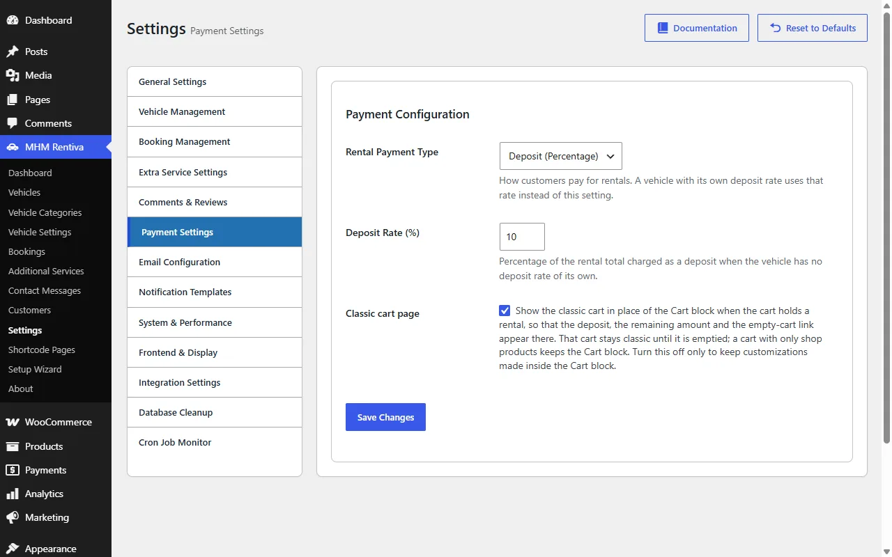

  

MHM Rentiva baut seine Finanzabläufe auf **WooCommerce** auf, der weltweit beliebtesten E-Commerce-Plattform. Dadurch kannst du Hunderte von Zahlungs-Gateways (Stripe, PayPal, iyzico usw.) ohne zusätzliche Entwicklung nutzen.

---

## 💳 Szenarien des Zahlungsablaufs

Das System verwaltet Zahlungen über zwei Hauptkanäle:

### 1. Zahlungen im Frontend (Kunde)
Alle Miettransaktionen, die Kunden auf deiner Website durchführen, laufen über den **WooCommerce**-Warenkorb.
- **Ablauf:** Der Kunde wählt ein Fahrzeug > legt die Daten fest > klickt auf „Jetzt mieten“ > das Produkt wird in den Warenkorb gelegt > die Kartendaten werden auf der Zahlungsseite eingegeben.
- **Wichtiger Hinweis:** Wenn der Kunde die Zahlung abschließt, erhält die WooCommerce-Bestellung den Status „In Bearbeitung“ oder „Abgeschlossen“; entsprechend wird die Rentiva-Buchung automatisch auf „Bestätigt“ gesetzt.
- **Gäste:** Ein nicht angemeldeter Besucher kann ohne Konto buchen. Das Buchungsformular fragt nichts zusätzlich ab; Name, E-Mail-Adresse und Telefonnummer aus den Rechnungsdaten der Zahlungsseite werden in der Buchung gespeichert.

### 2. Darstellung von Warenkorb und Zahlungsseite

Die Warenkorb- und die Zahlungsseite zeigen oberhalb des WooCommerce-Formulars die Buchungsschritte und eine Zusammenfassung der Miete (Fahrzeug, Daten, Preisaufschlüsselung). Die Beträge sind danach beschriftet, was der Kunde bezahlt:

| Wo | Beschriftung | Bedeutung |
| :--- | :--- | :--- |
| Warenkorb und Zahlungsseite | **Jetzt fällig** | Der Betrag, der jetzt berechnet wird (die Anzahlung oder der volle Preis). |
| Buchungsübersicht | **Fällig bei Abholung** | Der Restbetrag, der bei der Übergabe des Fahrzeugs bezahlt wird. |
| Danke-Seite | **Anzahlung bezahlt** / **Zu zahlende Anzahlung** | Die Anzahlungszeile richtet sich nach dem Stand der Zahlung: Zahlung eingegangen oder Banküberweisung noch ausstehend. |

### 3. Klassische Warenkorb-Seite

Wenn sich eine Miete im Warenkorb befindet, zeigt Rentiva die **klassischen** Warenkorb- und Zahlungsseiten von WooCommerce an, auch wenn deine Seiten den Warenkorb- oder Kasse-Block verwenden, damit die Buchungsschritte, die Anzahlung und der Restbetrag angezeigt werden. Ein Warenkorb, der nur Shop-Produkte enthält, behält den Warenkorb-Block, und eine Bestellung ohne Buchung verwendet weiterhin den Kasse-Block.

- **Einstellung:** MHM Rentiva > Einstellungen > Tab „Zahlung“ > **Klassische Warenkorb-Seite** (standardmäßig aktiviert). Deaktiviere sie nur, wenn du den Warenkorb-Block selbst angepasst hast.
- Der klassische Warenkorb bleibt bestehen, bis dieser Warenkorb geleert wird.
- Wenn deine Warenkorb- oder Kasse-Seite einen Block verwendet, sieht ein Administrator auf den Rentiva-Bildschirmen und auf der Plugins-Seite einen Hinweis, der dies erklärt. Klicke auf **Verstanden, nicht mehr anzeigen**, um ihn auszublenden; die Auswahl wird pro Administrator gespeichert.
- Ist die Einstellung deaktiviert, kann der Kasse-Block für eine Miete zwar weiterhin alle Zahlungsmethoden auflisten, eine für Mieten nicht zugelassene Methode (siehe unten) wird bei der Auswahl jedoch abgelehnt.

### 4. Nachnahme wird für Mieten nicht angeboten

Die WooCommerce-Methode **Nachnahme** wird für eine Miete nie angeboten: Eine an der Haustür bezahlte Anzahlung ist keine Anzahlung, und der Rest wird ohnehin bei der Abholung bezahlt. Dies gilt für jeden Warenkorb, der eine Buchung enthält, auch für einen gemischten Warenkorb (eine Bestellung hat eine Zahlungsmethode). Die Nachnahme-Einstellung deines Shops wird nicht geändert, sodass reine Shop-Bestellungen sie weiterhin nutzen.

- Ist Nachnahme die einzige aktivierte Methode, sieht der Kunde: „Nachnahme wird für Mieten nicht angeboten, und es ist noch keine andere Zahlungsmethode eingerichtet. Bitte kontaktiere uns, um deine Buchung abzuschließen.“ Aktiviere eine weitere Methode (Karte, Banküberweisung) unter WooCommerce > Einstellungen > Zahlungen.
- Wird die Methode dennoch gewählt (zum Beispiel im Kasse-Block bei deaktivierter Einstellung für den klassischen Warenkorb), wird sie mit „Nachnahme ist für eine Buchung nicht verfügbar. Bitte wähle eine andere Zahlungsmethode.“ abgelehnt, und es wird keine Buchung angelegt.

### 5. Kontoangebot für Gäste

Solange sich eine Miete im Warenkorb befindet, sieht ein Gast auf der Zahlungsseite das WooCommerce-Kästchen „Ein Konto erstellen?“, auch wenn die Shop-Einstellung für die Kontoerstellung an der Kasse deaktiviert ist. Diese Shop-Einstellung selbst wird nicht geändert, und andere Warenkörbe folgen ihr. Ein Gast, der ein Konto erstellt, sieht die Buchung unter **Mein Konto**; ein Gast, der das nicht tut, hat keine Seite „Mein Konto“, sodass er die Buchung auf der Danke-Seite und in den E-Mails sieht.

### 6. Erneute Auswahl desselben Fahrzeugs

Wird dasselbe Fahrzeug erneut mit sich überschneidenden Daten in den Warenkorb gelegt (zum Beispiel, wenn der Kunde im Browser auf „Zurück“ drückt und erneut auf „Jetzt mieten“ klickt), **ersetzt** die neue Auswahl die frühere Zeile, statt daneben hinzugefügt zu werden. Der Kunde sieht: „Dein Warenkorb enthielt bereits ‚Fahrzeug‘ für sich überschneidende Daten. Er enthält jetzt deine neueste Auswahl (Datum - Datum).“ Der Betrag wird nicht verdoppelt. Ein anderes Fahrzeug oder direkt aufeinanderfolgende Daten (eine Miete wird zurückgegeben, wenn die nächste abgeholt wird) bleiben getrennte Zeilen.

Sollte ein Warenkorb dennoch dasselbe Fahrzeug zweimal für sich überschneidende Daten enthalten, macht die Zahlungsseite keinen anderen Kunden dafür verantwortlich, sondern meldet: „Dein Warenkorb enthält ‚Fahrzeug‘ mehr als einmal für sich überschneidende Daten. Entferne die zusätzliche Zeile, um fortzufahren.“

Wenn zwei Kunden gleichzeitig dieselben Daten buchen wollen, sieht derjenige, der zu spät kommt, eine einzige Meldung, dass das Fahrzeug für diese Daten nicht mehr verfügbar ist. Auf der Warenkorbseite wird die Zeile entfernt und dieser Grund angezeigt.

### 7. Zahlungen im Backend (Admin) & Offline-Zahlungen
Wird für Buchungen verwendet, die manuell im Admin-Bereich angelegt werden.
- **Barzahlung:** Wenn du bei der Fahrzeugübergabe bar kassierst, kannst du dies in den Buchungsdetails als „Offline-Zahlung“ markieren.
- **Banküberweisung:** Arbeitet integriert mit der Methode „BACS“ (Banküberweisung) in WooCommerce. Nach einer Bestellung per Überweisung zeigt die Danke-Seite eine Karte **Deine Überweisung** mit der Bestellnummer als Verwendungszweck, dem zu überweisenden Betrag (der Bestellsumme, wie WooCommerce sie berechnet, einschließlich Steuern, Gutscheinen und Gebühren) und dem bei Abholung fälligen Betrag. Ein angemeldeter Kunde lädt den Überweisungsbeleg bei der Buchung unter „Mein Konto“ hoch (**Beleg hochladen**); ein Gast wird gebeten, den Beleg zusammen mit der Bestellnummer an die E-Mail-Adresse des Shops zu senden. Die Buchung wird bestätigt, sobald du die Zahlung freigibst.
- **Unbezahlte Bestellungen:** Eine Bestellung, hinter der keine Buchung steht (zum Beispiel bei einer abgebrochenen Zahlungsseite), kann nicht bezahlt werden, sodass ohne Buchung kein Geld eingehen kann.

---

## 💰 Anzahlungssystem

MHM Rentiva bietet eine fortgeschrittene Logik für Anzahlungen (Vorauszahlungen).
- **Einrichtung:** Lege die Anzahlung pro Fahrzeug fest oder websiteweit unter MHM Rentiva > Einstellungen > Tab „Zahlung“: **Zahlungsart für Mieten** (*Vollständige Zahlung erforderlich* oder *Anzahlung (Prozent)*) und **Anzahlungssatz (%)**. Ein Fahrzeug mit eigenem Anzahlungssatz verwendet stattdessen diesen Satz. Die websiteweite Standard-Anzahlung beträgt 10 %.
- **Funktionsweise:** Betragen die gesamten Mietkosten des Fahrzeugs 1000 und ist die Anzahlung auf 20 % festgelegt, werden nur 200 in den WooCommerce-Warenkorb übernommen. Die restlichen 800 erscheinen als **Fällig bei Abholung**.

:::tip Hinweis für Entwickler
Für die Berechnung der Anzahlung wird die Klasse `DepositCalculator::calculate_deposit()` verwendet. Diese Klasse berücksichtigt auch Zusatzleistungen und Steuern.
:::

---

## 🛠️ Unterstützte Zahlungsmethoden

Alle WooCommerce-kompatiblen Plugins funktionieren mit Rentiva. Die am häufigsten verwendeten:
- **Global:** Stripe, PayPal, Square.
- **Lokal (Türkei):** iyzico, PayTR, Param.

---

*MHM Rentiva > Einstellungen > Tab „Zahlung“ — Bildschirm für Anzahlung und weitere Einstellungen*

---

---

### Zusammenfassung des Abschnitts
- **WooCommerce ist erforderlich** für Zahlungen im Frontend.
- Mieten verwenden die klassischen Warenkorb- und Zahlungsseiten; **Nachnahme** wird für Mieten nicht angeboten.
- Mit der Funktion **Anzahlung** kannst du Vorauszahlungen einziehen.
- Für manuell angelegte Buchungen steht die Unterstützung von **Offline**-Zahlungen zur Verfügung.

### Änderungsprotokoll
| Datum | Version | Hinweis |
| :--- | :--- | :--- |
| 18.11.2026 | 6.4.0 | Einstellung „Klassische Warenkorb-Seite“, Beschriftungen der Zahlungsseite, Nachnahme-Regel, Kontoangebot für Gäste und Banküberweisungskarte hinzugefügt. |
| 23.04.2026 | 4.27.2 | Englische Übersetzung hinzugefügt. |
| 18.03.2026 | 4.21.2 | Inhalt auf hybrides Modell aktualisiert. |
| 26.02.2026 | 4.21.0 | Erste Version erstellt. |
