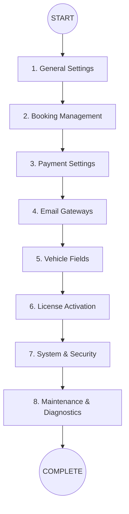

import Link from '@docusaurus/Link';

  

# ⚙️ Roadmap der Grundkonfiguration

Nach der Installation des Plugins müssen die Einstellungen in einem logischen Rahmen konfiguriert werden, damit die betrieblichen Abläufe reibungslos funktionieren. Dieser Abschnitt behandelt die grundlegenden Konfigurationsschritte, die das „Herz“ des Systems bilden.

:::tip KONFIGURATIONSLEITFADEN
Folge den unten nach Kategorien geordneten Karten, um das System vollständig einzurichten. Jede Karte bietet dir schnellen Zugriff auf die jeweilige Einstellungsgruppe.
:::

---

  

    

      <h3 className="cardTitle">🏢 1. Allgemeine Einstellungen</h3>
      
Lege Unternehmensinformationen, Währung und grundlegende Betriebsmodi fest.

      <Link className="button button--secondary button--block" to="/docs/core-configuration/settings">Allgemeine Einstellungen</Link>
    

  

  

    

      <h3 className="cardTitle">📅 2. Buchung</h3>
      
Mietdauern, Anzahlungssätze und Buchungsverhalten.

      <Link className="button button--secondary button--block" to="/docs/core-configuration/booking-settings">Buchung</Link>
    

  

  

    

      <h3 className="cardTitle">💳 3. Zahlungen</h3>
      
Konfiguriere WooCommerce-Zahlungs-Gateways und Regeln für den Zahlungseinzug.

      <Link className="button button--secondary button--block" to="/docs/core-configuration/payments">Zahlungseinstellungen</Link>
    

  

  

    

      <h3 className="cardTitle">📧 4. Benachrichtigungen</h3>
      
E-Mail-Vorlagen, SMTP-Einstellungen und automatische Benachrichtigungen.

      <Link className="button button--secondary button--block" to="/docs/core-configuration/emails">E-Mail-Einstellungen</Link>
    

  

  

    

      <h3 className="cardTitle">🏎️ 5. Fahrzeugfelder</h3>
      
Technische Daten (Kraftstoffart, Getriebe usw.) und Definitionen der Fahrzeugmerkmale.

      <Link className="button button--secondary button--block" to="/docs/core-configuration/vehicle-settings">Fahrzeugeinstellungen</Link>
    

  

  

    

      <h3 className="cardTitle">🔑 6. Lizenz</h3>
      
Aktiviere deinen Schlüssel, um die Pro-Funktionen freizuschalten.

      <Link className="button button--secondary button--block" to="/docs/core-configuration/license">Lizenzverwaltung</Link>
    

  

  

    

      <h3 className="cardTitle">⚡ 7. System & Leistung</h3>
      
Caching, Sicherheitsregeln und System-Zustandsprüfungen.

      <Link className="button button--secondary button--block" to="/docs/core-configuration/system-performance">System & Geschwindigkeit</Link>
    

  

  

    

      <h3 className="cardTitle">🛠️ 8. Wartung & Werkzeuge</h3>
      
Datenbankbereinigung, Cron-Überwachung und Diagnosewerkzeuge.

      <Link className="button button--secondary button--block" to="/docs/core-configuration/maintenance">Wartungsseite</Link>
    

  

---

## 📈 Ablaufdiagramm der Konfiguration

---

### Zusammenfassung des Abschnitts
- Wenn du die Einstellungen in der richtigen Reihenfolge konfigurierst, vermeidest du Systemkonflikte.
- Es wird empfohlen, das System am Ende mit den Werkzeugen unter **Wartung & Diagnose** zu überprüfen.

## Änderungsprotokoll
| Datum | Version | Hinweis |
|---|---|---|
| 23.04.2026 | 4.27.2 | Englische Übersetzung hinzugefügt. |
| 19.03.2026 | 4.21.2 | Roadmap der Grundkonfiguration mit Premium-Kartendesign erstellt. |
