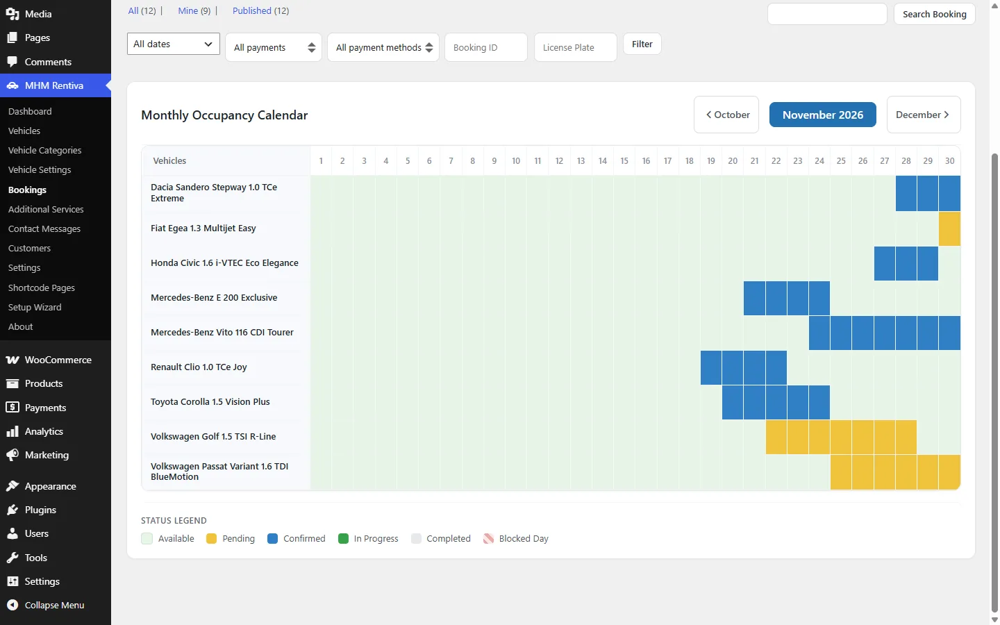
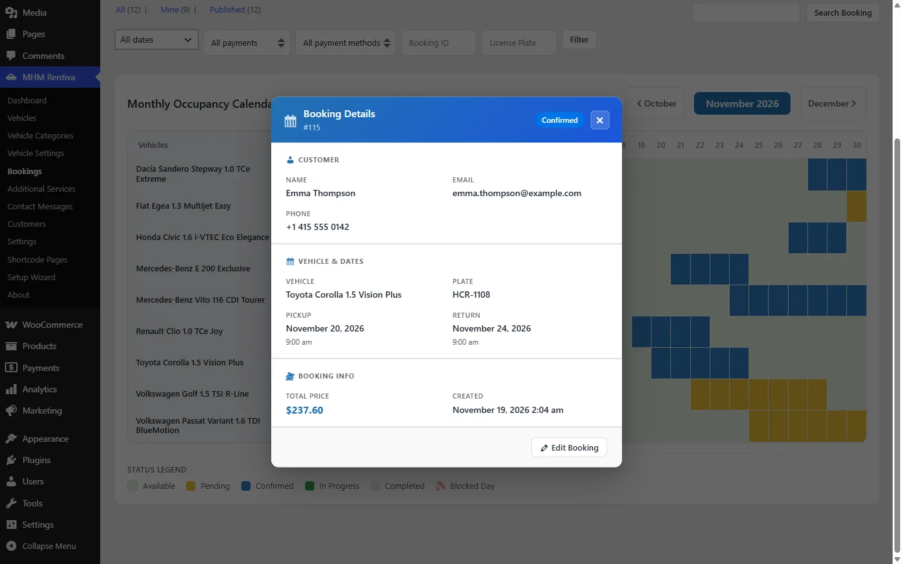

  

Buchungen sind der operative und finanzielle Kern des MHM Rentiva-Systems. Unter **MHM Rentiva > Buchungen** behältst du den gesamten Buchungsverkehr im Blick, legst neue Einträge an und verwaltest die Zahlungsflüsse.

Informationen zu den Warenkorb- und Kassenseiten, die der Kunde sieht (die Beschriftungen „Jetzt bezahlen“ und Anzahlung, Gastkonten, warum eine unbezahlte Bestellung nicht bezahlt werden kann), findest du unter [Zahlungen](../02-core-configuration/payments.md).

---

## 📊 Buchungsliste und Filter

Oben auf der Seite zeigen vier Karten den aktuellen Stand deiner Flotte:
- **Buchungen gesamt:** Alle Buchungen, die nicht im Papierkorb liegen, und wie viele davon in diesem Monat erstellt wurden.
- **Ausstehend:** Buchungen, die noch auf Freigabe oder Zahlung warten, und wie viele davon in dieser Woche erstellt wurden.
- **Abgeschlossen:** Beendete Mieten und wie viele davon in diesem Monat.
- **Buchungswert diesen Monat:** Der gebuchte Preis (nicht das eingenommene Geld) der in diesem Monat erstellten bestätigten, laufenden und abgeschlossenen Buchungen sowie die Veränderung gegenüber dem Vormonat.

Unter den Karten filtert eine Reihe von Status-Chips die Liste: **Alle**, **Ausstehend**, **Bestätigt**, **Laufend**, **Abgeschlossen** und **Storniert** werden immer angezeigt, jeweils mit ihrer Anzahl. Andere Status (zum Beispiel Erstattet) erscheinen nur, wenn mindestens eine Buchung diesen Status hat.

Neben den Chips grenzen die Auswahllisten **Alle Zahlungen** und **Alle Zahlungsmethoden** sowie die Felder **Buchungs-ID** und **Kennzeichen** die Liste weiter ein.
- Der Zahlungsfilter bietet dieselben Status wie die Spalte **Zahlung**: Unbezahlt, Ausstehend, Bezahlt, Teilweise bezahlt, Teilweise erstattet, Erstattet, Storniert usw. Es werden nur Status aufgeführt, die mindestens eine Buchung hat.
- **Bezahlt** liefert keine Anzahlungsbuchungen, bei denen noch ein Restbetrag offen ist; diese stehen unter **Teilweise bezahlt**.
- Der Zahlungsfilter wirkt zusammen mit dem Status-Chip und funktioniert auch in der Papierkorb-Ansicht.

**Listenspalten:** Kunde, Buchungs-ID, Fahrzeug, Zeitraum, Gesamt, Anzahlungsbetrag, Restbetrag, Zahlung, Status und Buchungsart. Ein kleines **M** neben der Art kennzeichnet eine manuell eingegebene Buchung. In der Spalte Zahlung zeigt das Badge Unbezahlt oder Ausstehend (gelb), Bezahlt (grün), Teilweise bezahlt (blau) oder Erstattet / Fehlgeschlagen / Storniert (rot).

Bei einer **ausstehenden** Buchung enthält die Zeile einen Link **Freigeben**, der sie bestätigt, ohne die Buchung zu öffnen.

### Kalenderansicht

Der Umschalter **Liste** / **Kalender** über der Tabelle zeigt dieselben Buchungen als Flottenkalender: eine Zeile pro Fahrzeug, eine Spalte pro Tag des gewählten Monats. Mit den Monatspfeilen wechselst du zwischen den Monaten; die Status-Chips und Filter gelten auch für den Kalender.

**Zellenfarben (Legende):**
- ● **Ausstehend**
- ● **Bestätigt**
- ● **Laufend**
- ● **Abgeschlossen** (hellgrau)
- Rote diagonale Streifen: **Gesperrter Tag** (ein im Bearbeitungsbildschirm des Fahrzeugs gesperrter Tag)
- Weiß: **Verfügbar**

Stornierte und erstattete Buchungen belegen kein Fahrzeug und werden daher nicht eingefärbt. Wählst du im Kalender den Chip **Storniert**, weist dich die Seite darauf hin, zur Listenansicht zu wechseln.

Klicke auf eine eingefärbte Zelle, um eine Übersicht mit Kunde, Fahrzeug, Kennzeichen, Abhol- und Rückgabezeiten, Gesamtpreis und einer Schaltfläche **Buchung bearbeiten** zu öffnen. Fallen mehrere Buchungen auf denselben Tag, werden alle aufgeführt.

---

## ➕ Neue Buchung

Mit **Neue Buchung hinzufügen** erfasst du Anfragen, die telefonisch oder persönlich eingehen. Der Seitenkopf lautet „← Buchungen · Neuer Eintrag · von einem Administrator hinzugefügt“. Das Formular hat folgende Abschnitte:

1.  **Fahrzeug & Kunde:** Wähle das Fahrzeug und dann einen vorhandenen Kunden aus, oder wähle **+ Neuen Kunden erstellen** und gib Vorname, Nachname, E-Mail und Telefon ein.
2.  **Datum & Dauer:** Datum und Uhrzeit von Abholung und Rückgabe. Die Rückgabe muss nach der Abholung liegen.
3.  **Zusatzleistungen:** Hake die vom Kunden gewünschten Zusatzleistungen an und lege die Mengen fest. Eine pro Tag berechnete Leistung wird mit der Anzahl der Miettage multipliziert angezeigt.
4.  **Zahlung & Notizen:** Wähle die **Zahlungsart** (**Vollständige Zahlung** oder **Anzahlung**; Anzahlung ist vorausgewählt), die **Zahlungsart** (**Offline** ist vorausgewählt, oder **Online**), den **Status** (**Ausstehend** oder **Bestätigt**; Bestätigt ist vorausgewählt) und eventuelle Notizen. Unter **Online** weist ein Hinweis darauf hin, dass der Zahlungslink separat versendet wird.

Klicke auf **Preis berechnen**. Das Preisfeld zeigt den Fahrzeugpreis, die Zusatzleistungen und den Gesamtbetrag; bei einer Anzahlung zeigt es außerdem die Zeilen **Anzahlung** und **Verbleibend**. Klicke anschließend auf **Buchung erstellen**. Es gibt kein Feld für die Anzahl der Gäste.

**Land und Bundesland eines neuen Kunden.** Die Karte für neue Kunden enthält die optionalen Felder **Land** und Bundesland. Die Länderliste stammt aus WooCommerce (die Länder, in die dein Shop verkauft, wobei das Land des Shops vorausgewählt ist). Bei einem Land mit Bundesland-Liste wählst du daraus; bei einem Land ohne Liste gibst du die Region ein; bei einem Land, das keine Bundesländer verwendet oder dessen Kasse das Bundesland-Feld ausblendet (zum Beispiel Zypern, Bosnien und Herzegowina, Botswana), wird das Feld nicht angezeigt. Die Werte werden als WooCommerce-Rechnungsland und -bundesland des Kunden gespeichert.

**Kundenkonto.** Wird hier ein neuer Kunde angelegt, erhält er eine E-Mail, um sein eigenes Passwort festzulegen, und die Erfolgsmeldung weist darauf hin.

### Buchungen, die außerhalb der Website bezahlt werden

Eine Buchung, die du manuell mit der Zahlungsart **Offline** eingibst (Bar- oder Kartenzahlung bei der Abholung, eine Überweisung, die du selbst prüfst), hat keine Zahlungsfrist. Sie wird nicht automatisch storniert, wenn das Zahlungsfenster abläuft oder der Abholtag verstreicht, und der Kunde erhält keine E-Mail „Zahlungsfrist abgelaufen“. Eine manuell eingegebene Buchung mit der Zahlungsart **Online** sowie jede auf der Website getätigte Buchung behält ihre Zahlungsfrist (**Zahlungsfrist (Minuten)** unter **Einstellungen › Buchung**, zusammen mit **Automatische Stornierung aktivieren**).

:::info Geändert in 6.4.0
Manuell eingegebene Offline-Buchungen wurden früher von der automatischen Bereinigung storniert. Beim Update belegen ältere, auf diese Weise stornierte Buchungen ihr Fahrzeug wieder. Hat in der Zwischenzeit ein anderer Kunde diese Termine gebucht, bleibt die Buchung unverändert, und unter **Protokolle** erscheint eine mit dieser Buchung verknüpfte Warnung.
:::

---

## 📝 Buchung bearbeiten (Bildschirmaufbau)

Öffne eine Buchung aus der Liste, um sie zu bearbeiten. Der Kopf lautet „← Buchungen · Kunden-, Fahrzeug- und Zahlungsdetails“. Der Standardaufbau ist:

**Rechte Spalte**
- **Buchungsstatus:** eine kurze Zusammenfassung (Fahrzeug, Tage, Gesamtbetrag), die Schaltfläche **Buchung stornieren** mit dem Hinweis „Die Stornierung startet die Erstattung des gezahlten Betrags und sendet dem Kunden eine Benachrichtigung.“ sowie die üblichen Schaltflächen **Aktualisieren** und **In den Papierkorb verschieben**.
- **Kundenkonto:** Name und E-Mail des Kunden, ein Link **Kundenprofil anzeigen** und eine Zeile **Land / Bundesland** (WooCommerce-Rechnungsland und -bundesland des Kunden). Ist kein Konto verknüpft und hat die Buchung eine E-Mail-Adresse, legt **Kundenkonto erstellen** eines an, und der Kunde erhält eine E-Mail, um sein Passwort festzulegen. Die Box zeigt außerdem die Zeile **Mietvertrag**: **Akzeptiert** mit Datum und Version des Textes oder „Keine Zustimmung (Admin-Buchung)“ bei einer manuell eingegebenen Buchung.
- **Zahlungsbeleg:** wird nur angezeigt, wenn der Kunde einen Beleg für eine Banküberweisung hochgeladen hat. Siehe [Kundenbeleg](#customer-receipt).
- **Erstattung:** der Erstattungsstatus und die Erstattungsaktionen. Siehe [Stornierung und Erstattung](#cancellation-and-refund).
- **E-Mail an Kunden senden:** siehe [E-Mail an Kunden senden](#send-email-to-customer).

**Linke Spalte**
- **Buchungsdetails bearbeiten:** Buchungsreferenz und -art, Fahrzeug, Datum und Uhrzeit von Abholung und Rückgabe, Status, Zusatzleistungen mit Mengen und besondere Hinweise. Es gibt kein Feld für die Anzahl der Gäste (ein bereits gespeicherter Wert bleibt erhalten).
- **Zahlungsverwaltung:** Beträge, Zahlungsstatus, Fristen, Zahlungsverlauf, Buchungsverlauf und Notizeingabe (siehe unten).

Die Boxen lassen sich verschieben, und der Aufbau wird pro Benutzer gespeichert; die obige Reihenfolge gilt, bis du sie neu anordnest.

**Zahlungsstatus-Badges** in der Box Zahlungsverwaltung: Bezahlt ist grün; Teilweise bezahlt, Ausstehend und Prüfung ausstehend sind gelb; Unbezahlt, Fehlgeschlagen und Storniert sind rot; Erstattet und Teilweise erstattet sind blau.

### Das Fahrzeug liegt im Papierkorb

Wurde das Fahrzeug der Buchung in den Papierkorb verschoben oder ist es nicht mehr veröffentlicht, zeigt die Fahrzeugliste es weiterhin als ausgewählt mit „— Im Papierkorb“ neben dem Namen an. Ein Hinweis darunter erklärt, dass Kunden seine Seite nicht mehr öffnen können und dass du es aus der Fahrzeugliste wiederherstellen oder ein anderes Fahrzeug wählen kannst. Wählst du ein anderes Fahrzeug, verschwindet der Hinweis.

### Termine und gesperrte Tage

Datum und Uhrzeit der Rückgabe müssen nach der Abholung liegen. Ist das nicht der Fall, verhindert der Browser das Speichern; gelangt ein ungültiger Zeitraum dennoch zum Server, wird er nicht gespeichert und die Termine bleiben unverändert. Hat das Fahrzeug im Zeitraum gesperrte Tage, wird die Buchung gespeichert und ein Hinweis nennt diese Tage.

### Kundenbeleg

Hat der Kunde einen Beleg für eine Banküberweisung hochgeladen, zeigt die Box **Zahlungsbeleg** die Datei (**Anzeigen/Herunterladen**), ihren Status (Eingereicht, Freigegeben oder Abgelehnt), eine **Admin-Notiz** sowie die Schaltflächen **Beleg freigeben** und **Beleg ablehnen**.

---

## 🔄 Wann der Preis neu berechnet wird

**Aktualisieren** berechnet den Preis nur neu, wenn sich etwas Preisrelevantes geändert hat: das Fahrzeug, Datum oder Uhrzeit von Abholung oder Rückgabe oder die Zusatzleistungen und ihre Mengen. Änderst du bei einer bezahlten Buchung nur den Status oder eine Notiz, bleiben Gesamtbetrag und Zusatzleistungszeilen unverändert.

Wenn sich der Preis ändert:
- **Der bereits eingenommene Betrag bleibt erhalten.** Verlängerst du eine bezahlte Buchung oder wird sie teurer, wird sie zu einer Anzahlungsbuchung: Der gezahlte Betrag gilt als Anzahlung, die Differenz ist der **Restbetrag**, den du mit **Restbetrag verarbeiten** oder per Zahlungslink einziehst.
- **Ein neuer Gesamtbetrag unter dem eingenommenen Betrag wird nicht gespeichert.** Fahrzeug, Termine und Zusatzleistungen bleiben wie gespeichert (Notizen und andere Felder werden gespeichert), und eine Meldung fordert dich auf, die Buchung zu stornieren, die Zahlung zu erstatten und eine neue Buchung anzulegen.
- **Der Gesamtbetrag kann nicht geändert werden**, solange für die Buchung ein Zahlungslink für den Restbetrag existiert, wenn eine erstattete Buchung einen höheren Gesamtbetrag erhalten würde, wenn die Buchung in mehr als einer Währung oder in einer anderen Währung als der des Shops bezahlt wurde oder wenn sie in einer Bestellung bezahlt wurde, die auch andere Buchungen oder Produkte enthält. Die Meldung nennt den zutreffenden Fall; um den Preis in diesen Fällen zu ändern, storniere die Buchung und lege eine neue an.

Bei einer Anzahlungsbuchung, die noch gar nicht bezahlt wurde (keine Zahlung eingegangen, keine WooCommerce-Bestellung), folgt eine prozentuale Anzahlung dem neuen Gesamtbetrag zu dem Satz, mit dem die Buchung angelegt wurde: Eine Anzahlung von 10 % bleibt 10 % des neuen Gesamtbetrags, und der Restbetrag wird entsprechend angepasst. Der aktuelle Anzahlungssatz in den Einstellungen wird nicht auf eine bestehende Buchung angewendet. Eine Anzahlung mit festem Betrag, eine mit einer Bestellung verknüpfte Buchung oder eine Buchung mit einer Zahlung behält ihre Anzahlung unverändert; nur der Restbetrag folgt dem neuen Gesamtbetrag.

---

## 💰 Anzahlung und Restzahlung

Die Box **Zahlungsverwaltung** zeigt **Zahlungsart** (Anzahlung oder Vollständige Zahlung), **Zahlungsart** (Online oder Offline), **Gesamtbetrag**, **Anzahlungsbetrag**, **Restbetrag**, **Miettage** und **Anzahlungsart**, gefolgt vom Zahlungsstatus, den **Stornierungsbedingungen** (die Frist und ob die Buchung noch storniert werden kann) und der **Zahlungsfrist**.

Eine Anzahlungsbuchung, deren Anzahlung bezahlt ist, bei der aber noch ein Restbetrag offen ist, zeigt in der Box und in der Liste **Teilweise bezahlt**. Eine Buchung, die vor Einführung des Anzahlungssystems angelegt wurde, zeigt einen Hinweis, dass keine Anzahlungsinformationen verfügbar sind.

**Schaltflächen:**
- **Zahlungseingang markieren:** für eine ausstehende oder bestätigte Buchung, die noch nicht bezahlt ist (zum Beispiel eine von dir geprüfte Banküberweisung). Sie markiert die Zahlung als eingegangen und bestätigt die Buchung.
- **Restbetrag verarbeiten:** für eine Anzahlungsbuchung, deren Anzahlung bezahlt ist und bei der ein Restbetrag offen ist. Sie erfasst den Restbetrag als eingenommen; die Buchung wird Bestätigt oder, falls die Miete bereits beendet ist, Abgeschlossen.
- **Zahlungslink senden:** sendet dem Kunden per E-Mail einen Zahlungslink für den Restbetrag. Sie wird nicht angeboten, wenn die Anzahlung außerhalb von WooCommerce bezahlt wurde; verwende in diesem Fall **Restbetrag verarbeiten**.

### Der Kunde bezahlt den Restbetrag

Bei einer Anzahlungsbuchung kann der Kunde in **Mein Konto** in den Buchungsdetails auf **Restbetrag bezahlen** klicken. Es wird eine kleine WooCommerce-Bestellung über den offenen Betrag angelegt, die der Kunde mit jeder auf deiner Website aktiven Zahlungsart bezahlt. Wurde die Anzahlung außerhalb der Website bezahlt, teilt die Seite stattdessen mit, dass du den Kunden kontaktierst, um den Restbetrag einzuziehen.

- Nur der aktuelle Zahlungslink der Buchung nimmt eine Zahlung an. Ein älterer Link meldet, dass der Betrag nicht mehr aktuell ist und der Kunde einen neuen anfordern soll. Eine abgelehnte Karte kann über denselben Link erneut versucht werden.
- Schlägt die Bestellung für den Restbetrag fehl oder wird sie storniert, wird die Buchung nicht storniert. Wird eine bezahlte Restbetragsbestellung später storniert, bleibt das Geld bei dieser Bestellung; ob du es erstattest oder wiederherstellst, entscheidest du.
- Geht eine Zahlung für einen nicht mehr aktuellen Betrag ein, wird der Restbetrag nicht auf null gesetzt. Im Bearbeitungsbildschirm der Buchung bleibt eine Warnung mit Bestellnummer, eingenommenem Betrag und Restbetrag sichtbar, bis du auf **Ich habe es geprüft** klickst; korrigiere den Restbetrag manuell.

:::info Geändert in 6.4.0
Ein vor dem Update erstellter Zahlungslink für den Restbetrag kann an der Kasse wegen Steuer- oder Währungsunterschieden abgelehnt werden. Der Kunde fordert dann einen neuen Link an.
:::

---

## 🧾 Buchungsverlauf

Die Box **Zahlungsverwaltung** endet mit dem **Buchungsverlauf**.

- **Notiz hinzufügen:** Schreibe eine Notiz, wähle den **Typ** (**Notiz** oder **Kundenkontakt**) und klicke auf **Notiz hinzufügen**. Eine leere Notiz wird abgelehnt, ohne **Aktualisieren** zu blockieren, und das Ergebnis wird in der Box angezeigt. Die Zeilen zu Status, Zahlung und System schreibt Rentiva selbst.
- **Verlauf:** neueste zuerst, jede Zeile mit Typ (Notiz, Statusänderung, Zahlungsaktualisierung, Kundenkontakt, System), Datum und „Von“-Namen. Von automatischen Aufgaben geschriebene Zeilen zeigen **System**. Nur die letzten fünf sind aufgeklappt; der Rest verbirgt sich hinter „+ N weitere Einträge“.
- Jede Zahlungsänderung ist eine Zeile, zum Beispiel „Zahlung: Ausstehend → Teilweise bezahlt“. Freigabe der Anzahlung, Restzahlung, eine WooCommerce-Bestellung, eine Erstattung, eine automatische Stornierung, eine Neuberechnung des Preises bei **Aktualisieren** und eine Änderung der Zahlungsart schreiben jeweils eine solche Zeile.
- Weitere Zeilen: der Abschluss der manuellen Auszahlung einer Erstattung, der Grund, wenn keine Erstattung fällig ist, eine an den Kunden gesendete E-Mail sowie das Erstellen oder Versenden des Zahlungslinks für den Restbetrag.
- Die Notizen sind im Export der personenbezogenen Daten des Kunden enthalten. Die Zeitleiste in Mein Konto des Kunden zeigt keine Zahlungszeilen.

---

## ❌ Stornierung und Erstattung {#cancellation-and-refund}

**Buchung stornieren** in der Box **Buchungsstatus** storniert eine ausstehende oder bestätigte Buchung. Sie startet die Erstattung des gezahlten Betrags und sendet eine Benachrichtigung an den Kunden und den Administrator. Eine bereits begonnene Miete kann hier nicht storniert werden.

Wenn du in der Liste **Status** die Option **Storniert** wählst und auf **Aktualisieren** klickst, passiert genau dasselbe. Andere gleichzeitig im Formular vorgenommene Änderungen werden nicht gespeichert, und der Bildschirm weist darauf hin („bearbeite zuerst die Buchung, dann storniere sie“). Ein Benutzer ohne Berechtigung für Geldvorgänge sieht **Storniert** nicht in der Statusliste.

**Stornierungsfrist.** Die Frist wird ab der Abholung zurückgerechnet (**Einstellungen › Buchung › Stornierungsfrist (Stunden)**). Danach kann ein Kunde nicht mehr stornieren. Die Stornierung durch den Administrator ignoriert die Frist und erstattet den gesamten erstattungsfähigen Betrag. In der Box Zahlungsverwaltung erscheinen die Sätze „Diese Buchung kann storniert werden.“ und „Stornierungsfrist abgelaufen.“ nur bei offenen Buchungen; stornierte, abgeschlossene und erstattete Buchungen behalten nur die Zeilen zur Frist.

**Erstattungsbox.** Ihre erste Zeile ist **Erstattungsstatus:** (zum Beispiel Erstattung läuft, Wartet auf manuelle Auszahlung, Manuelle Auszahlung bestätigt, Über das Zahlungs-Gateway erstattet, Keine Erstattung fällig gewesen).
- **Rückerstattung durchführen** erscheint bei einer stornierten Buchung mit erstattungsfähigem Betrag; sie schließt die Erstattung ab oder versucht sie erneut. Wurde bereits ein Teil des Geldes zurückgezahlt, bietet sie den Rest an.
- Eine bezahlte, nicht stornierte WooCommerce-Buchung zeigt „Sie kann in der WooCommerce-Bestellansicht erstattet werden.“
- Bei Offline-Zahlungen listet die Box **Kanal**, **Bezahlt**, **Bereits erstattet** und **Noch erstattungsfähig** auf.

**Manuelle Auszahlung (bar, Banküberweisung).** Wird die Erstattung manuell zurückgezahlt, lautet der Status **Wartet auf manuelle Auszahlung**. Sobald du das Geld ausgezahlt hast, gib optional eine **Zahlungsreferenz (optional)** ein und klicke auf **Manuelle Auszahlung bestätigen**. Der Buchungsverlauf hält dies fest, und wenn eine Referenz eingegeben wurde, erhält der Kunde eine E-Mail, dass die Erstattung mit dieser Referenz ausgezahlt wurde. Bei einer manuell zurückgezahlten Erstattung erhält der Kunde die Rentiva-E-Mail „Die Erstattung wird dir manuell ausgezahlt“ und nicht die WooCommerce-E-Mail „Bestellung erstattet“; ist die Rentiva-E-Mail deaktiviert oder fehlt eine Adresse, bleibt die WooCommerce-E-Mail bestehen. Eine über das Zahlungs-Gateway zurückgezahlte Erstattung behält die WooCommerce-E-Mail.

**Prüfung erforderlich.** Findet eine automatische Stornierung eine bezahlte Bestellung, ohne dass Geld bewegt wurde, lautet der Status **Prüfung erforderlich**. **Stornieren und Erstattung starten** storniert und startet die Erstattung. **Keine Erstattung fällig** schließt die Prüfung ab; du musst den Grund unter **Warum ist keine Erstattung fällig?** angeben, und er wird im Verlauf festgehalten. Ist die Buchung bereits storniert, erstatte zuerst die bezahlte Bestellung in der WooCommerce-Bestellansicht.

**Erstattung in der WooCommerce-Bestellansicht.** Wird eine Bestellung dort vollständig erstattet:
- Eine noch nicht begonnene Buchung (Ausstehend, Zahlung ausstehend, Bestätigt) wird storniert und ihre Termine werden freigegeben; der Zahlungsstatus wird Erstattet.
- Eine abgeschlossene Miete bleibt **Erstattet**.
- Eine laufende Miete behält ihre Termine, da sich das Fahrzeug beim Kunden befindet; du schließt sie selbst ab.
- Der Kunde erhält eine einzige Erstattungs-E-Mail und keine separate E-Mail „Buchung storniert“.

---

## ✉️ E-Mail an Kunden senden {#send-email-to-customer}

Die Box **E-Mail an Kunden senden** zeigt Name und E-Mail-Adresse des Kunden, dann:
1.  **E-Mail-Typ:** **Buchungsbestätigung**, **Buchungserinnerung**, **Buchungsstornierung** oder **Individuelle Nachricht**.
2.  **Betreff** und **Nachricht:** Die Auswahl eines Typs füllt beide aus der passenden Vorlage unter **Einstellungen → E-Mail-Templates**; du kannst sie vor dem Senden bearbeiten (ein erneuter Wechsel des Typs fragt nach, bevor deine Änderungen ersetzt werden). **Individuelle Nachricht** beginnt leer und benötigt sowohl einen Betreff als auch eine Nachricht.
3.  **E-Mail senden.**

Der Typ **Buchungsstornierung** füllt Betreff und Nachricht aus und sendet. Hat der Kunde automatische Benachrichtigungen deaktiviert, weist die Box darauf hin; eine hier gesendete E-Mail wird trotzdem verschickt. Eine gesendete E-Mail wird im Buchungsverlauf festgehalten.

---

## 🆔 Anzeige-ID

Buchungslisten und Widgets zeigen die WooCommerce-Bestellnummer, wenn die WooCommerce-Integration aktiv ist; andernfalls zeigen sie die eigene Nummer der Buchung. So stimmt die Nummer, die der Kunde sieht, mit der im Adminbereich überein.

---

### Zusammenfassung des Abschnitts
- Filtere die **Liste** nach Status, Zahlung, Zahlungsmethode, Buchungs-ID oder Kennzeichen oder wechsle zum **Kalender**.
- Mit **Neue Buchung** erfasst du telefonische und persönliche Anfragen; von dir eingegebene Offline-Buchungen werden nie automatisch storniert.
- **Aktualisieren** berechnet den Preis nur neu, wenn sich eine Preisangabe ändert, und senkt nie den eingenommenen Betrag.
- Verfolge Anzahlungen und Restbeträge in der **Zahlungsverwaltung**; nutze **Restbetrag verarbeiten** oder **Zahlungslink senden**.
- **Buchung stornieren** und **Storniert + Aktualisieren** bewirken dasselbe und starten die Erstattung.
- Der **Buchungsverlauf** hält jede Zahlungs-, Status- und E-Mail-Änderung fest.

### Änderungsprotokoll
| Datum | Version | Hinweis |
| :--- | :--- | :--- |
| 18.11.2026 | 6.4.0 | Karten, Filter und Flottenkalender der Buchungsliste; Aufbau der Bildschirme für neue Buchung und Bearbeitung; Box Zahlungsverwaltung mit Verlauf; Regeln zur Neuberechnung des Preises; Stornierung und Erstattung im Bearbeitungsbildschirm; Bestätigung der manuellen Auszahlung; manuelle Offline-Buchungen werden nicht mehr automatisch storniert. |
| 23.04.2026 | 4.27.2 | Dokumentation mit der aktuellen Plugin-Version synchronisiert. |
| 27.03.2026 | 4.23.0 | Zeitangaben im Kalender-Pop-up, Anzeige-ID und Status-Hooks dokumentiert. |
| 19.03.2026 | 4.21.2 | Buchungsliste, Kalender, manuelle Eingabe und Zahlungsverwaltung anhand der tatsächlichen Oberfläche neu geschrieben. |
| 18.03.2026 | 4.21.0 | Erste Version erstellt. |
