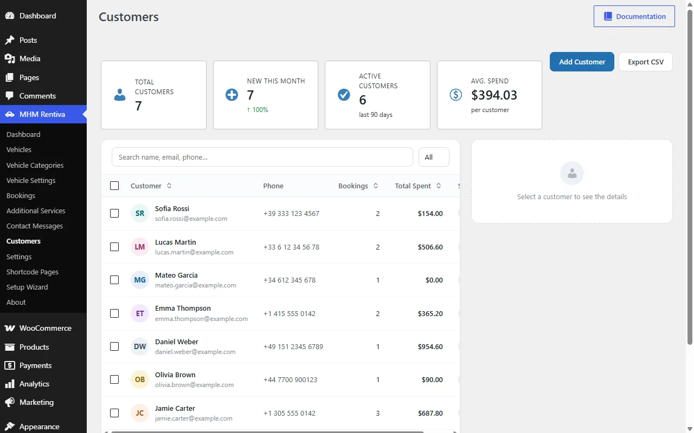

  

:::info React-SPA (seit v4.39.0)
Die Kundenseite wurde in v4.39.0 vollständig auf eine **React-SPA** umgestellt, die auf der REST-API basiert. Die alten Dateien `CustomersListTable.php`, `CustomersListPage.php`, `customers.js` und die zugehörigen CSS-Dateien wurden gelöscht. Die Seite lädt jetzt sofort und bietet Live-Suche, sortierbare Spalten, ein einblendbares Detail-Panel und Massenlöschung – alles ohne Neuladen der Seite.
:::

Die Kundenverwaltung ist der zentrale Bereich, um einen treuen Kundenstamm aufzubauen und die Buchungshistorie zu verfolgen. Du erreichst die vollständige Kundendatenbank über **MHM Rentiva > Kunden**.

---

## 📊 Kundenanalysen (wichtigste Kennzahlen)

Oben auf der Seite zeigen vier Karten das Wachstum und die Aktivität deines Kundenstamms:

:::info Keine Kundenbegrenzung
Lite hat keine Begrenzung der Kundenanzahl, daher wird auf diesem Bildschirm kein Hinweis auf ein Limit angezeigt.
:::

- **Kunden gesamt:** Die Anzahl aller Kunden im System.
- **Neu in diesem Monat:** Die Anzahl der Kunden, die sich in den letzten 30 Tagen registriert haben.
- **Aktive Kunden:** Kunden mit einer Buchung in den letzten 90 Tagen.
- **Durchschn. Ausgaben:** Der durchschnittliche Betrag, den ein Kunde ausgegeben hat.

---

---

## 👥 Kundenliste und finanzielle Übersicht

Mit der Kundentabelle kannst du den Wert (LTV – Lifetime Value) messen, den jeder Nutzer deinem Unternehmen bringt:

Die Spalten sind **Kunde** (Name und E-Mail-Adresse), **Telefon**, **Buchungen**, **Gesamtausgaben** und **Status** (VIP, Neu oder Aktiv). Verwende den Filter **Alle / Aktiv / Neu / VIP** über der Tabelle, um die Liste einzugrenzen.

- **Buchungen:** Gesamtzahl der vom Kunden abgeschlossenen Miet- bzw. Transfer-Vorgänge.
- **Gesamtausgaben:** Gesamtumsatz aus allen Vorgängen des Kunden (mit Währungssymbol).

---

## ➕ Einen neuen Kunden hinzufügen

Der Bildschirm zur manuellen Kundenerfassung ist auf schnelle Abläufe ausgelegt. Klicke auf **„Kunde hinzufügen“**, um die folgenden Daten einzugeben:

- **Kundenname:** (Pflichtfeld)
- **E-Mail-Adresse:** (Pflichtfeld) – die eindeutige Kennung im System.
- **Telefon:** Für die Kommunikation.
- **Adresse:** Grundlegende Adressangaben zur Rechnungsstellung oder zur Bestimmung des Lieferorts.

---

## 🖱️ Einblendbares Kunden-Detail-Panel (v4.39.0+)

Klicke auf eine beliebige Zeile der Kundentabelle, um ein **einblendbares Detail-Panel** ohne Neuladen der Seite zu öffnen:

- **Name, E-Mail-Adresse, Telefon, Adresse**
- **Registrierungsdatum**
- **Buchungen gesamt** und **Gesamtausgaben**
- Datum der **ersten / letzten Buchung**
- Schnelllinks: **Kunde bearbeiten**, **Buchungen anzeigen**

Drücke **Escape** oder klicke außerhalb des Panels, um es zu schließen.

---

## 🔍 Live-Suche und Spaltensortierung (v4.39.0+)

- **Live-Suche:** 300 ms Debounce – kein Neuladen der Seite.
- **Sortierbare Spalten:** **Kunde**, **Buchungen** und **Gesamtausgaben**. Verwende die Schaltfläche im Spaltenkopf: Der erste Klick sortiert mit dem größten Wert zuerst (absteigend), ein zweiter Klick auf dieselbe Spalte kehrt die Reihenfolge um. Die sortierte Spalte wird Screenreadern angesagt.
- **Alle auswählen:** Das Kontrollkästchen „Alle auswählen“ zeigt eine gestrichelte (gemischte) Markierung, wenn nur einige Zeilen ausgewählt sind, und ausgewählte Zeilen werden hellblau hinterlegt. Eine Änderung der Sortierung hebt die Auswahl auf.
- **Massenlöschung:** Wähle Zeilen über das Kontrollkästchen aus und klicke auf „Ausgewählte löschen“. Eine Bestätigungsabfrage des Browsers verhindert versehentliches Löschen.
- **CSV-Export:** Lädt alle Kunden (seitenweise) oder nur die ausgewählten IDs herunter. Die Aktion wird serverseitig über admin-post.php verarbeitet.

---

## React-Komponenten (v4.39.0+)

| Komponente | Zweck |
| :--- | :--- |
| `StatsCards` | Vier KPI-Karten mit Farbverlauf oben auf der Seite |
| `SearchBar` | Live-Suchfeld mit Debounce |
| `FilterBar` | Filtersteuerung für Status / Segment |
| `CustomerTable` | Sortierbare Tabelle mit Seitennummerierung |
| `CustomerPanel` | Einblendbares Detail-Panel |
| `Pagination` | Steuerelemente zur Seitennavigation |

**REST-Endpunkte:**
- `GET /wp-json/mhm-rentiva/v1/customers` – seitenweise, Suche, Sortierung
- `GET /wp-json/mhm-rentiva/v1/customers/{id}` – Details
- `DELETE /wp-json/mhm-rentiva/v1/customers/bulk` – Massenlöschung

Alle Endpunkte erfordern die Berechtigung `manage_options`.

---

### Zusammenfassung des Abschnitts
- Verfolge das Kundenwachstum mit den **Analysekarten**.
- Erkenne deine VIP-Kunden anhand der Spalte **Gesamtausgaben**.
- Sieh dir Kundendetails sofort im **Detail-Panel** an (ohne Neuladen der Seite).
- Ordne über die **zentrale Datenbank** alle Buchungen den Kunden zu.

### Änderungsprotokoll
| Datum | Version | Hinweis |
| :--- | :--- | :--- |
| 18.11.2026 | 6.4.0 | Sortierung der Kundentabelle über den Spaltenkopf mit Ansage für Screenreader, gemischte Markierung bei „Alle auswählen“ und hinterlegte ausgewählte Zeilen dokumentiert; Karten, Spalten und Filter an den aktuellen Bildschirm angepasst. |
| 09.11.2026 | 6.3.1 | Korrektur: Der Kasten „Lite-Limit-Hinweis“ wurde entfernt. Lite hat keine Kundenbegrenzung und zeigt keinen Limit-Hinweis an. |
| 11.05.2026 | 4.39.0 | Vollständige Umstellung auf React-SPA. Live-Suche, sortierbare Spalten, Detail-Panel, Massenlöschung, CSV-Export. Alte PHP-Listentabelle + jQuery entfernt. |
| 23.04.2026 | 4.27.2 | Dokumentation mit der aktuellen Plugin-Version abgeglichen. |
| 27.03.2026 | 4.23.0 | Position des Lite-Hinweises (unter den KPI-Karten) dokumentiert. |
| 19.03.2026 | 4.21.2 | Kundenliste, Analysekarten und Registrierungsformular anhand der tatsächlichen Oberfläche aktualisiert. |
| 26.02.2026 | 4.21.0 | Erste Version erstellt. |
