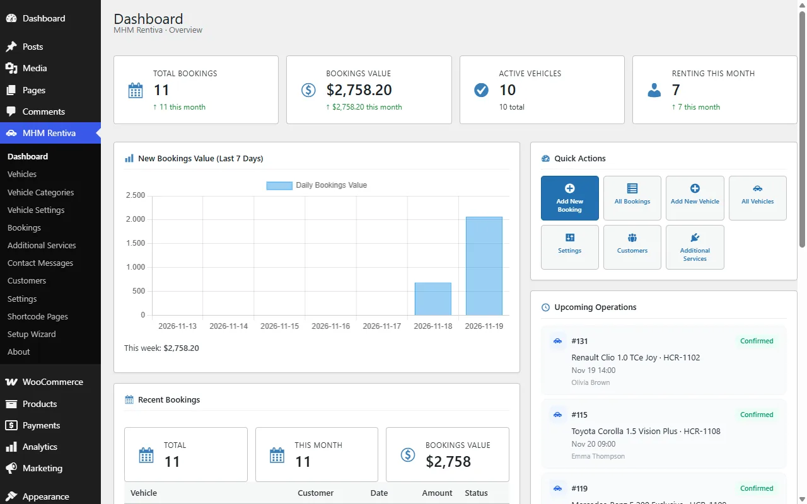

  

Das Dashboard zeigt dir dein Geschäft auf einen Blick: Buchungszahlen, offene Beträge, die nächsten sieben Tage und praktische Schnellzugriffe. Du erreichst es über **MHM Rentiva > Dashboard**. Der Seitentitel lautet „Dashboard“ mit dem Untertitel „MHM Rentiva · Übersicht“.

---

## 📊 Übersichtskarten

Oben befinden sich vier Karten. Sie zeigen Gesamtwerte zusammen mit dem Wert des aktuellen Monats und der Veränderung gegenüber dem Vormonat:

- **Buchungen gesamt:** alle Buchungen außer stornierten und erstatteten, mit der Anzahl dieses Monats.
- **Buchungswert:** der Preis bestätigter, laufender und abgeschlossener Buchungen. Es handelt sich um den gebuchten Betrag, nicht um eingenommenes Geld; was noch offen ist, findest du im Feld **Zahlungen**.
- **Aktive Fahrzeuge:** die aktuell aktiven Fahrzeuge im Verhältnis zu deinem Gesamtbestand.
- **Vermietet in diesem Monat:** die Anzahl verschiedener Kunden, die in diesem Monat eine Buchung vorgenommen haben (stornierte und erstattete Buchungen werden nicht gezählt).

:::info Geändert in 6.4.0
Stornierte und erstattete Buchungen werden nicht mehr in **Buchungen gesamt**, der Anzahl dieses Monats oder **Vermietet in diesem Monat** gezählt; sie erscheinen im Feld **Buchungsstatus**. Die Karte „Gesamtumsatz“ heißt jetzt **Buchungswert**, und die nicht funktionierende Auswahl „Letzte 30 Tage“ oben rechts wurde entfernt.
:::

---

## 📈 Diagramme und Listen

- **Wert neuer Buchungen (letzte 7 Tage):** ein Balkendiagramm des gebuchten Betrags pro Tag für die letzten sieben Tage, mit der Summe unter **Diese Woche**. Die Tage werden nach dem Erstellungsdatum der Buchung gezählt, nicht nach dem Mietdatum.
- **Neueste Buchungen:** die letzten Buchungen, zuletzt erstellte zuerst, mit den Spalten Fahrzeug, Kunde, Datum, Betrag und Status sowie Blättern über **← Zurück / Weiter →**.
- **Anstehende Vorgänge:** Mieten (Fahrzeug, Kennzeichen, Abholung → Rückgabedatum, Kunde und Status) und Transfers (Pro), die in den nächsten 7 Tagen beginnen („Keine anstehenden Vorgänge in den nächsten 7 Tagen.“, wenn es keine gibt).
- **Buchungsstatus:** die Anzahl der Buchungen je Status, einschließlich stornierter und erstatteter.
- **Zahlungen:** zwei Werte.
  - **Zahlung ausstehend:** was Buchungen noch schulden, berechnet so, wie es die Spalte **Zahlung** der Buchungsliste anzeigt: der Restbetrag nach einer Anzahlung, Buchungen, die noch gar nicht bezahlt wurden (einschließlich Offline-Buchungen), und Buchungen, die auf eine Zahlung warten. Stornierte, erstattete und vollständig bezahlte Buchungen schulden nichts.
  - **Anzahlung (einbehalten):** Anzahlungen bestätigter und laufender Buchungen, die als Anzahlung entgegengenommen wurden.

---

## ⚡ Schnellaktionen

Schnellzugriffe auf **Neue Buchung hinzufügen**, **Alle Buchungen**, **Neues Fahrzeug hinzufügen**, **Alle Fahrzeuge**, **Einstellungen**, **Kunden** und **Zusatzleistungen**. Rentiva Pro ergänzt Schnellzugriffe auf seine eigenen Bildschirme (Berichte, Anbieter, Nachrichten, Export); jeder davon erscheint nur, wenn deine Lizenz die jeweilige Funktion enthält.

---

## Lite und Pro

Jedes Feld des Dashboards funktioniert in Lite. Kein Feld ist Pro vorbehalten.

---

### Zusammenfassung des Abschnitts
- Die Karten und Felder zählen, was **gebucht** wurde; **Zahlung ausstehend** zeigt, was noch offen ist.
- Stornierte und erstattete Buchungen werden aus den Summen herausgenommen und unter **Buchungsstatus** angezeigt.
- Das Dashboard ist der erste Bildschirm, den du nach der Installation des Plugins siehst.

### Änderungsprotokoll
| Datum | Version | Hinweis |
| :--- | :--- | :--- |
| 18.11.2026 | 6.4.0 | Dashboard für den aktuellen Bildschirm neu beschrieben: Karte „Buchungswert“, stornierte Buchungen werden nicht mehr gezählt, „Zahlung ausstehend“ umfasst Restbeträge nach Anzahlung und unbezahlte Offline-Buchungen, zuletzt erstellte Buchungen zuerst, Auswahl „Letzte 30 Tage“ entfernt. |
| 09.11.2026 | 6.3.1 | Korrektur: Das Umsatzdiagramm und „Anstehende Vorgänge“ sind nicht nur in Pro verfügbar; jedes Dashboard-Widget funktioniert in Lite. Die Schnellzugriffe von Pro werden erwähnt. |
| 10.05.2026 | 4.36.0 | Vollständige Migration auf eine React-SPA. Alte PHP-Widgets entfernt. |
| 19.03.2026 | 4.6.3 | Dashboard-Anleitung mit echten Kennzahlen der Oberfläche aktualisiert. |
