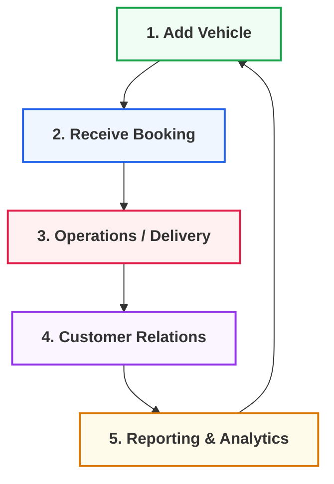

import Link from '@docusaurus/Link';

  

# 🚗 Funktionen & Nutzungs-Roadmap

Um alle Möglichkeiten von MHM Rentiva optimal zu nutzen, empfehlen wir dir, die unten stehende Reihenfolge im Betriebsablauf einzuhalten.

:::tip NUTZUNGSANLEITUNG
Nutze die unten nach Kategorien sortierten Karten, um deine täglichen Vermietungsabläufe zu verwalten, Fahrzeuge hinzuzufügen und Berichte zu erstellen.
:::

---

  

    

      <h3 className="cardTitle">🏎️ 1. Fahrzeuge & Bestand</h3>
      
Fahrzeuge hinzufügen, Kategorien verwalten, Preise und globale Fahrzeugeinstellungen.

      <Link className="button button--secondary button--block" to="/docs/features-usage/vehicles">Fahrzeugverwaltung</Link>
    

  

  

    

      <h3 className="cardTitle">📅 2. Buchungsverfolgung</h3>
      
Eingehende Anfragen verwalten, den Kalender im Blick behalten und Buchungsdetails prüfen.

      <Link className="button button--secondary button--block" to="/docs/features-usage/bookings">Buchungen</Link>
    

  

  

    

      <h3 className="cardTitle">✨ 3. Zusatzleistungen & VIP</h3>
      
Zusatzleistungen wie Babysitze und Versicherungen sowie die Definition von VIP-Transfer-Routen.

      <Link className="button button--secondary button--block" to="/docs/features-usage/additional-services-usage">Zusatzleistungen</Link>
    

  

  

    

      <h3 className="cardTitle">💬 4. Kunden & Kommunikation</h3>
      
Verwaltung des Kundenportals, Treueprogramm und internes Nachrichtensystem.

      <Link className="button button--secondary button--block" to="/docs/features-usage/customers">Kundenverwaltung</Link>
    

  

  

    

      <h3 className="cardTitle">📊 5. Berichte & Analysen</h3>
      
Diagramme zur Geschäftsentwicklung, Umsatzberichte und Datenexport.

      <Link className="button button--secondary button--block" to="/docs/features-usage/reports">Berichte & Export</Link>
    

  

---

## 📈 Betriebszyklus

---

### Zusammenfassung des Abschnitts
- Dieser Abschnitt behandelt die Arbeitsabläufe für die tägliche Nutzung des Plugins.
- Der Betriebszyklus ist auf ein nachhaltiges Vermietungsgeschäft ausgelegt.

## Änderungsprotokoll
| Datum | Version | Hinweis |
|---|---|---|
| 23.04.2026 | 4.27.2 | Englische Übersetzung hinzugefügt. |
| 21.03.2026 | 4.21.3 | Alle Kartenlinks (Fahrzeuge, Buchungen, Zusatzleistungen usw.) auf relative Pfade korrigiert. |
| 19.03.2026 | 4.21.2 | Funktionen- & Nutzungs-Roadmap mit Premium-Kartendesign erstellt. |
