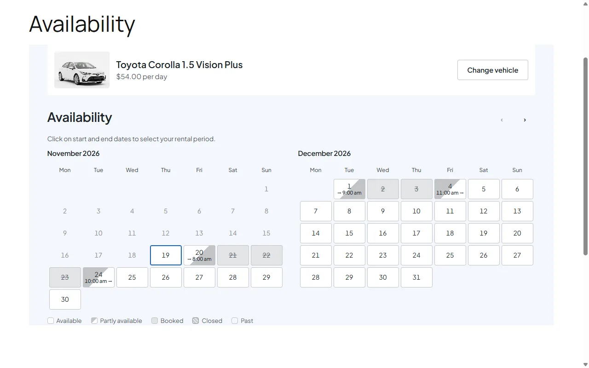

  

:::info Zweck
Diese Seite beschreibt das Modul „Verfügbarkeitskalender“ als Standardreferenz und deckt sowohl technische als auch betriebliche Aspekte ab.
:::

# 🚗 Verfügbarkeitskalender

## Inhalt
- Verwendung
- Funktionen
- Hinweise für Entwickler

Das Modul „Verfügbarkeitskalender“ dient dazu, die **Buchungs**-Verfügbarkeit auf der Rentiva-Plattform zu verwalten und Besuchern anzuzeigen.

## Verwendung



Um dieses Modul zu einer beliebigen Seite oder einem Beitrag hinzuzufügen, verwende den folgenden Shortcode:

```shortcode
[rentiva_availability_calendar vehicle_id=""]
```

Du kannst es auch visuell im Gutenberg-Blockeditor einfügen, indem du **„MHM Rentiva → Availability Calendar“** auswählst.

### Parameter

Folgende Parameter stehen im Shortcode zur Verfügung:

| Parameter | Standard | Beschreibung |
| :--- | :--- | :--- |
| `vehicle_id` | `(empty)` | Steuert das **Funktions**-Filterverhalten des Moduls. |
| `show_pricing` | `apply_filters(mhmrentiva_availability_calendar_show_pricing` | Steuert das **allgemeine** Anzeigeverhalten des Moduls. |
| `show_booking_button` | `apply_filters(` | Steuert das **allgemeine** Anzeigeverhalten des Moduls. |
| `theme` | `apply_filters(mhmrentiva_availability_calendar_theme` | Steuert das **allgemeine** Anzeigeverhalten des Moduls. |
| `months_ahead` | `apply_filters(mhmrentiva_availability_calendar_months_ahead` | Steuert das **allgemeine** Anzeigeverhalten des Moduls. |
| `months_to_show` | `apply_filters(mhmrentiva_availability_calendar_months_to_show` | Steuert das **allgemeine** Anzeigeverhalten des Moduls. |
| `start_month` | `(empty)` | Steuert das **allgemeine** Anzeigeverhalten des Moduls. |
| `show_weekends` | `apply_filters(mhmrentiva_availability_calendar_show_weekends` | Steuert das **allgemeine** Anzeigeverhalten des Moduls. |
| `show_past_dates` | `apply_filters(mhmrentiva_availability_calendar_show_past_dates` | Steuert das **allgemeine** Anzeigeverhalten des Moduls. |
| `class` | `(empty)` | Steuert das **allgemeine** Layoutverhalten des Moduls. |


## Funktionen

### 📱 Responsives Design
- **Mobil:** Einspaltiges Layout.
- **Tablet (unter 782px):** Optimierte Ansicht.
- **Desktop:** Vollständige Ansicht mit der eingestellten Spaltenanzahl bzw. Breite.

### 🚀 Auf Performance ausgelegt
- **Intelligentes Caching:** Datenbankabfragen werden vom System optimiert und zwischengespeichert.
- **Bedingtes Laden:** Statische Assets werden nur auf Seiten eingebunden, auf denen das Modul verwendet wird.

## Den Kalender lesen

| Tag | Bedeutung |
| :--- | :--- |
| Verfügbar | Den ganzen Tag frei. |
| Teilweise verfügbar | An diesem Tag endet oder beginnt eine Buchung. Ein Rückgabetag zeigt „11:00 →“ (Rückgabezeit plus Pufferzeit, auf die halbe Stunde aufgerundet); ein Abholtag zeigt „→ 09:00“ (Abholzeit minus Puffer, abgerundet). Die Zelle ist zur Hälfte eingefärbt; auf dem Smartphone wird die Kurzzeit angezeigt. |
| Gebucht | Durch eine Buchung belegt. |
| Geschlossen (durchgestrichen) | Du hast den Tag manuell geschlossen. Er wird nicht mehr als „Gebucht“ angezeigt. |

Die Legende unter dem Kalender führt Verfügbar, Teilweise verfügbar, Gebucht, Geschlossen und Vergangen auf.

Wählt ein Kunde einen Rückgabetag als Beginn, wird die Abholzeit auf diese Uhrzeit verschoben, das Panel weist darauf hin („Am ... ist das Fahrzeug ab ... frei; die Uhrzeit wurde darauf gesetzt.“) und der Buchungslink übernimmt die Uhrzeit. Ein mit „→ 09:00“ markierter Tag kann nur ein Rückgabetag sein; liegt die gewählte Rückgabezeit später, warnt der Kalender („Am ... ist das Fahrzeug bis ... frei. Wähle einen früheren Rückgabetag.“).

### „Fahrzeug nicht gefunden.“
Verweist die `vehicle_id` des Shortcodes auf ein Fahrzeug, das nicht mehr existiert oder nicht vermietet werden kann, zeigt der Kalender **Fahrzeug nicht gefunden.** an. Prüfe die ID im Shortcode.

:::info Seiten-Cache nach dem Update auf 6.4.0
Leere nach dem Update deinen Seiten-Cache (deines Hosters, LiteSpeed Cache, WP Rocket usw.). Eine unter 6.3.x zwischengespeicherte Seite behält das alte Buchungsformular und Kalender-Markup, und die neuen Skripte können darauf nicht ausgeführt werden. Rentivas eigener Kurzzeit-Cache aktualisiert sich von selbst. Siehe [Performance & Cache](../../06-faq/performance-cache.md).
:::

## Hinweise für Entwickler

- **HTML-Struktur:** Alle Container beginnen mit der Klasse `.mhm-rentiva-availability-calendar-wrapper`.
- **Anpassung:** CSS-Variablen (`--mhm-color-primary` usw.) werden aus der globalen Datei `css-variables.css` übernommen.

## Zusammenfassung des Abschnitts
- Die Seite „Verfügbarkeitskalender“ wurde an die Standardstruktur der Dokumentation mit einheitlichen Referenzüberschriften angepasst.

## Änderungsprotokoll
| Datum | Version | Hinweis |
|---|---|---|
| 18.11.2026 | 6.4.0 | Teilweise verfügbare und geschlossene Tage, Zeithinweise, „Fahrzeug nicht gefunden.“ und Hinweis zum Seiten-Cache. |
| 11.10.2026 | 6.2.0 | `show_seasonal_prices`, `show_discounts`, `start_date` und `integrate_pricing` entfernt: 6.2.0 liest sie nicht mehr aus. |
| 23.04.2026 | 4.27.2 | Englische Übersetzung hinzugefügt. |
| 19.03.2026 | 4.21.0-docs | Seite alphabetisch sortiert und Bildplatzhalter hinzugefügt. |
