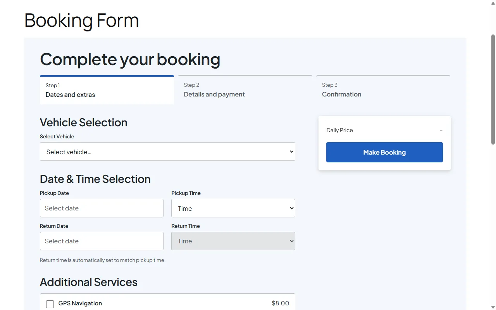

  

:::info Zweck
Diese Seite beschreibt das Modul „Buchungsformular“ als Standardreferenz und deckt sowohl technische als auch betriebliche Aspekte ab.
:::

# 🚗 Buchungsformular

## Inhalt
- Verwendung
- Funktionen
- Hinweise für Entwickler

Das Modul „Buchungsformular“ dient dazu, **Buchungs**prozesse auf der Rentiva-Plattform zu verwalten und Besuchern zu präsentieren.

## Verwendung



Um dieses Modul zu einer beliebigen Seite oder einem Beitrag hinzuzufügen, verwende den folgenden Shortcode:

```shortcode
[rentiva_booking_form vehicle_id=""]
```

Du kannst es auch visuell im Gutenberg-Blockeditor einfügen, indem du **„MHM Rentiva → Buchungsformular“** auswählst.

### Parameter

Die folgenden Parameter stehen im Shortcode zur Verfügung:

| Parameter | Standard | Beschreibung |
| :--- | :--- | :--- |
| `vehicle_id` | `(empty)` | Steuert das **Funktions**-Filterverhalten des Moduls. |
| `start_date` | `(empty)` | Steuert das **allgemeine** Anzeigeverhalten des Moduls. |
| `end_date` | `(empty)` | Steuert das **Workflow**-Verhalten des Moduls. |
| `show_vehicle_selector` | `1` | Steuert das **allgemeine** Anzeigeverhalten des Moduls. |
| `default_days` | `(from settings)` | Steuert das **Workflow**-Verhalten des Moduls. |
| `show_addons` | `1` | Schalter für die Sichtbarkeit. `1` (an) oder `0` (aus). |
| `class` | `(empty)` | Steuert das **allgemeine** Layoutverhalten des Moduls. |
| `redirect_url` | `(empty)` | Steuert das **Workflow**-Verhalten des Moduls. |
| `enable_deposit` | `1` | Schalter für die Sichtbarkeit. `1` (an) oder `0` (aus). |
| `form_title` | `(empty)` | Steuert das **Inhalts**verhalten des Moduls. |
| `show_vehicle_info` | `1` | Schalter für die Sichtbarkeit. `1` (an) oder `0` (aus). |
| `show_time_select` | `1` | Schalter für die Sichtbarkeit. `1` (an) oder `0` (aus). |


## Funktionen

### 📱 Responsives Design
- **Mobil:** Einspaltiges Layout.
- **Tablet (unter 782px):** Optimierte Ansicht.
- **Desktop:** Vollständige Ansicht mit der eingestellten Spaltenanzahl bzw. Breite.

### 🚀 Auf Performance ausgerichtet
- **Intelligentes Caching:** Datenbankabfragen werden vom System optimiert und zwischengespeichert.
- **Bedingtes Laden:** Statische Assets werden nur auf Seiten eingebunden, auf denen das Modul verwendet wird.

## Gut zu wissen

### Mietvertrag
Wenn du **Mietvertrag erforderlich** aktivierst (siehe [Buchungseinstellungen](../../02-core-configuration/booking-settings.md)), zeigt das Formular unterhalb der Zusatzleistungen einen Abschnitt **Mietvertrag** an: ein scrollbares Textfeld und ein Kontrollkästchen **Ich habe den Mietvertrag gelesen und akzeptiere ihn.** Ein Kunde, der es nicht anhakt, sieht „Akzeptiere den Mietvertrag, um deine Buchung abzuschließen.“ und die Buchung wird abgelehnt – im Browser und erneut auf dem Server. Datum und Uhrzeit der Zustimmung sowie die Version des Textes werden mit der Buchung gespeichert.

Wenn du den Text bearbeitest, während ein Kunde die Seite (oder eine zwischengespeicherte Kopie davon) bereits geöffnet hat, wird seine Übermittlung mit „Der Mietvertrag wurde geändert. Lade die Seite neu und lies ihn vor der Buchung durch.“ abgelehnt, und er prüft den neuen Text. Bei Transfer-Buchungen wird der Mietvertrag nicht angezeigt.

### Rückgabe- und Abholdatum
- Liegt die Rückgabe vor der Abholung (oder fällt sie auf denselben Zeitpunkt), zeigt das Formular „Das Rückgabedatum muss nach dem Abholdatum liegen.“ an und lässt **Buchung vornehmen** gesperrt, bis die Daten korrigiert sind.
- Für eine bereits vergangene Abholzeit kann ein Kunde weder einen Preis berechnen lassen noch buchen: „Die Abholzeit ist bereits verstrichen. Bitte wähle ein späteres Datum oder eine spätere Uhrzeit.“ Ein Administrator kann eine vergangene Buchung weiterhin manuell eintragen.

### Wenn das Fahrzeug belegt ist
Ist das gewählte Fahrzeug für diesen Zeitraum bereits gebucht, zeigt das Formular „Das ausgewählte Fahrzeug ist nicht verfügbar, aber wir können ähnliche Fahrzeuge vorschlagen:“ an und listet freie Fahrzeuge für dieselben Daten auf, jeweils mit einer Schaltfläche **Dieses Fahrzeug auswählen**, die die Daten beibehält.

:::info Seiten-Cache nach dem Update auf 6.4.0
Leere deinen Seiten-Cache nach dem Update einmal. Siehe [Performance & Cache](../../06-faq/performance-cache.md).
:::

## Hinweise für Entwickler

- **HTML-Struktur:** Alle Container beginnen mit der Klasse `.mhm-rentiva-booking-form-wrapper`.
- **Anpassung:** CSS-Variablen (`--mhm-color-primary` usw.) werden von der globalen Datei `css-variables.css` geerbt.

## Zusammenfassung des Abschnitts
- Die Seite „Buchungsformular“ wurde an die Standardstruktur der Dokumentation mit einheitlichen Referenzüberschriften angepasst.

## Änderungsprotokoll
| Datum | Version | Hinweis |
|---|---|---|
| 18.11.2026 | 6.4.0 | Mietvertrag, Datumsprüfungen und Vorschläge ähnlicher Fahrzeuge dokumentiert. |
| 11.10.2026 | 6.2.0 | `min_days`, `max_days`, `show_payment_options` und `default_payment` entfernt: 6.2.0 liest sie nicht mehr aus; die globalen Einstellungen gelten weiterhin. |
| 23.04.2026 | 4.27.2 | Englische Übersetzung hinzugefügt. |
| 19.03.2026 | 4.21.0-docs | Seite alphabetisch sortiert und Bildplatzhalter hinzugefügt. |
