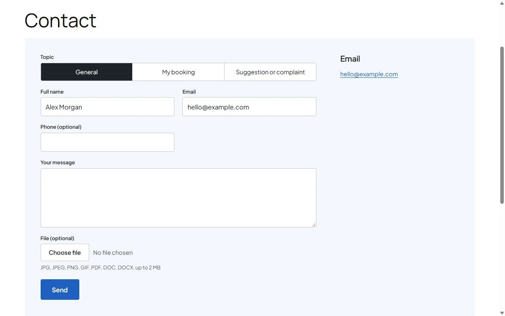

  

:::info Zweck
Diese Seite beschreibt das Modul Kontaktformular als Standardreferenz und deckt sowohl technische als auch betriebliche Aspekte ab.
:::

# 🚗 Kontaktformular

## Inhalt
- Verwendung
- Parameter
- Spamschutz
- Nachrichten lesen
- Hinweise für Entwickler

Mit dem Kontaktformular können Besucher dir über deine Website schreiben. Jede Nachricht wird unter **MHM Rentiva > Kontaktnachrichten** gespeichert und dir per E-Mail zugesendet.

## Verwendung



Um dieses Modul zu einer beliebigen Seite oder einem Beitrag hinzuzufügen, verwende den folgenden Shortcode:

```shortcode
[rentiva_contact]
```

Du kannst es auch visuell im Gutenberg-Blockeditor einfügen, indem du **„MHM Rentiva → Kontaktformular“** auswählst. Der Einrichtungsassistent erstellt eine Kontaktformular-Seite für dich.

### Parameter

| Parameter | Standard | Beschreibung |
| :--- | :--- | :--- |
| `type` | `general` | Formulartyp: `general`, `booking`, `support` oder `feedback`. |
| `show_topic_selector` | `1` | Lässt den Besucher das Thema auswählen. Setze den Wert auf `0`, um `type` festzulegen. |
| `title` | leer | Eigener Titel. |
| `description` | leer | Eigene Beschreibung. |
| `show_phone` | `1` | Telefonfeld anzeigen. |
| `show_company` | `0` | Firmenfeld anzeigen. |
| `show_vehicle_selector` | `0` | Fahrzeugauswahl anzeigen (für Buchungsanfragen). |
| `show_priority` | `0` | Prioritätsauswahl anzeigen (für Supportanfragen). |
| `show_attachment` | `1` | Feld für Dateianhänge anzeigen. |
| `show_booking_id_field` | `0` | Feld für die Buchungsnummer anzeigen. |
| `show_company_info` | `1` | Box mit Kontaktinformationen anzeigen (wird unter **Einstellungen > Allgemein > Marken- und Kontaktinformationen** ausgefüllt). |
| `redirect_url` | leer | Seite, die nach erfolgreichem Absenden geöffnet wird (nur dieselbe Website). |
| `success_message` | leer | Ersetzt den Standard-Erfolgstext. |
| `email_to` | leer | Sendet die Nachrichten dieses Formulars an eine andere Adresse statt an den Standardempfänger. |
| `auto_reply` | `1` | Dem Besucher eine automatische Antwort senden. |
| `theme` | `default` | `default`, `compact` oder `detailed`. |
| `class` | leer | Zusätzliche CSS-Klasse. |

## Spamschutz

Das Formular benötigt keine Einrichtung und zeigt dem Besucher keine Aufgabe zum Lösen an. Eine Nachricht, die nach Spam aussieht, wird mit dem Status **Spam** gespeichert, und es wird weder eine E-Mail noch eine automatische Antwort versendet; der Besucher sieht die normale „Empfangen“-Antwort, sodass ein Bot nichts erfährt. Eine Nachricht wird als Spam behandelt, wenn:

- ein verstecktes Fallenfeld ausgefüllt ist;
- sie zu kurz nach dem Öffnen der Seite gesendet wird;
- sie mit deiner WordPress-Liste unter **Einstellungen > Diskussion > Nicht erlaubte Kommentarschlüssel** übereinstimmt;
- sie mehr Links als erlaubt enthält;
- dieselbe Nachricht in den letzten 10 Minuten von derselben Adresse kam;
- Akismet sie als Spam markiert, sofern es installiert ist und einen Schlüssel hat.

Zwei Grenzwerte werden unter **MHM Rentiva > Einstellungen > Allgemein > Marken- und Kontaktinformationen** festgelegt:

- **Mindestanzahl Sekunden vor dem Absenden** (Standard 3, 0 schaltet die Funktion aus): Ein Formular oder eine neue Bewertung, das bzw. die früher als diese Zeit nach dem Öffnen der Seite gesendet wird, gilt als Bot.
- **Maximale Anzahl Links in einer Nachricht** (Standard 3): Eine Nachricht mit mehr Links landet im Spam. Bei 0 genügt bereits ein einziger Link.

Im selben Abschnitt befindet sich **Einwilligung zum Datenschutzhinweis**: Ist diese Option aktiviert, müssen Absender vor dem Senden ein Kästchen zum Datenschutzhinweis ankreuzen.

## Nachrichten lesen

Öffne **MHM Rentiva > Kontaktnachrichten**. Nachrichten werden als Neu, Gelesen oder Beantwortet aufgelistet; abgefangene Nachrichten findest du unter dem Filter **Spam**, wobei bei jeder Nachricht der Grund angezeigt wird. Ist eine Nachricht kein Spam, verwende **Kein Spam**, und sie wird zu einer normalen neuen Nachricht (dabei wird keine E-Mail versendet). Der Typfilter bietet dieselben Typen wie das Formular; Technischer Support erscheint erst, sobald eine Nachricht dieses Typs vorhanden ist. Eine Nachricht, die ein angemeldeter Kunde zu einer seiner eigenen Buchungen gesendet hat, zeigt die ausgewählte Buchung an.

## Funktionen

### 📱 Responsives Design
- **Mobil:** Einspaltiges Layout.
- **Tablet (unter 782px):** Optimierte Ansicht.
- **Desktop:** Vollständige Ansicht mit der konfigurierten Spaltenanzahl oder Breite.

### 🚀 Leistungsorientiert
- **Bedingtes Laden:** Statische Assets werden nur auf Seiten eingebunden, auf denen das Modul verwendet wird.
- Das Formular enthält ein Sicherheitstoken und wird daher nicht im HTML-Seitencache gespeichert.

## Hinweise für Entwickler

- **HTML-Struktur:** Alle Container beginnen mit der Klasse `.mhm-rentiva-contact-wrapper`.
- **Anpassung:** CSS-Variablen (`--mhm-color-primary` usw.) werden aus der globalen Datei `css-variables.css` übernommen.
- **Filter:** `mhmrentiva_contact_min_seconds`, `mhmrentiva_contact_max_links`, `mhmrentiva_contact_spam_reason` und `mhmrentiva_contact_attachment_max_bytes`.

## Zusammenfassung des Abschnitts
- Das Formular ist ab Werk vor Spam geschützt; prüfe den Filter **Spam**, wenn eine Nachricht zu fehlen scheint.

## Änderungsprotokoll
| Datum | Version | Hinweis |
|---|---|---|
| 18.11.2026 | 6.4.0 | Spamschutz, Option zur Datenschutzeinwilligung, Spamfilter und Buchungsverknüpfung in den Kontaktnachrichten; Parametertabelle vervollständigt. |
| 23.04.2026 | 4.27.2 | Englische Übersetzung hinzugefügt. |
| 19.03.2026 | 4.21.0-docs | Seite alphabetisch sortiert und Bildplatzhalter hinzugefügt. |
