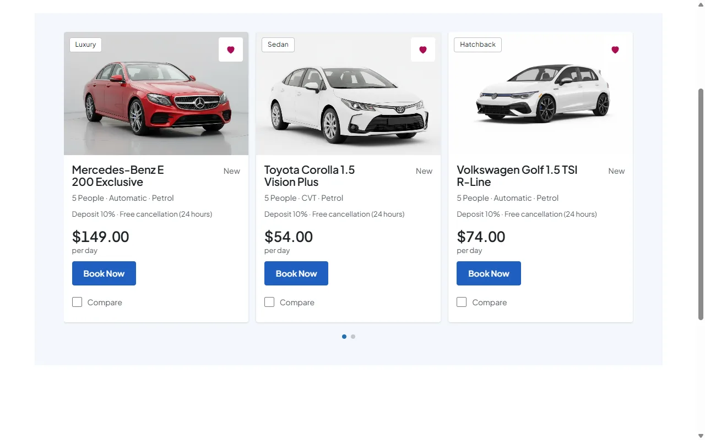

  

:::info Zweck
Diese Seite beschreibt das Modul „Hervorgehobene Fahrzeuge“ als Standardreferenz und deckt sowohl technische als auch betriebliche Aspekte ab.
:::

# 🚗 Hervorgehobene Fahrzeuge

## Inhalt
- Verwendung
- Funktionen
- Hinweise für Entwickler

Das Modul „Hervorgehobene Fahrzeuge“ dient dazu, **Fahrzeug**-Einträge auf der Rentiva-Plattform zu verwalten und Besuchern zu präsentieren.

## Verwendung



Um dieses Modul zu einer beliebigen Seite oder einem Beitrag hinzuzufügen, verwende den folgenden Shortcode:

```shortcode
[rentiva_featured_vehicles limit="6"]
```

Du kannst es auch visuell im Gutenberg-Blockeditor einfügen, indem du **„MHM Rentiva → Featured Vehicles“** auswählst.

### Parameter

Folgende Parameter stehen im Shortcode zur Verfügung:

| Parameter | Standard | Beschreibung |
| :--- | :--- | :--- |
| `ids` | `(empty)` | Kommagetrennte ID-Liste (z. B. `12,15,44`). |
| `category` | `(empty)` | Steuert das **Funktions**-Filterverhalten des Moduls. |
| `limit` | `6` | Maximale Anzahl der anzuzeigenden Elemente. |
| `layout` | `grid` | Steuert das **allgemeine** Layoutverhalten des Moduls. |
| `columns` | `3` | Steuert das **allgemeine** Layoutverhalten des Moduls. |
| `autoplay` | `1` | Sichtbarkeitsschalter. `1` (an) oder `0` (aus). |
| `interval` | `5000` | Steuert das **Layout**-Verhalten des Moduls. |
| `orderby` | `date` | Steuert das **allgemeine** Sortierverhalten des Moduls. |
| `order` | `DESC` | Steuert die **allgemeine** Sortierrichtung des Moduls. |
| `show_price` | `1` | Steuert das **allgemeine** Anzeigeverhalten des Moduls. |
| `show_rating` | `1` | Steuert das **allgemeine** Anzeigeverhalten des Moduls. |
| `show_category` | `1` | Steuert das **allgemeine** Anzeigeverhalten des Moduls. |
| `show_booking_button` | `1` | Zeigt den Buchungsbutton auf jeder Karte an. `1` (an) oder `0` (aus). Ersetzt `show_book_button`, das von 6.2.0 nicht mehr ausgelesen wird. |
| `show_features` | `1` | Steuert das **allgemeine** Anzeigeverhalten des Moduls. |
| `max_features` | `5` | Steuert das **Funktions**-Filterverhalten des Moduls. |
| `show_brand` | `0` | Sichtbarkeitsschalter. `1` (an) oder `0` (aus). |
| `show_compare_button` | `1` | Steuert das **allgemeine** Anzeigeverhalten des Moduls. |
| `show_favorite_button` | `1` | Steuert das **allgemeine** Anzeigeverhalten des Moduls. |
| `image_size` | `medium_large` | Steuert das **Layout**-Verhalten des Moduls. |
| `filter_brands` | `(empty)` | Steuert das **Daten**-Abfrageverhalten des Moduls. |
| `filter_categories` | `(empty)` | Steuert das **Funktions**-Filterverhalten des Moduls. |


## Funktionen

### 📱 Responsives Design
- **Mobil:** Einspaltiges Layout.
- **Tablet (unter 782px):** Optimierte Ansicht.
- **Desktop:** Vollständige Ansicht mit der eingestellten Spaltenanzahl bzw. Breite.

### 🚀 Leistungsorientiert
- **Intelligentes Caching:** Datenbankabfragen werden vom System optimiert und zwischengespeichert.
- **Bedingtes Laden:** Statische Assets werden nur auf Seiten eingebunden, auf denen das Modul verwendet wird.

## Details der Fahrzeugkarte

- **Pflichtleistungen im Gesamtbetrag:** Wird die Seite mit Daten aufgerufen (zum Beispiel aus einer Suche), zeigt jede Karte den Gesamtbetrag für den Zeitraum. Wenn du einige Zusatzleistungen als verpflichtend markiert hast, nennt eine Zeile unter dem Gesamtbetrag diese, zum Beispiel „Inklusive Pflichtleistung: Vollkasko 25“ (mehrere Leistungen werden durch Kommas getrennt mit einem gemeinsamen Betrag aufgeführt; eine Leistung pro Tag wird mit der Anzahl der Tage multipliziert). Eine Karte ohne Daten zeigt den Tagespreis und keine solche Zeile.
- **Anordnung von Preis und Button:** Die Breite der Karte selbst bestimmt das Layout. In einer schmalen Karte (zum Beispiel hervorgehobene Fahrzeuge auf der Startseite oder eine dreispaltige Fahrzeugseite) steht der Preis über dem Button **Buchung vornehmen**; in einer breiten Karte (zum Beispiel Suchergebnisse mit Daten) stehen sie nebeneinander. Karten in derselben Reihe sehen immer gleich aus.
- **Zahlenformat:** Kilometerstand und Hubraum richten sich nach der Sprache der Seite: Englisch „18,500 km“ und „1.6 L“, Türkisch „18.500 km“ und „1,6 L“.

## Hinweise für Entwickler

- **HTML-Struktur:** Alle Container beginnen mit der Klasse `.mhm-rentiva-featured-vehicles-wrapper`.
- **Anpassung:** CSS-Variablen (`--mhm-color-primary` usw.) werden aus der globalen Datei `css-variables.css` übernommen.

## Zusammenfassung des Abschnitts
- Die Seite „Hervorgehobene Fahrzeuge“ wurde an die Standardstruktur der Dokumentation mit einheitlichen Referenzüberschriften angepasst.

## Änderungsprotokoll
| Datum | Version | Hinweis |
|---|---|---|
| 18.11.2026 | 6.4.0 | Details der Fahrzeugkarte: Zeile für Pflichtleistungen, Anordnung von Preis/Button, Zahlenformat. |
| 11.10.2026 | 6.2.0 | `title`, `show_book_button`, `show_availability`, `show_badges` und `price_format` entfernt: 6.2.0 liest sie nicht mehr aus. `show_booking_button` dokumentiert (ersetzt `show_book_button`). |
| 23.04.2026 | 4.27.2 | Englische Übersetzung hinzugefügt. |
| 19.03.2026 | 4.21.0-docs | Seite alphabetisch sortiert und Bildplatzhalter hinzugefügt. |
