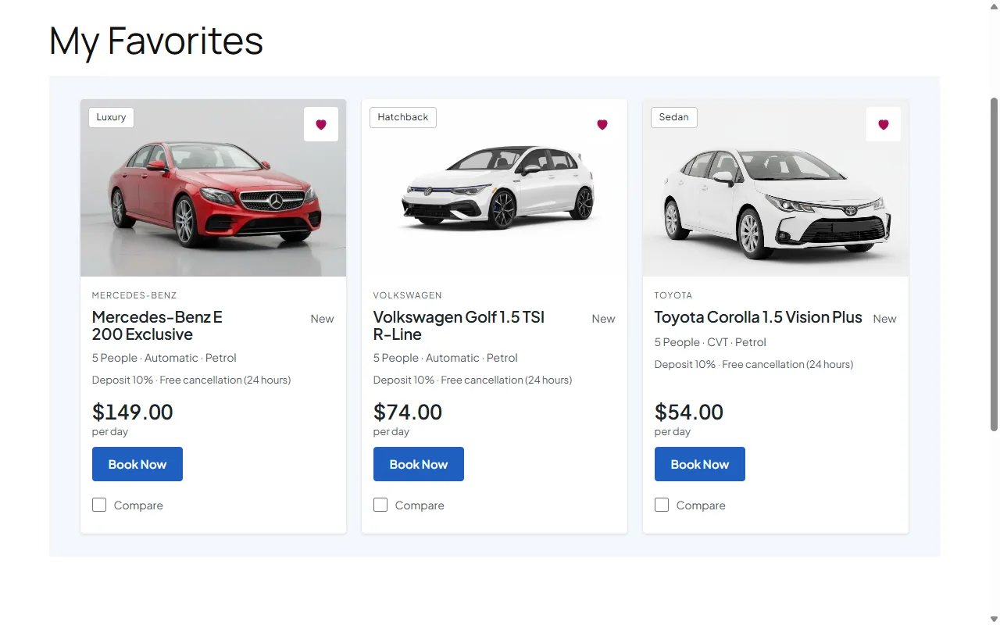

  

:::info Zweck
Diese Seite beschreibt das Modul „Konto-Favoriten“ als Standardreferenz und deckt sowohl technische als auch betriebliche Aspekte ab.
:::

# 🚗 Konto-Favoriten

## Inhalt
- Verwendung
- Funktionen
- Hinweise für Entwickler

Das Modul „Konto-Favoriten“ dient dazu, **Konto**-Favoriten auf der Rentiva-Plattform zu verwalten und Besuchern anzuzeigen.

## Verwendung



Um dieses Modul zu einer beliebigen Seite oder einem Beitrag hinzuzufügen, verwende den folgenden Shortcode:

```shortcode
[rentiva_my_favorites limit="12"]
```

Du kannst es auch visuell im Gutenberg-Blockeditor einfügen, indem du **„MHM Rentiva → Account Favorites“** auswählst.

### Parameter

Die folgenden Parameter stehen im Shortcode zur Verfügung:

| Parameter | Standard | Beschreibung |
| :--- | :--- | :--- |
| `limit` | `12` | Maximale Anzahl der anzuzeigenden Elemente. |
| `columns` | `3` | Steuert das **allgemeine** Layoutverhalten des Moduls. |
| `orderby` | `date` | Steuert das **allgemeine** Sortierverhalten des Moduls. |
| `order` | `DESC` | Steuert die **allgemeine** Sortierrichtung des Moduls. |
| `show_image` | `1` | Sichtbarkeitsschalter. `1` (an) oder `0` (aus). |
| `show_title` | `1` | Steuert das **allgemeine** Anzeigeverhalten des Moduls. |
| `show_price` | `1` | Steuert das **allgemeine** Anzeigeverhalten des Moduls. |
| `show_features` | `1` | Steuert das **allgemeine** Anzeigeverhalten des Moduls. |
| `show_rating` | `1` | Steuert das **allgemeine** Anzeigeverhalten des Moduls. |
| `show_booking_button` | `1` | Steuert das **allgemeine** Anzeigeverhalten des Moduls. |
| `show_favorite_button` | `1` | Steuert das **allgemeine** Anzeigeverhalten des Moduls. |
| `layout` | `grid` | Steuert das **allgemeine** Layoutverhalten des Moduls. |
| `no_results_text` | `__(You have no favorite vehicles yet.` | Steuert das **Inhalts**verhalten des Moduls. |


## Funktionen

### 📱 Responsives Design
- **Mobil:** Einspaltiges Layout.
- **Tablet (unter 782px):** Optimierte Ansicht.
- **Desktop:** Vollständige Ansicht mit der konfigurierten Spaltenanzahl bzw. Breite.

### 🚀 Auf Performance ausgelegt
- **Intelligentes Caching:** Datenbankabfragen werden vom System optimiert und zwischengespeichert.
- **Bedingtes Laden:** Statische Assets werden nur auf Seiten eingebunden, auf denen das Modul verwendet wird.

## Details der Fahrzeugkarte

Favoriten verwenden dieselbe Fahrzeugkarte wie das Fahrzeugraster. Der Preis und der Button **Buchung vornehmen** richten sich nach der Breite der Karte (in einer schmalen Karte untereinander, in einer breiten nebeneinander), und Kilometerstand sowie Hubraum richten sich nach der Sprache der Seite („18,500 km“ auf Englisch, „18.500 km“ auf Türkisch).

## Hinweise für Entwickler

- **HTML-Struktur:** Alle Container beginnen mit der Klasse `.mhm-rentiva-my-favorites-wrapper`.
- **Anpassung:** CSS-Variablen (`--mhm-color-primary` usw.) werden aus der globalen Datei `css-variables.css` übernommen.

## Zusammenfassung des Abschnitts
- Die Seite „Konto-Favoriten“ wurde an die Standardstruktur der Dokumentation mit einheitlichen Referenzüberschriften angepasst.

## Änderungsprotokoll
| Datum | Version | Hinweis |
|---|---|---|
| 18.11.2026 | 6.4.0 | Kartenlayout und Zahlenformat dokumentiert. |
| 11.10.2026 | 6.2.0 | `show_badges`, `show_remove_button` und `show_added_date` entfernt: 6.2.0 liest sie nicht mehr aus. |
| 23.04.2026 | 4.27.2 | Englische Übersetzung hinzugefügt. |
| 19.03.2026 | 4.21.0-docs | Seite alphabetisch sortiert und Bildplatzhalter hinzugefügt. |
