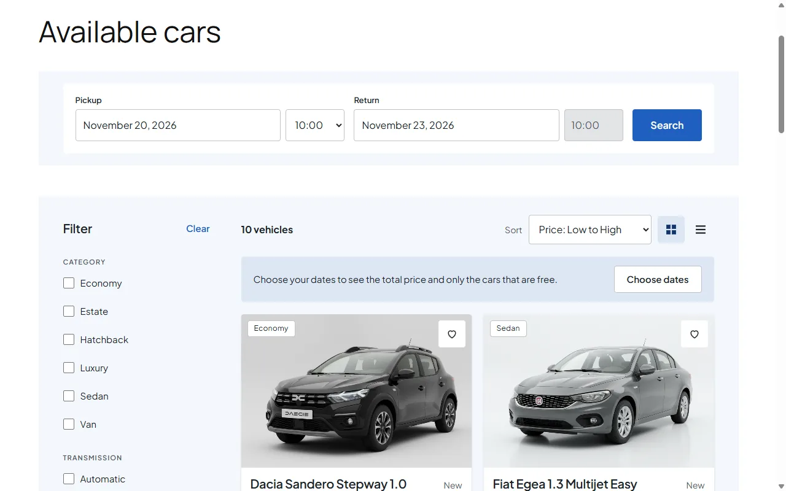

  

:::info Zweck
Diese Seite beschreibt das Modul „Suchergebnisse“ als Standardreferenz und behandelt sowohl technische als auch betriebliche Aspekte.
:::

# 🚗 Suchergebnisse

## Inhalt
- Verwendung
- Funktionen
- Hinweise für Entwickler

Das Modul „Suchergebnisse“ dient dazu, Suchergebnisse für **Fahrzeuge** auf der Rentiva-Plattform zu verwalten und Besuchern anzuzeigen.

## Verwendung



Um dieses Modul zu einer beliebigen Seite oder einem Beitrag hinzuzufügen, verwende den folgenden Shortcode:

```shortcode
[rentiva_search_results layout="grid"]
```

Du kannst es auch visuell im Gutenberg-Blockeditor einfügen, indem du **„MHM Rentiva → Suchergebnisse“** auswählst.

### Parameter

Im Shortcode stehen die folgenden Parameter zur Verfügung:

| Parameter | Standard | Beschreibung |
| :--- | :--- | :--- |
| `layout` | `grid` | Steuert das **allgemeine** Layoutverhalten des Moduls. |
| `show_filters` | `1` | Steuert das **allgemeine** Anzeigeverhalten des Moduls. |
| `results_per_page` | `12` | Steuert das **allgemeine** Anzeigeverhalten des Moduls. |
| `show_pagination` | `1` | Steuert das **allgemeine** Anzeigeverhalten des Moduls. |
| `show_sorting` | `1` | Steuert das **allgemeine** Anzeigeverhalten des Moduls. |
| `show_view_toggle` | `1` | Steuert das **allgemeine** Anzeigeverhalten des Moduls. |
| `show_favorite_button` | `1` | Steuert das **allgemeine** Anzeigeverhalten des Moduls. |
| `show_compare_button` | `1` | Steuert das **allgemeine** Anzeigeverhalten des Moduls. |
| `show_booking_button` | `1` | Steuert das **allgemeine** Anzeigeverhalten des Moduls. |
| `show_price` | `1` | Steuert das **allgemeine** Anzeigeverhalten des Moduls. |
| `show_title` | `1` | Steuert das **allgemeine** Anzeigeverhalten des Moduls. |
| `show_features` | `1` | Steuert das **allgemeine** Anzeigeverhalten des Moduls. |
| `show_rating` | `1` | Steuert das **allgemeine** Anzeigeverhalten des Moduls. |
| `show_badges` | `1` | Steuert das **allgemeine** Anzeigeverhalten des Moduls. |
| `default_sort` | `price_asc` | Die erste Sortierreihenfolge: `relevance`, `price_asc`, `price_desc`, `name_asc`, `name_desc` oder `year_desc`. Ersetzt `order` und `orderby`, die ab 6.2.0 nicht mehr ausgelesen werden. |
| `class` | `(empty)` | Steuert das **allgemeine** Layoutverhalten des Moduls. |


## Funktionen

### 📱 Responsives Design
- **Mobil:** Einspaltiges Layout.
- **Tablet (unter 782px):** Optimierte Ansicht.
- **Desktop:** Vollständige Ansicht mit der eingestellten Spaltenanzahl oder Breite.

### 🚀 Auf Performance ausgelegt
- **Intelligentes Caching:** Datenbankabfragen werden vom System optimiert und zwischengespeichert.
- **Bedingtes Laden:** Statische Assets werden nur auf Seiten eingebunden, auf denen das Modul verwendet wird.

## Seitenleisten-Filter

### Standortfilter (Mehrfachauswahl)

Seit v4.22.1 verwendet der Standortfilter **Checkboxen** statt Radiobuttons. Dadurch können Nutzer mehrere Standorte gleichzeitig auswählen. Ausgewählte Standorte werden mit einer `IN()`-SQL-Klausel abgefragt.

- Einfachauswahl: Wird ein Standort ausgewählt, werden nur Fahrzeuge an diesem Standort aufgelistet.
- Mehrfachauswahl: Werden mehrere Standorte ausgewählt, werden Fahrzeuge angezeigt, die an einem der ausgewählten Standorte verfügbar sind.

## Fahrzeugkarten und Datumsprobleme

- **Pflichtleistungen im Gesamtpreis:** Wird die Seite mit Daten aufgerufen (zum Beispiel aus einer Suche), zeigt jede Karte den Gesamtpreis für den Zeitraum. Wenn du einige Zusatzleistungen als Pflicht markiert hast, nennt eine Zeile unter dem Gesamtpreis diese, zum Beispiel „Pflichtleistung enthalten: Vollkasko 25“ (mehrere Leistungen werden durch Kommas getrennt mit einem gemeinsamen Betrag aufgeführt; eine Leistung pro Tag wird mit der Anzahl der Tage multipliziert). Eine Karte ohne Daten zeigt den Tagespreis und keine solche Zeile.
- **Anordnung von Preis und Button:** Die Breite der Karte selbst bestimmt das Layout. In einer schmalen Karte (zum Beispiel bei hervorgehobenen Fahrzeugen auf der Startseite oder einer dreispaltigen Fahrzeugseite) steht der Preis über dem Button **Buchung vornehmen**; in einer breiten Karte (zum Beispiel bei Suchergebnissen mit Daten) stehen sie nebeneinander. Karten in derselben Reihe sehen immer gleich aus.
- **Zahlenformat:** Kilometerstand und Hubraum richten sich nach der Seitensprache: Englisch „18,500 km“ und „1.6 L“, Türkisch „18.500 km“ und „1,6 L“.

- **Datumsprobleme:** Wenn die Daten nicht gebucht werden können (Rückgabe vor der Abholung oder ein bereits verstrichener Abholzeitpunkt), weist die Seite in einem Hinweis über der Liste darauf hin („Das Rückgabedatum muss nach dem Abholdatum liegen.“ oder „Der Abholzeitpunkt ist bereits verstrichen. Bitte wähle ein späteres Datum oder eine spätere Uhrzeit.“) und zeigt einen Link **Termine ändern**. Es wird nicht „keine Fahrzeuge verfügbar“ angezeigt; bei einem vergangenen Datum werden die Fahrzeuge stattdessen ohne Daten aufgelistet.
- **Mehrere Sprachen:** Auf einer Polylang- oder WPML-Website zeigt die Filter-Seitenleiste Kraftstoff-, Getriebe- und Kategorienamen in der jeweiligen Sprache des Besuchers. Siehe [Häufige Probleme](../../06-faq/common-issues.md).

## Hinweise für Entwickler

- **HTML-Struktur:** Alle Container beginnen mit der Klasse `.mhm-rentiva-search-results-wrapper`.
- **Anpassung:** CSS-Variablen (`--mhm-color-primary` usw.) werden aus der globalen Datei `css-variables.css` übernommen.
- **Verfügbarkeitsabfrage:** `QueryHelper::get_availability_subquery()` ist gegen leere Datumsparameter abgesichert. `strtotime('')` gibt in PHP den Zeitstempel des heutigen Tages statt `false` zurück; dies wurde in v4.22.1 behoben. Wird ein leeres Datum übergeben, ist der Verfügbarkeitsfilter deaktiviert.
- **Standortabfrage:** `QueryHelper::get_location_subquery()` akzeptiert sowohl einzelne (`int`) als auch mehrere (`array`) Standort-IDs.

## Zusammenfassung des Abschnitts
- Die Seite „Suchergebnisse“ wurde an die Standard-Dokumentationsstruktur mit einheitlichen Referenzüberschriften angepasst.

## Änderungsprotokoll
| Datum | Version | Hinweis |
|---|---|---|
| 18.11.2026 | 6.4.0 | Zeile für Pflichtleistungen, Kartenlayout, Hinweis bei Datumsproblemen und mehrsprachige Filternamen. |
| 11.10.2026 | 6.2.0 | Werte für `default_sort` dokumentiert; ersetzt `order` / `orderby`, die ab 6.2.0 nicht mehr ausgelesen werden. |
| 23.04.2026 | 4.27.2 | Englische Übersetzung hinzugefügt. |
| 27.03.2026 | 4.22.1 | Standortfilter von Radiobutton auf Checkbox (Mehrfachauswahl) umgestellt. Verfügbarkeitsabfrage gegen leere Daten abgesichert. Informationen zu QueryHelper in den Hinweisen für Entwickler ergänzt. |
| 19.03.2026 | 4.21.0-docs | Seite alphabetisch geordnet und Bildplatzhalter hinzugefügt. |
