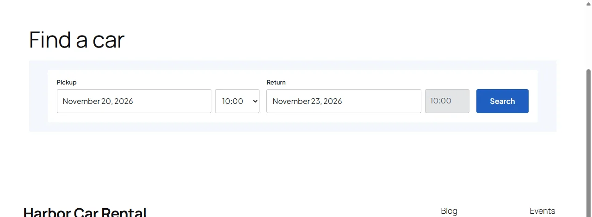

  

:::info Zweck
Diese Seite beschreibt das Modul „Unified Search“ als Standardreferenz und behandelt sowohl technische als auch betriebliche Aspekte.
:::

# 🚗 Einheitliche Suche

## Inhalt
- Verwendung
- Funktionen
- Hinweise für Entwickler

Das Modul „Unified Search“ dient dazu, **Fahrzeug**-Suchvorgänge auf der Rentiva-Plattform zu verwalten und Besuchern bereitzustellen.

## Verwendung



Um dieses Modul zu einer beliebigen Seite oder einem Beitrag hinzuzufügen, verwende den folgenden Shortcode:

```shortcode
[rentiva_unified_search default_tab="default"]
```

Du kannst es auch visuell im Gutenberg-Blockeditor einfügen, indem du **„MHM Rentiva → Unified Search“** auswählst.

### Parameter

Folgende Parameter stehen im Shortcode zur Verfügung:

| Parameter | Standard | Beschreibung |
| :--- | :--- | :--- |
| `default_tab` | `default` | Steuert das **Workflow**-Verhalten des Moduls. |
| `default_tab_alias` | `defaultTab` | Steuert das Verhalten des **Funktions**-Filters des Moduls. |
| `show_rental_tab` | `default` | Sichtbarkeitsschalter. `1` (an) oder `0` (aus). |
| `show_transfer_tab` | `default` | Sichtbarkeitsschalter. `1` (an) oder `0` (aus). |
| `show_location_select` | `default` | Sichtbarkeitsschalter. `1` (an) oder `0` (aus). |
| `show_time_select` | `default` | Sichtbarkeitsschalter. `1` (an) oder `0` (aus). |
| `show_date_picker` | `default` | Sichtbarkeitsschalter. `1` (an) oder `0` (aus). |
| `show_dropoff_location` | `default` | Sichtbarkeitsschalter. `1` (an) oder `0` (aus). |
| `show_pax` | `default` | Sichtbarkeitsschalter. `1` (an) oder `0` (aus). |
| `show_luggage` | `default` | Sichtbarkeitsschalter. `1` (an) oder `0` (aus). |
| `service_type` | `both` | Steuert das Verhalten des **Funktions**-Filters des Moduls. |
| `redirect_page` | `default` | Steuert das **Workflow**-Verhalten des Moduls. |
| `search_layout` | `horizontal` | `horizontal` oder `vertical` (stapelt die Felder). Ersetzt `layout`, das von 6.2.0 nicht mehr ausgelesen wird. |
| `style` | `glass` | Steuert das **Layout**-Verhalten des Moduls. |
| `location_required` | `0` | Legt fest, ob die Auswahl eines Standorts erforderlich ist. `1` (erforderlich) oder `0` (optional). |
| `class` | `(empty)` | Steuert das **allgemeine** Layout-Verhalten des Moduls. |

### Verhalten bei Pflichtfeldern

Welche Felder im Suchformular Pflichtfelder sind, hängt vom Tab ab:

- **Tab „Vermietung“:** Die Pflichtfelder hängen von der globalen Einstellung `mhmrentiva_fields_required` ab. Der Standardwert ist `0` (nicht erforderlich).
- **Tab „Transfer“:** Die Transfer-Felder (`origin_id`, `destination_id`, `date`, `luggage_count`, `luggage_large`) sind immer erforderlich (fest codiert `required`). Da der Transfer ein streckenbasierter Service ist, dürfen diese Felder nicht leer bleiben.

:::tip Verwaltung der Einstellungen
Der Wert `mhmrentiva_fields_required` kann unter **MHM Rentiva > Einstellungen** geändert werden. Diese Einstellung betrifft nur den Tab „Vermietung“; im Tab „Transfer“ sind die Felder immer erforderlich.
:::

## Funktionen

### 📱 Responsives Design
- **Mobil:** Einspaltiges Layout.
- **Tablet (unter 782px):** Optimierte Ansicht.
- **Desktop:** Vollständige Ansicht mit der konfigurierten Spaltenanzahl bzw. Breite.

### 🚀 Leistungsorientiert
- **Intelligentes Caching:** Datenbankabfragen werden vom System optimiert und zwischengespeichert.
- **Bedingtes Laden:** Statische Assets werden nur auf Seiten eingebunden, auf denen das Modul verwendet wird.

## Nicht buchbare Termine

Wählt ein Besucher ein Rückgabedatum vor der Abholung oder eine bereits vergangene Abholzeit, erklärt die Ergebnisseite das Problem und bietet **Termine ändern** an, statt zu melden, dass keine Fahrzeuge verfügbar sind.

## Hinweise für Entwickler

- **HTML-Struktur:** Alle Container beginnen mit der Klasse `.mhm-rentiva-unified-search-wrapper`.
- **Anpassung:** CSS-Variablen (`--mhm-color-primary` usw.) werden aus der globalen Datei `css-variables.css` übernommen.

## Zusammenfassung des Abschnitts
- Die Seite „Unified Search“ wurde mit einheitlichen Referenzüberschriften an die Standardstruktur der Dokumentation angepasst.

## Änderungsprotokoll
| Datum | Version | Hinweis |
|---|---|---|
| 18.11.2026 | 6.4.0 | Hinweis zu nicht buchbaren Terminen hinzugefügt. |
| 11.10.2026 | 6.2.0 | `filter_categories` und `layout` entfernt: 6.2.0 liest sie nicht mehr aus. Verwende `search_layout="vertical"` statt `layout`. |
| 23.04.2026 | 4.27.2 | Englische Übersetzung hinzugefügt. |
| 27.03.2026 | 4.22.1 | Parameter `location_required` hinzugefügt. Verhalten der Pflichtfelder (fields_required) dokumentiert: Bei der Vermietung bedingt, beim Transfer immer erforderlich. |
| 19.03.2026 | 4.21.0-docs | Seite alphabetisch sortiert und Bildplatzhalter hinzugefügt. |
