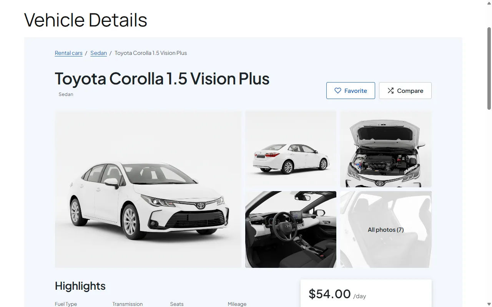

  

:::info Zweck
Diese Seite beschreibt das Modul „Fahrzeugdetails“ als Standardreferenz und deckt sowohl technische als auch betriebliche Aspekte ab.
:::

# 🚗 Fahrzeugdetails

## Inhalt
- Verwendung
- Funktionen
- Hinweise für Entwickler

Das Modul „Fahrzeugdetails“ dient dazu, Detailinformationen zum **Fahrzeug** auf der Rentiva-Plattform zu verwalten und Besuchern anzuzeigen.

## Verwendung



Um dieses Modul zu einer beliebigen Seite oder einem Beitrag hinzuzufügen, verwende den folgenden Shortcode:

```shortcode
[rentiva_vehicle_details vehicle_id=""]
```

Du kannst es auch visuell im Gutenberg-Blockeditor einfügen, indem du **„MHM Rentiva → Fahrzeugdetails“** auswählst.

### Parameter

Die folgenden Parameter stehen im Shortcode zur Verfügung:

| Parameter | Standard | Beschreibung |
| :--- | :--- | :--- |
| `vehicle_id` | `(empty)` | Steuert das **Funktions**-Filterverhalten des Moduls. |
| `show_gallery` | `1` | Sichtbarkeitsschalter. `1` (an) oder `0` (aus). |
| `show_features` | `1` | Steuert das **allgemeine** Anzeigeverhalten des Moduls. |
| `show_pricing` | `1` | Steuert das **allgemeine** Anzeigeverhalten des Moduls. |
| `show_booking` | `1` | Sichtbarkeitsschalter. `1` (an) oder `0` (aus). |
| `show_calendar` | `1` | Sichtbarkeitsschalter. `1` (an) oder `0` (aus). |
| `show_price` | `1` | Steuert das **allgemeine** Anzeigeverhalten des Moduls. |
| `show_booking_button` | `1` | Steuert das **allgemeine** Anzeigeverhalten des Moduls. |
| `show_favorite_button` | `1` | Steuert das **allgemeine** Anzeigeverhalten des Moduls. |
| `show_compare_button` | `1` | Steuert das **allgemeine** Anzeigeverhalten des Moduls. |
| `class` | `(empty)` | Steuert das **allgemeine** Layoutverhalten des Moduls. |


## Funktionen

### 📱 Responsives Design
- **Mobil:** Einspaltiges Layout.
- **Tablet (unter 782px):** Optimierte Ansicht.
- **Desktop:** Vollständige Ansicht mit der eingestellten Spaltenanzahl bzw. Breite.

### 🚀 Leistungsorientiert
- **Intelligentes Caching:** Datenbankabfragen werden vom System optimiert und zwischengespeichert.
- **Bedingtes Laden:** Statische Assets werden nur auf Seiten eingebunden, auf denen das Modul verwendet wird.

## Gut zu wissen

- **Belegte Daten:** Wird die Seite mit Daten geöffnet, die bereits gebucht sind (zum Beispiel aus einer Suche), zeigt die Buchungskarte den Tagespreis statt eines Gesamtbetrags oder einer Anzahlung an und schlägt unter „Alternative Fahrzeuge“ bis zu zwei ähnliche Fahrzeuge vor, die an diesen Daten frei sind. Jedes hat eine Schaltfläche **Dieses Fahrzeug auswählen**, die die Seite des jeweiligen Fahrzeugs mit denselben Daten öffnet. Wenn der Kunde die Daten ändert, werden Verfügbarkeit und Preis sofort aktualisiert.
- **Vergangene oder ungültige Daten:** Eine bereits verstrichene Abholzeit oder eine Rückgabe vor der Abholung wird nicht berechnet; die Karte zeigt den Grund an („Die Abholzeit ist bereits verstrichen. Bitte wähle ein späteres Datum oder eine spätere Uhrzeit.“ / „Das Rückgabedatum muss nach dem Abholdatum liegen.“).
- **Telefon:** Die Verfügbarkeitslegende (Ausgewählt, Teilweise verfügbar, Gebucht, Geschlossen) wird in eine zweite Zeile umbrochen, statt überzulaufen.
- **Zahlenformat:** Kilometerstand und Hubraum richten sich nach der Sprache der Seite („18,500 km“ und „1.6 L“ auf Englisch, „18.500 km“ und „1,6 L“ auf Türkisch).
- **Mehrere Sprachen:** Auf einer Polylang- oder WPML-Website erscheint die Verfügbarkeitsmeldung in der jeweiligen Sprache des Besuchers.

## Hinweise für Entwickler

- **HTML-Struktur:** Alle Container beginnen mit der Klasse `.mhm-rentiva-vehicle-details-wrapper`.
- **Anpassung:** CSS-Variablen (`--mhm-color-primary` usw.) werden aus der globalen Datei `css-variables.css` übernommen.

## Zusammenfassung des Abschnitts
- Die Seite „Fahrzeugdetails“ wurde an die Standard-Dokumentationsstruktur mit einheitlichen Referenzüberschriften angepasst.

## Änderungsprotokoll
| Datum | Version | Hinweis |
|---|---|---|
| 18.11.2026 | 6.4.0 | Vorschläge bei belegten Daten, Datumsmeldungen, Zahlenformat und mehrsprachige Verfügbarkeitsmeldung. |
| 23.04.2026 | 4.27.2 | Englische Übersetzung hinzugefügt. |
| 19.03.2026 | 4.21.0-docs | Seite alphabetisch sortiert und Bildplatzhalter hinzugefügt. |
