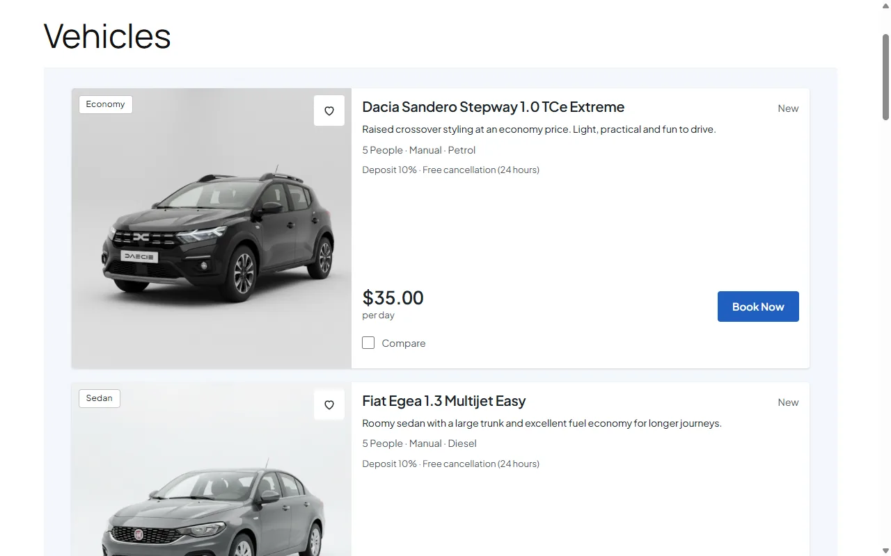

  

:::info Zweck
Diese Seite beschreibt das Modul „Fahrzeugliste“ als Standardreferenz und deckt sowohl technische als auch betriebliche Aspekte ab.
:::

# 🚗 Fahrzeugliste

## Inhalt
- Verwendung
- Funktionen
- Hinweise für Entwickler

Das Modul „Fahrzeugliste“ dient dazu, **Fahrzeug**-Einträge auf der Rentiva-Plattform zu verwalten und Besuchern anzuzeigen.

## Verwendung



Um dieses Modul zu einer beliebigen Seite oder einem Beitrag hinzuzufügen, verwende den folgenden Shortcode:

```shortcode
[rentiva_vehicles_list limit="12"]
```

Du kannst es auch visuell im Gutenberg-Blockeditor einfügen, indem du **„MHM Rentiva → Fahrzeugliste“** auswählst.

### Parameter

Die folgenden Parameter stehen im Shortcode zur Verfügung:

| Parameter | Standard | Beschreibung |
| :--- | :--- | :--- |
| `limit` | `12` | Maximale Anzahl der angezeigten Elemente. |
| `columns` | `1` | Steuert das **allgemeine** Layoutverhalten des Moduls. |
| `orderby` | `title` | Steuert das **allgemeine** Sortierverhalten des Moduls. |
| `order` | `ASC` | Steuert die **allgemeine** Sortierrichtung des Moduls. |
| `category` | `(empty)` | Steuert das Filterverhalten des Moduls nach **Ausstattungsmerkmalen**. |
| `featured` | `0` | Sichtbarkeitsschalter. `1` (an) oder `0` (aus). |
| `show_image` | `1` | Sichtbarkeitsschalter. `1` (an) oder `0` (aus). |
| `show_title` | `1` | Steuert das **allgemeine** Anzeigeverhalten des Moduls. |
| `show_price` | `1` | Steuert das **allgemeine** Anzeigeverhalten des Moduls. |
| `show_features` | `1` | Steuert das **allgemeine** Anzeigeverhalten des Moduls. |
| `show_rating` | `1` | Steuert das **allgemeine** Anzeigeverhalten des Moduls. |
| `show_booking_button` | `1` | Steuert das **allgemeine** Anzeigeverhalten des Moduls. |
| `show_favorite_button` | `1` | Steuert das **allgemeine** Anzeigeverhalten des Moduls. |
| `show_category` | `1` | Steuert das **allgemeine** Anzeigeverhalten des Moduls. |
| `show_brand` | `0` | Sichtbarkeitsschalter. `1` (an) oder `0` (aus). |
| `show_description` | `1` | Sichtbarkeitsschalter. `1` (an) oder `0` (aus). |
| `show_compare_button` | `1` | Steuert das **allgemeine** Anzeigeverhalten des Moduls. |
| `enable_lazy_load` | `1` | Sichtbarkeitsschalter. `1` (an) oder `0` (aus). |
| `enable_ajax_filtering` | `0` | Sichtbarkeitsschalter. `1` (an) oder `0` (aus). |
| `enable_infinite_scroll` | `0` | Sichtbarkeitsschalter. `1` (an) oder `0` (aus). |
| `image_size` | `medium` | Steuert das **Layout**-Verhalten des Moduls. |
| `ids` | `(empty)` | Kommagetrennte ID-Liste (z. B. `12,15,44`). |
| `max_features` | `5` | Steuert das Filterverhalten des Moduls nach **Ausstattungsmerkmalen**. |
| `class` | `(empty)` | Steuert das **allgemeine** Layoutverhalten des Moduls. |
| `custom_css_class` | `(empty)` | Steuert das **Layout**-Verhalten des Moduls. |
| `min_rating` | `(empty)` | Steuert das **Abfrage**-Verhalten des Moduls. |
| `min_reviews` | `(empty)` | Steuert das **Abfrage**-Verhalten des Moduls. |


## Funktionen

### 📱 Responsives Design
- **Mobil:** Einspaltiges Layout.
- **Tablet (unter 782px):** Optimierte Ansicht.
- **Desktop:** Vollständige Ansicht mit der eingestellten Spaltenanzahl oder Breite.

### 🚀 Leistungsorientiert
- **Intelligentes Caching:** Datenbankabfragen werden vom System optimiert und zwischengespeichert.
- **Bedingtes Laden:** Statische Assets werden nur auf Seiten eingebunden, auf denen das Modul verwendet wird.

## Details der Fahrzeugkarte

- **Pflichtleistungen im Gesamtpreis:** Wenn die Seite mit Datumsangaben geöffnet wird (zum Beispiel aus einer Suche), zeigt jede Karte den Gesamtpreis für den Zeitraum. Wenn du einige Zusatzleistungen als Pflicht markiert hast, nennt eine Zeile unter dem Gesamtpreis diese, zum Beispiel „Pflichtleistung enthalten: Vollkasko 25“ (mehrere Leistungen werden durch Kommas getrennt mit einem gemeinsamen Betrag aufgeführt; eine Leistung pro Tag wird mit der Anzahl der Tage multipliziert). Eine Karte ohne Datumsangaben zeigt den Tagespreis und keine solche Zeile.
- **Anordnung von Preis und Button:** Die Breite der Karte selbst bestimmt das Layout. In einer schmalen Karte (zum Beispiel bei hervorgehobenen Fahrzeugen auf der Startseite oder einer dreispaltigen Fahrzeugseite) steht der Preis über dem Button **Buchung vornehmen**; in einer breiten Karte (zum Beispiel bei Suchergebnissen mit Datumsangaben) stehen beide nebeneinander. Karten in derselben Reihe sehen immer gleich aus.
- **Zahlenformat:** Kilometerstand und Hubraum richten sich nach der Sprache der Seite: Englisch „18,500 km“ und „1.6 L“, Türkisch „18.500 km“ und „1,6 L“.

## Hinweise für Entwickler

- **HTML-Struktur:** Alle Container beginnen mit der Klasse `.mhm-rentiva-vehicles-list-wrapper`.
- **Anpassung:** CSS-Variablen (`--mhm-color-primary` usw.) werden aus der globalen Datei `css-variables.css` übernommen.

## Zusammenfassung des Abschnitts
- Die Seite „Fahrzeugliste“ wurde an die Standardstruktur der Dokumentation mit einheitlichen Referenzüberschriften angepasst.

## Änderungsprotokoll
| Datum | Version | Hinweis |
|---|---|---|
| 18.11.2026 | 6.4.0 | Details der Fahrzeugkarte: Zeile für Pflichtleistungen, Anordnung von Preis/Button, Zahlenformat. |
| 11.10.2026 | 6.2.0 | `show_badges`, `show_availability` und `price_format` entfernt: 6.2.0 liest sie nicht mehr aus. |
| 23.04.2026 | 4.27.2 | Englische Übersetzung hinzugefügt. |
| 19.03.2026 | 4.21.0-docs | Seite alphabetisch geordnet und Bildplatzhalter hinzugefügt. |
