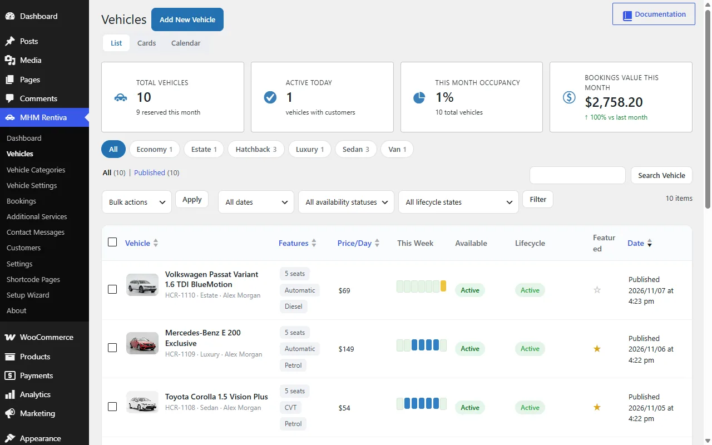

  

Fahrzeuge sind die grundlegenden Bausteine des MHM Rentiva-Systems. **MHM Rentiva > Fahrzeuge** ist der zentrale Verwaltungsbildschirm, auf dem alle Fahrzeuge deiner Flotte aufgelistet, ihre Status verfolgt und neue Fahrzeuge angelegt werden.

---

## Fahrzeugliste und Schnellaktionen

Die Fahrzeugliste bietet dir einen allgemeinen Überblick über deine Flotte. Darüber befinden sich vier Karten: **Fahrzeuge gesamt** (mit der Anzahl der in diesem Monat reservierten Fahrzeuge), **Heute aktiv** (Fahrzeuge, die sich derzeit bei Kunden befinden), **Auslastung diesen Monat** und **Buchungswert diesen Monat** (im Vergleich zum Vormonat). Der Umschalter **Liste / Karten / Kalender** ändert die Darstellung der Flotte.

- **Listenspalten:** Fahrzeug (Foto, Titel, darunter Kennzeichen, Kategorie und der Name des Autors), Standort (nur wenn die Standort-Funktion aktiv ist), Merkmale (Sitze, Getriebe und Kraftstoff), Preis/Tag, Diese Woche (eine 7-Tage-Verfügbarkeitsleiste), Verfügbar, Lebenszyklus und Hervorgehoben.
- **QuickEdit:** Verwende die Zeilenaktion **„QuickEdit“**, um Kennzeichen, Preis, Verfügbarkeit und die anderen Schnellfelder zu aktualisieren, ohne die Seite neu zu laden.
- **Filtern:** Filtere Fahrzeuge nach Kategorie, Verfügbarkeitsstatus, Standort (wenn aktiv) oder Lebenszyklus-Status (Aktiv, Pausiert, Abgelaufen, Zurückgezogen oder Archiv).
- **Buchungswert:** Die Karte „Buchungswert diesen Monat“ summiert den Preis der bestätigten, laufenden und abgeschlossenen Buchungen dieses Monats. Es handelt sich um den gebuchten Betrag, nicht um eingenommenes Geld; stornierte oder erstattete Buchungen werden nicht mitgezählt.

---

## Fahrzeuge hinzufügen und bearbeiten

Der Bearbeitungsbildschirm eines Fahrzeugs enthält einen Link **„← Fahrzeuge“** und den Fahrzeugnamen unter dem Seitentitel. Die Hauptspalte enthält von oben nach unten die Boxen **Fahrzeuggalerie**, **Fahrzeugdetails** und **Blockierte Termine**. Die Seitenspalte enthält **Veröffentlichen**, **Hervorgehoben**, **Fahrzeugkategorien** und **Fahrzeugbild**, gefolgt von den (Pro-)Boxen **Lebenszyklus-Status**, **Fahrzeugdokumente** und **Transfer-Einstellungen (VIP-Modul)**. Wenn du die Boxen in deine eigene Reihenfolge ziehst, bleibt diese Reihenfolge erhalten.

Beim Hinzufügen eines neuen Fahrzeugs oder beim Bearbeiten eines bestehenden wird empfohlen, alle Felder in der Box **„Fahrzeugdetails“** auszufüllen. Welche Felder dort erscheinen, legst du unter **Fahrzeugeinstellungen** fest (siehe [Fahrzeugeinstellungen](./vehicle-settings.md)).

Du kannst Details, Merkmale und Ausstattung in die gewünschte Reihenfolge ziehen; die Reihenfolge wird mit **Aktualisieren** gespeichert, und zwar für jedes Fahrzeug separat.

### 1. Technische Grunddaten
- **Verfügbarkeit:** Ob das Fahrzeug im System aktiv oder passiv ist.
- **Standort:** Zu welchem Büro oder welcher Anbieterregion das Fahrzeug gehört.
- **Preis und Finanzen:** Tägliche Mietgebühr und Anzahlungsbetrag.
- **Identifikationsdaten:** Kennzeichen, Marke, Modell und Baujahr.
- **Kapazität:** Anzahl der Sitze und Anzahl der Türen.
- **Mechanik:** Getriebeart (Automatik/Schaltgetriebe), Kraftstoffart (Benzin, Diesel, Hybrid, Elektro, LPG, CNG oder Wasserstoff) und Hubraum.

---

## Merkmale und Ausstattung

Für jedes Fahrzeug stehen zwei Haupt-Checklisten zur Verfügung, die Kunden zum Filtern nutzen können:

### Fahrzeugmerkmale
Klimaanlage, Servolenkung, ABS, Airbags, Zentralverriegelung, elektrische Fensterheber/Spiegel, Nebelscheinwerfer, Tempomat, Bluetooth, Navigation, Schiebedach und Sitzheizung.

### Fahrzeugausstattung
Ersatzreifen, Verbandskasten, Feuerlöscher, Warndreieck, Fahrzeugabdeckung, Kindersitz, GPS-Tracker, Dashcam und Reinigungsset.

---

## Transfer-Einstellungen (VIP-Modul) (Pro)

> Die Box „Transfer-Einstellungen“ ist Teil von **MHM Rentiva Pro**.

MHM Rentiva Pro unterstützt zusätzlich zur normalen Vermietung auch VIP-Transfer-Dienste. Konfiguriere die folgenden Einstellungen in der Box **Transfer-Einstellungen (VIP-Modul)** in der Seitenspalte des Fahrzeugs:

- **Art der Leistung:** Nur Vermietung, Nur Transfer oder Beides.
- **Passagierkapazität:** Maximale Anzahl an Passagieren.
- **Gepäckgrenzen:** Maximale Kapazität für großes und kleines Gepäck (für die punktbasierte Berechnung).
- **Preismultiplikator:** Weise bestimmten Fahrzeugen einen eigenen Preismultiplikator zu (z. B. 1,2x für VIP-Fahrzeuge).

---

## Galerie- und Bildverwaltung

- **Fahrzeugbild:** Das Hauptprofilfoto, das in den Suchergebnissen angezeigt wird.
- **Fahrzeuggalerie:** Bis zu 10 Fotos, die Innen- und Außendetails des Fahrzeugs zeigen.

---

## Fahrzeugdokumente (v4.23.1)

Das Formular zum Einreichen von Fahrzeugen (`[rentiva_vehicle_submit]`) enthält zwei Felder zum Hochladen von Dokumenten:

### Fahrzeugschein
Der Anbieter lädt den Fahrzeugschein über das Formular hoch. Er wird vom Administrator zur Verifizierung geprüft.

### Versicherungsnachweis des Fahrzeugs
Hinzugefügt in v4.23.1. Dieser Abschnitt, der direkt nach dem Fahrzeugschein erscheint, ermöglicht das Hochladen des Versicherungsnachweises des Fahrzeugs.

- **Meta-Key:** `_mhmrentiva_vehicle_insurance_doc`
- **Verarbeitung:** Wird vom AJAX-Handler `VehicleSubmit.php` verarbeitet und in der WordPress-Mediathek gespeichert.
- **Verlauf:** Dieses Feld befand sich früher im Bewerbungsformular für Anbieter. In v4.23.1 wurde es in das Formular zum Einreichen von Fahrzeugen verschoben, damit pro Fahrzeug ein Versicherungsnachweis hochgeladen werden kann.

---

## Blockierte Termine

Verwende die Box **Blockierte Termine**, um ein Fahrzeug an bestimmten Tagen zu sperren. Klicke auf Tage im Kalender, um sie zu sperren; gesperrte Tage werden rot dargestellt, und ein Badge zeigt **„N Tage blockiert“** an. Jeder gesperrte Tag wird unter **Blockierte Tage** mit einer optionalen Notiz (**„Notiz hinzufügen … (optional)“**) aufgeführt, und **Alle entfernen** gibt alle Tage dieses Fahrzeugs wieder frei. Die Änderungen werden mit **Aktualisieren** gespeichert.

- **Auf alle Fahrzeuge anwenden:** ersetzt die gesperrten Tage aller anderen veröffentlichten Fahrzeuge durch die gesperrten Tage dieses Fahrzeugs.
- **Von allen Fahrzeugen entfernen:** entfernt nur die gesperrten Tage dieses Fahrzeugs bei allen anderen veröffentlichten Fahrzeugen; deren übrige gesperrte Tage bleiben erhalten.

(Pro) Tage, die durch eine Stornierungsstrafe eines Anbieters gesperrt wurden, werden von diesen Buttons weder kopiert noch entfernt; sie werden nach 30 Tagen automatisch aufgehoben. Termine, die du manuell gesperrt hast, bleiben erhalten.

Beide Buttons wirken auf die gesamte Flotte und stehen daher nur Benutzern zur Verfügung, die Inhalte anderer bearbeiten dürfen (Administratoren).

Notizen dürfen beliebige Zeichen enthalten, einschließlich türkischer Buchstaben und Anführungszeichen.

### Schnell sperren über den monatlichen Reservierungskalender (v4.61.0)

Du kannst einen einzelnen Tag auch direkt im **Monatlichen Reservierungskalender** sperren oder freigeben, ohne das Fahrzeug zur Bearbeitung zu öffnen:

- **Klicke auf einen leeren Tag**, um ihn für neue Reservierungen zu sperren.
- **Klicke auf einen gesperrten Tag**, um ihn wieder freizugeben.

Tage, an denen bereits eine Buchung besteht, bleiben unverändert – sie behalten ihr Reservierungs-Popup und können auf diese Weise nicht gesperrt werden.

---

## Fahrzeug in den Papierkorb legen und wiederherstellen

Du kannst ein Fahrzeug über die Zeilenaktion, die Mehrfachaktion oder den Bearbeitungsbildschirm in den Papierkorb verschieben. Ein Fahrzeug mit noch anstehenden Buchungen wird dabei nicht abgelehnt: Die Buchungen behalten das Fahrzeug, aber Kunden können die Seite des Fahrzeugs nicht mehr aufrufen. Wenn du ein solches Fahrzeug in den Papierkorb legst, zeigt die Fahrzeugliste daher eine Warnung mit der Anzahl der anstehenden Buchungen, einem Link zu jeder Buchung (die ersten fünf, danach „und N weitere“) und einem Button **Fahrzeug wiederherstellen** an.

**Fahrzeug wiederherstellen** (bzw. **Wiederherstellen** im Papierkorb) stellt das Fahrzeug mit dem Status wieder her, den es vor dem Verschieben in den Papierkorb hatte – ein veröffentlichtes Fahrzeug ist also wieder veröffentlicht, und seine Seite lässt sich wieder aufrufen.

---

## AssetManager-Admin-Bereich

Seit v4.22.0 läuft `AssetManager::enqueue_admin_assets()` nur auf Rentiva-Adminseiten (abgesichert durch `is_rentiva_admin_page()`). In v4.22.1 wurden außerdem die Post-Types `mhmrentiva_vehicle`, `mhmrentiva_booking` und `mhmrentiva_addon` zu dieser Absicherung hinzugefügt. Dadurch werden die CSS-Variablen (`css-variables.css`) korrekt geladen und die KPI-Karten nicht beschädigt.

---

### Zusammenfassung des Abschnitts
- Fahrzeuge werden als **CPT** (Custom Post Type) gespeichert, und jedes Fahrzeug hat einen eigenen Satz an Meta-Feldern.
- Arbeite mit **QuickEdit** schneller im Tagesgeschäft.
- Verwalte Transfer-Kapazitäten und Preismultiplikatoren mit dem **VIP-Modul**.
- **Blockierte Termine** verwendet für die Funktion „Auf alle anwenden“ jetzt einen JSON-Payload.

### Änderungsprotokoll
| Datum | Version | Hinweis |
| :--- | :--- | :--- |
| 18.11.2026 | 6.4.0 | Karten und Spalten der Fahrzeugliste, das neue Layout des Fahrzeug-Bearbeitungsbildschirms, die Box „Blockierte Termine“ sowie die Papierkorb-Warnung mit „Fahrzeug wiederherstellen“ dokumentiert. |
| 29.06.2026 | 4.61.0 | Spalte „Hinzugefügt von“ (Anbieter/Betreiber) in der Fahrzeugliste und schnelles Sperren von Tagen über den monatlichen Reservierungskalender dokumentiert. |
| 23.04.2026 | 4.27.2 | Dokumentation mit der aktuellen Plugin-Version synchronisiert. |
| 28.03.2026 | 4.23.1 | Abschnitt zum Hochladen des Versicherungsnachweises hinzugefügt. Städteauswahl auf SelectWoo umgestellt. |
| 27.03.2026 | 4.23.0 | Korrektur von „Auf alle anwenden“ bei „Blockierte Termine“ und AssetManager-Admin-Absicherung dokumentiert. |
| 19.03.2026 | 4.21.2 | Fahrzeugdetails, Merkmale, Ausstattung und VIP-Modul anhand der tatsächlichen Oberfläche aktualisiert. |
| 26.02.2026 | 4.21.0 | Erste Version erstellt. |
