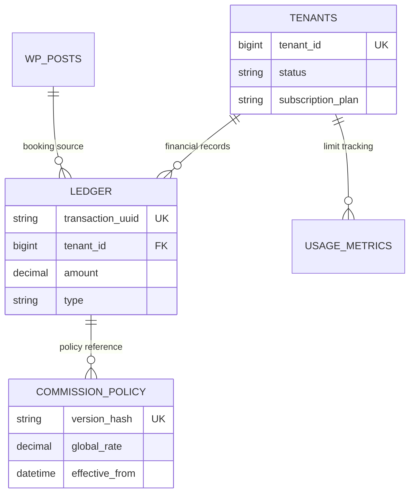

  

:::info Zweck
Diese Seite erläutert die hybride Datenbankarchitektur von MHM Rentiva (WP Core + native individuelle Tabellen), die Tabellenschemata und die Standards zur Datenintegrität.
:::

# 🗄️ Datenbankarchitektur

MHM Rentiva nutzt eine hybride Architektur, die das **WordPress-Post/User-Meta**-System mit **hochperformanten individuellen Tabellen** kombiniert, um die Anforderungen an Performance und Datenintegrität zu erfüllen.

## 📊 Individuelle Tabellen

Für Finanzdatensätze und SaaS-Vorgänge umgeht das Plugin die Standardtabellen von WordPress und nutzt direkt die folgenden SQL-optimierten Tabellen:

| Tabellenname | Zweck | Kritische Spalten |
| :--- | :--- | :--- |
| `wp_mhmrentiva_ledger` | Unveränderliches Finanzjournal. | `transaction_uuid`, `amount`, `tenant_id` |
| `wp_mhmrentiva_commission_policy` | Versionierte Datensätze der Provisionsrichtlinien. | `version_hash`, `global_rate`, `effective_from` |
| `wp_mhmrentiva_tenants` | Mandantendatensätze und Kontingente. | `tenant_id`, `status`, `subscription_plan` |
| `wp_mhmrentiva_usage_metrics` | SaaS-Nutzungslimits und Metrikerfassung. | `metric_type`, `metric_value`, `cycle_start` |

### 🏗️ Grundsätze der Datenintegrität
- **Unveränderlichkeit:** Datensätze in der Tabelle `ledger` werden niemals aktualisiert oder gelöscht. Korrekturen erfolgen durch das Anlegen einer neuen Gegenbuchung.
- **Mandantenisolierung:** Die Spalte `tenant_id` ist in allen individuellen Tabellen vorhanden. Die Daten sind auf Datenbankebene logisch voneinander getrennt.
- **Prüfpfad:** Provisionsrichtlinien werden mit einem `version_hash` (SHA-256) signiert, um einen finanziellen Prüfpfad zu erstellen.

---

## 🔑 Standards für Meta-Schlüssel

Betriebsdaten (Fahrzeugeigenschaften, Kundenpräferenzen usw.) werden in den Meta-Tabellen von WordPress gespeichert und folgen dieser Präfix-Konvention:
`_mhmrentiva_[category]_[field_name]`

| Kategorie | Beispielschlüssel |
| :--- | :--- |
| **Fahrzeug** | `_mhmrentiva_vehicle_license_plate` |
| **Buchung** | `_mhmrentiva_booking_payout_status` |
| **Kunde** | `_mhmrentiva_customer_banned` |

---

## 🧬 Tabellenbeziehungen (ER)

---

## Transfer-Tabellen

Das Transfer-Modul nutzt zwei individuelle Tabellen:

| Tabellenname | Zweck | Kritische Spalten |
| :--- | :--- | :--- |
| `wp_rentiva_transfer_locations` | Transferpunkte (Flughafen, Hotel, Hafen usw.) | `name`, `type`, `city`, `lat`, `lng` |
| `wp_rentiva_transfer_routes` | Routendefinitionen zwischen zwei Standorten | `origin_id`, `destination_id`, `base_price`, `min_price`, `max_price`, `distance_km` |

### Änderungen in DatabaseMigrator v3.4.0
- Spalte `city` VARCHAR(100) zur Tabelle `rentiva_transfer_locations` hinzugefügt (für die städtebasierte Filterung im Anbieter-Marktplatz).
- Spalte `max_price` DECIMAL(10,2) zur Tabelle `rentiva_transfer_routes` hinzugefügt (Obergrenze für die Preisspanne der Anbieter).

---

## Wartung und Entwicklung

- **Migrationen:** Das Datenbankschema ist unter `src/Core/Database/Migrations/` definiert. Die Klassen `MultiTenantMigration` und `LedgerMigration` führen mithilfe von `dbDelta` sichere Aktualisierungen durch.
- **Prüfwerkzeug:** Die Konsistenz der Datenbank kann mit den CLI-Befehlen `wp mhm-rentiva audit` überprüft werden.

---

## Tabellenliste des Deinstallationsprogramms

Die folgenden Tabellen werden bei der Deinstallation des Plugins entfernt:

| Tabelle | Kategorie |
|---|---|
| `wp_mhmrentiva_ledger` | Finanzen |
| `wp_mhmrentiva_commission_policy` | Finanzen |
| `wp_mhmrentiva_tenants` | SaaS |
| `wp_mhmrentiva_usage_metrics` | SaaS |
| `wp_mhmrentiva_notification_queue` | System |
| `wp_mhmrentiva_payment_log` | System |
| `wp_mhmrentiva_sessions` | System |
| `wp_rentiva_transfer_locations` | Transfer |
| `wp_rentiva_transfer_routes` | Transfer |

Veraltete `mhm_rentiva_transfer_*`-Tabellen werden ebenfalls entfernt, sofern vorhanden.

## Zusammenfassung des Abschnitts
- Kritische Finanzdaten werden per SQL in **individuellen Tabellen** verwaltet.
- Die Transfer-Tabellen unterstützen den Anbieter-Marktplatz mit den Spalten `city` und `max_price`.
- Flexible Daten werden im **WP-Meta**-System gespeichert.
- Die **Mandantenfähigkeit** gibt den Parameter `tenant_id` durch alle Schichten weiter.
- Das Deinstallationsprogramm entfernt 9 individuelle Tabellen sowie alle veralteten Tabellen.

## Änderungsprotokoll
| Datum | Version | Hinweis |
|---|---|---|
| 23.04.2026 | 4.27.2 | Englische Übersetzung hinzugefügt. |
| 27.03.2026 | 4.23.0 | Transfer-Tabellen (Standorte + Routen), Änderungen in DatabaseMigrator v3.4.0 (city, max_price) und Tabellenliste des Deinstallationsprogramms (9 Tabellen + veraltete Tabellen) hinzugefügt. |
| 19.03.2026 | 4.23.0 | Datenbankdokumentation für die SaaS- und Finanzarchitektur neu geschrieben. |
