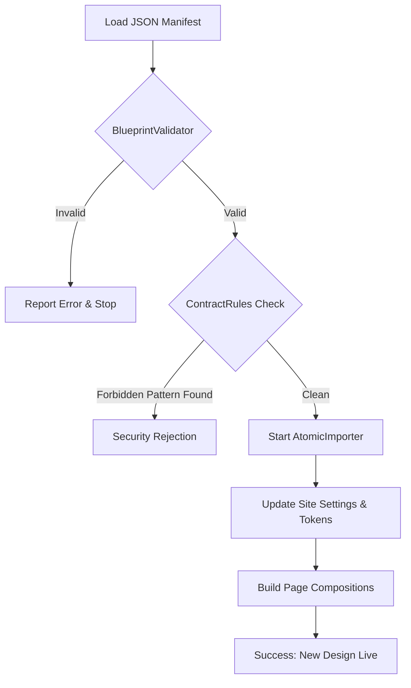

  

:::info Zweck
Diese Seite erklärt, wie Design-Manifeste (JSON) in das System importiert werden, welche Validierungsstufen es gibt und wie der atomare Importprozess abläuft.
:::

# 🏗️ Layout-Import-Pipeline

MHM Rentiva verwendet ein themeunabhängiges Designsystem. Dieses System arbeitet, indem es JSON-Dateien verarbeitet, die **Layout-Manifeste** genannt werden. Der Prozess durchläuft eine mehrstufige Validierungs-Pipeline, damit ein fehlerhaftes Design das System nicht beschädigen kann.

## 🛠️ Kernkomponenten

Das System wird über die folgenden Klassen koordiniert:

| Komponente | Rolle |
| :--- | :--- |
| `BlueprintValidator` | Prüft die strukturelle und logische Korrektheit der Manifest-JSON-Datei. |
| `AtomicImporter` | Wendet Änderungen innerhalb einer einzigen Datenbanktransaktion an. |
| `ContractRules` | Legt strenge Regeln fest, die das Design einhalten muss (z. B. das Verbot von Tailwind-Klassen). |
| `LayoutRollbackService` | Setzt das System im Fehlerfall auf das vorherige stabile Design zurück. |

---

## 🔄 Ablauf (Pipeline-Reihenfolge)

Wenn eine Designdatei hochgeladen wird, durchläuft sie die folgenden Stufen:

---

## 🛡️ Sicherheits- und Validierungsregeln

### 1. Strukturelle Validierung (`BlueprintValidator`)
Die folgenden Root-Schlüssel müssen in der Manifest-Datei vorhanden sein:
- `version`: Manifest-Version (v1.x wird unterstützt).
- `pages`: Seitendesigns und Slug-Definitionen.
- `tokens`: Variablen für Farben, Typografie und Abstände.
- `components`: Liste der verwendeten Komponenten.

### 2. Scan nach verbotenen Mustern (`ContractRules`)
Die aktuelle Architektur verbietet die Verwendung von **Tailwind CSS**-Klassen oder umfangreichen Inline-Style-Definitionen in Manifesten, um CSS-Lecks und Performance-Probleme zu vermeiden. Wenn `BlueprintValidator` diese Muster erkennt, bricht es den Vorgang automatisch ab.

---

## 💾 Atomare Operationen und Rollback

Der Importvorgang arbeitet nach dem **atomaren** Prinzip (alles oder nichts).
- Tritt bei Seite 9 eines Manifests mit 10 Seiten ein Fehler auf, werden auch die 8 bereits aktualisierten Seiten auf ihren vorherigen Zustand zurückgesetzt.
- Dies wird von `LayoutRollbackService` gesteuert und bewahrt die Integrität der Datenbank.

---

## 🛠️ Hinweise für Entwickler

- **Manifest-Version:** Derzeit werden nur Designs auf Basis von `1.0.0` unterstützt.
- **Cache:** Nach einem erfolgreichen Import wird der Object Cache der Plattform (Redis/Memcached) automatisch geleert.
- **Log:** Alle Importvorgänge können über `AdvancedLogger` im Kanal `layout_ingestion` nachverfolgt werden.

## Zusammenfassung des Abschnitts
- Die Pipeline arbeitet nach dem Prinzip **„Erst validieren, dann schreiben“**.
- Designfehler werden beim Import erkannt, nicht erst zur Laufzeit.
- Bei einem Fehler kehrt das System automatisch zur vorherigen stabilen Version zurück.

## Änderungsprotokoll
| Datum | Version | Hinweis |
|---|---|---|
| 23.04.2026 | 4.27.2 | Englische Übersetzung hinzugefügt. |
| 19.03.2026 | 4.21.2 | Seite an die v1.9-Architektur und die aktuellen Validator-Regeln angepasst. |
