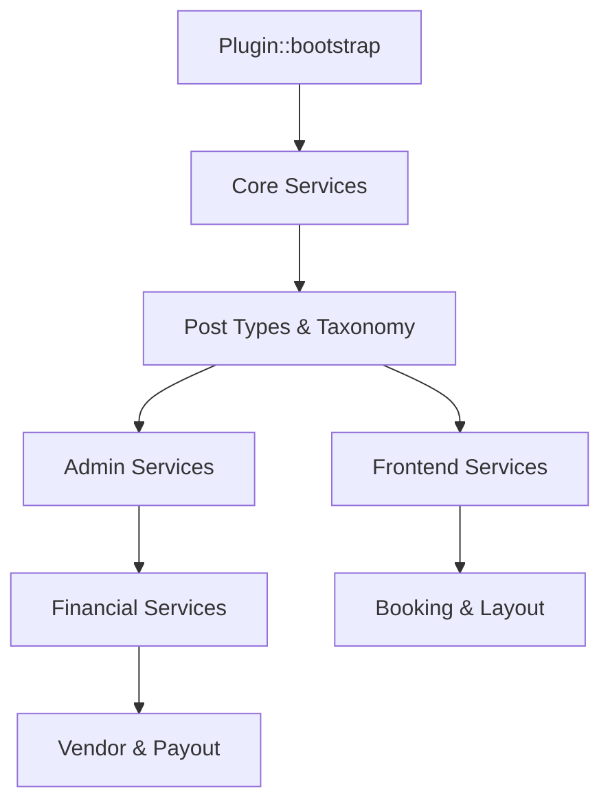

  

:::info Zweck
Dieses Dokument fasst die Verantwortungsgrenzen, den Datenfluss und die Abhängigkeitshierarchie zwischen den Services der Module von Rentiva als technische Referenz zusammen.
:::

# 🧱 Modularchitektur von MHM Rentiva

MHM Rentiva ist nach dem Ansatz **„Modularer Monolith“** aufgebaut. Jedes Modul ist als eigenständiger „Service“ oder „Manager“ konzipiert, das gesamte System wird jedoch über die Root-Klasse `MHMRentiva\Plugin` (Service Graph) koordiniert.

## 🚀 Service Graph und Bootstrap

Aus Gründen der Performance und Vorhersagbarkeit folgt das Plugin einer strikten Initialisierungsreihenfolge der Services. Die Methode `Plugin::initialize_services()` verwaltet diese Hierarchie.

### 📊 Hierarchie zwischen den Modulen

---

## 📂 Modulkategorien und Zuständigkeiten

| Kategorie | Namespace | Zuständigkeit |
| :--- | :--- | :--- |
| **Core** | `MHMRentiva\Core` | Datenbank (Migrations), Sicherheit (Governance), Lizenzprüfungen (Licensing). |
| **Admin** | `MHMRentiva\Admin` | Admin-Oberflächen, Listentabellen (ListTables), Einstellungsseiten. |
| **Financial** | `MHMRentiva\Core\Financial` | Ledger-Einträge, Provisionsrichtlinien, Auszahlungsverwaltung. |
| **Layout** | `MHMRentiva\Layout` | Manifest-Validierung, atomarer Import, Verwaltung von Design-Tokens. |
| **API** | `MHMRentiva\Api` | REST-API-Endpunkte, Webhook-Handler und JSON-Ausgaben. |

---

## 🛠️ Zentrale Architekturprinzipien

### 1. Singleton und statischer Zugriff
Core-Klassen (z. B. `Plugin.php`) verwenden das Singleton-Muster. Dadurch wird verhindert, dass Services pro Anfrage mehr als einmal initialisiert werden, was die Speichernutzung optimiert.

### 2. Dependency Injection (lose Kopplung)
Die Module sind nicht eng miteinander gekoppelt. Ob ein Modul ausgeführt wird oder nicht, wird dynamisch über `is_class_available()`-Prüfungen und die Lizenzschranke bestimmt.

### 3. Ereignisgesteuerte Architektur (Hooks)
Das System ist über das `add_action`- und `add_filter`-Ökosystem von WordPress erweiterbar. Wenn zum Beispiel eine Buchung abgeschlossen wird (`mhmrentiva_booking_completed`), werden die Finanzbuchungen (Ledger) automatisch ausgelöst.

---

## 🛡️ Sicherheit und Compliance

Jedes Modul muss diese Sicherheitsprotokolle einhalten:
- **Bereinigung (Sanitization):** Alle Eingaben werden über Hilfsklassen wie `Sanitizer::text_field_safe()` bereinigt.
- **Nonce & Berechtigung:** `current_user_can()`- und `check_admin_referer()`-Prüfungen sind bei jeder Anfrage im Admin-Bereich Standard.
- **Audit-Logs:** Jeder kritische finanzielle oder architektonische Vorgang wird über `AdvancedLogger` protokolliert.

## Zusammenfassung des Abschnitts
- Das System basiert auf einem servicebasierten Graphen (Service Graph).
- Das Modul **Core** bildet das unterste Fundament, das das gesamte System trägt.
- Die Kommunikation zwischen den Modulen erfolgt über Hooks (ereignisgesteuert) oder zentrale Service-Aufrufe.

## Änderungsprotokoll
| Datum | Version | Hinweis |
|---|---|---|
| 23.04.2026 | 4.27.2 | Dokumentation ins Englische übersetzt. |
| 19.03.2026 | 4.21.2 | Seite um Details zu Service Graph und modularem Monolithen ergänzt. |
