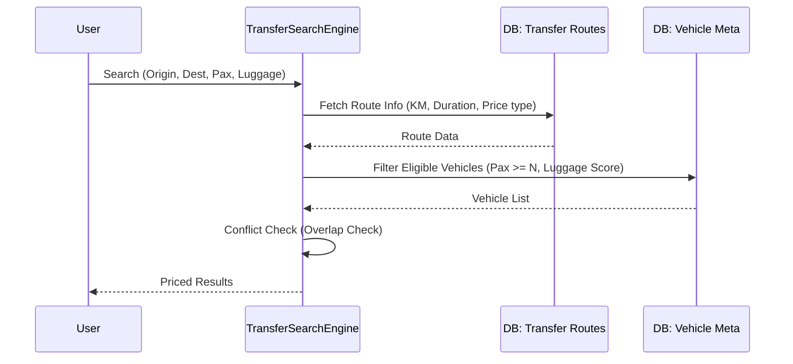

  

:::info Pro-Funktion
Diese Seite dokumentiert eine Funktion des Add-ons **MHM Rentiva Pro**. Sie ist nicht Teil der kostenlosen
Lite-Edition auf WordPress.org und erfordert, dass Pro zusätzlich zu Lite installiert ist, sowie eine gültige Lizenz.
Die vollständige Aufteilung findest du unter [Editionen – Lite vs. Pro](/docs/), oder hol dir Pro unter [wpalemi.com/rentiva](https://wpalemi.com/rentiva/).
:::

:::info Zweck
Diese Seite erklärt die Kernklassen des Transfer-Moduls, die routenbasierte Preis-Engine und den Datenfluss.
:::

# 🚕 MHM Rentiva Transfer-Architektur

Das Transfer-Modul ist ein Subsystem, das auf einer „Zeit + Ort“-basierten Such- und Preis-Engine aufbaut und vom Fahrzeugvermietungsmodul getrennt ist.

## 🛠️ Kernkomponenten (Klassenübersicht)

Transfer-Vorgänge werden von den folgenden Kernklassen verwaltet:

| Klasse | Rolle |
| :--- | :--- |
| `TransferSearchEngine` | Die Haupt-Engine, die routenbasierte Fahrzeugfilterung, Anbieterpreise und Gepäckpunktzahl-Filter anwendet. |
| `LocationProvider` | Standortabfragedienst; unterstützt stadtbasierte Filterung über die Methode `get_by_city()`. |
| `TransferShortcodes` | Verwaltet Suchformulare und Ergebnislisten im Frontend (`[rentiva_transfer_search]`). |
| `TransferCartIntegration` | Integriert den ausgewählten Transfer-Service in den WooCommerce-Warenkorb. |
| `TransferBookingHandler` | Speichert Transfer-Details (Routen-ID, KM, Dauer) nach dem Checkout in der Buchung. |

---

## 🔄 Datenfluss und Suchprozess

Wenn eine Transfer-Suche durchgeführt wird, folgt das System diesen Schritten:

---

## 🔍 Preis- und Kapazitätslogik

### 1. Routenbasierte Preisgestaltung
Transfer-Preise werden anhand der Regeln in der Tabelle `wp_rentiva_transfer_routes` berechnet:
- **Festpreis:** Der definierte `base_price` wird direkt angewendet.
- **Entfernung:** Es wird die Formel `base_price * distance_km` verwendet. Optional kann eine Untergrenze `min_price` hinzugefügt werden.
- **Multiplikator:** Ein fahrzeugspezifischer Multiplikator (`_mhmrentiva_transfer_price_multiplier`) ermöglicht automatische Preisaufschläge für VIP-Fahrzeuge.

### 1a. Anbieterpreise (v4.23.0)
In der Integration des Anbieter-Marktplatzes funktioniert die Preisgestaltung wie folgt:
- Der Admin legt für jede Route einen Bereich aus `min_price` und `max_price` fest.
- Der Anbieter weist seinem eigenen Fahrzeug einen routenbasierten Preis zu (JSON-Meta `_mhmrentiva_transfer_route_prices`).
- `TransferSearchEngine` prüft zuerst den Anbieterpreis; fehlt dieser, wird auf den `base_price` der Route zurückgegriffen.
- Liegt der Anbieterpreis außerhalb des vom Admin festgelegten Bereichs, gilt er als ungültig.

### 2. Berechnung der Gepäckpunktzahl
Das System berechnet die Gepäckkapazität eines Fahrzeugs mit folgendem mathematischen Modell:
`Luggage Score = (Small Bags * 1) + (Large Bags * 2.5)`
Überschreitet bei der Suche die angefragte Gepäckmenge den Wert `_mhmrentiva_transfer_max_luggage_score` des Fahrzeugs, wird das Fahrzeug ausgeschlossen.

---

## 🛡️ Wichtige Hooks und Actions

- **AJAX-Suche:** `mhmrentiva_transfer_search_results` – Gibt die Suchergebnisse zurück.
- **In den Warenkorb:** `rentiva_transfer_add_to_cart` – Sendet die Transfer-Daten mit Meta-Feldern an den Warenkorb.
- **Bestellerstellung:** `woocommerce_checkout_create_order_line_item` – Wandelt die Routendetails in einen dauerhaften Bestelldatensatz um.

## Stadtbasierte Filterung (v4.23.0)

Die Methode `LocationProvider::get_by_city()` fragt Standorte in der Stadt ab, in der der Anbieter registriert ist. Diese Struktur wird wie folgt verwendet:

1. Im Formular zum Einreichen von Anbieterfahrzeugen (`VehicleSubmit.php`) werden nur Standorte und Routen in der eigenen Stadt des Anbieters angezeigt.
2. Im Admin-Bereich zeigt `VehicleTransferMetaBox` die Stadtinformationen des Anbieters an.

---

## Fahrzeug-Meta-Struktur

Das Transfer-Modul verwendet die folgenden Meta-Schlüssel:

| Meta-Schlüssel | Typ | Beschreibung |
|---|---|---|
| `_mhmrentiva_transfer_locations` | array | Standort-IDs, die das Fahrzeug bedient |
| `_mhmrentiva_transfer_routes` | array | Routen-IDs, die das Fahrzeug bedient |
| `_mhmrentiva_transfer_route_prices` | JSON | Routenbasierte Anbieterpreise (`{route_id: price}`) |

---

## Zusammenfassung des Abschnitts
- Das Transfer-Modul ist eine eigenständige, routenbasierte Preis-Engine.
- **Anbieterpreise:** Der Admin legt den Bereich `min_price`/`max_price` fest; Anbieter legen ihren eigenen Preis fest.
- **Stadtfilterung:** Mit `LocationProvider::get_by_city()` sehen Anbieter nur Routen in ihrer eigenen Stadt.
- **Gepäckpunktzahl** und **Passagierkapazität** sind die wichtigsten Datenfilter.
- Buchungskonflikte werden über `Util::has_overlap()` geprüft, das mit dem Kernsystem geteilt wird.

## Änderungsprotokoll
| Datum | Version | Hinweis |
|---|---|---|
| 23.04.2026 | 4.27.2 | Englische Übersetzung hinzugefügt. |
| 27.03.2026 | 4.23.0 | Anbieterpreise, `LocationProvider::get_by_city()`, stadtbasierte Filterung und Fahrzeug-Meta-Schlüssel hinzugefügt. |
| 19.03.2026 | 4.21.2 | Transfer-Architektur um Details zur routenbasierten Preisgestaltung und Gepäckverwaltung aktualisiert. |
