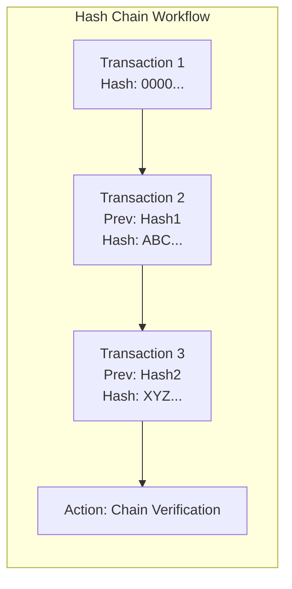

  

:::info Pro-Funktion
Diese Seite dokumentiert eine Funktion des Add-ons **MHM Rentiva Pro**. Sie ist nicht Teil der kostenlosen
Lite-Edition auf WordPress.org und erfordert, dass Pro zusätzlich zu Lite installiert ist, sowie eine gültige Lizenz.
Die vollständige Aufteilung findest du unter [Editionen – Lite vs. Pro](/docs/), Pro erhältst du unter [wpalemi.com/rentiva](https://wpalemi.com/rentiva/).
:::

:::info Zweck
Diese Seite beschreibt die Modelle für digitale Signatur, Schlüsselverwaltung und Datenintegrität (Hash-Chain), die in finanziellen Audit-Prozessen verwendet werden.
:::

# 🔐 Audit-Kryptografie und Integrität

MHM Rentiva verwendet kryptografische Standards auf militärischem Niveau, um zu garantieren, dass Finanzberichte und exportierte Daten nicht manipuliert wurden.

## 🛠️ Technische Komponenten

Die kryptografische Sicherheitsschicht wird von den folgenden Diensten verwaltet:

| Dienst | Aufgabe | Algorithmus |
| :--- | :--- | :--- |
| `ExportSignatureService` | Signiert exportierte Dateien (CSV/JSON). | **Ed25519** (Detached) |
| `KeyPairManager` | Verwaltet die Schlüsselpaare des Systems (privat/öffentlich). | Basiert auf **Libsodium** |
| `HashChainService` | Verknüpft Finanzereignisse zu einer verketteten Abfolge. | **SHA-256** |

---

## ⚡ Hash-Chain-Modell (Integritätskette)

Jede Finanztransaktion wird unter Bezugnahme auf den Hash-Wert der vorherigen Transaktion gespeichert. Diese Struktur stellt sicher, dass die Kette bricht und die Manipulation sofort erkannt wird, sobald auch nur eine einzige Zeile in der Datenbank verändert wird.

---

## 🖋️ Ablauf der Dateisignierung (Ed25519)

Wenn ein Audit-Bericht (Audit Export) erstellt wird, läuft folgender Prozess ab:

1.  **Vorbereitung der Nutzdaten:** Die Daten werden als CSV oder JSON erzeugt.
2.  **Erzeugung des Hex-Hashs:** Der Dateiinhalt wird mit `SHA-256` gehasht (Datei-Hash).
3.  **Digitale Signatur:** Dieser Digest wird mit dem aktiven `Private Key` des Systems und dem Ed25519-Algorithmus signiert.
4.  **Verifizierungsschlüssel:** Der `Key ID` wird zusammen mit der Signatur in das Exportpaket aufgenommen.

:::important Verifizierung
Für die Überprüfung der Signatur wird nur der `Public Key` benötigt. So kann der Prüfer, der die Daten erhält, nachweisen, dass sie aus dem MHM Rentiva-System stammen und bei der Übertragung nicht verändert wurden.
:::

---

## 🔑 Schlüsselverwaltung

- **Stille Erzeugung:** Schlüssel werden bei der Erstinstallation oder manuell über `KeyPairManager` erzeugt.
- **Sichere Speicherung:** Der `Private Key` wird verschlüsselt in der Datenbank gespeichert oder kann aus einer Umgebungsvariable (Env) gelesen werden.
- **Rotation:** Eine regelmäßige Schlüsselrotation wird empfohlen; alte Schlüssel sollten in den Status „Archiv“ verschoben werden.

## Zusammenfassung des Abschnitts
- Das System verwendet **Ed25519** für leistungsstarkes, sicheres Signieren.
- Die **Hash-Chain**-Struktur macht eine nachträgliche Manipulation der Daten unmöglich.
- Finanzdaten sind sowohl in der Datenbank als auch beim Export geschützt.

## Änderungsprotokoll
| Datum | Version | Hinweis |
|---|---|---|
| 23.04.2026 | 4.27.2 | Englische Übersetzung hinzugefügt. |
| 19.03.2026 | 4.21.2 | Seite mit Details zur Ed25519- und Hash-Chain-Architektur aktualisiert. |
