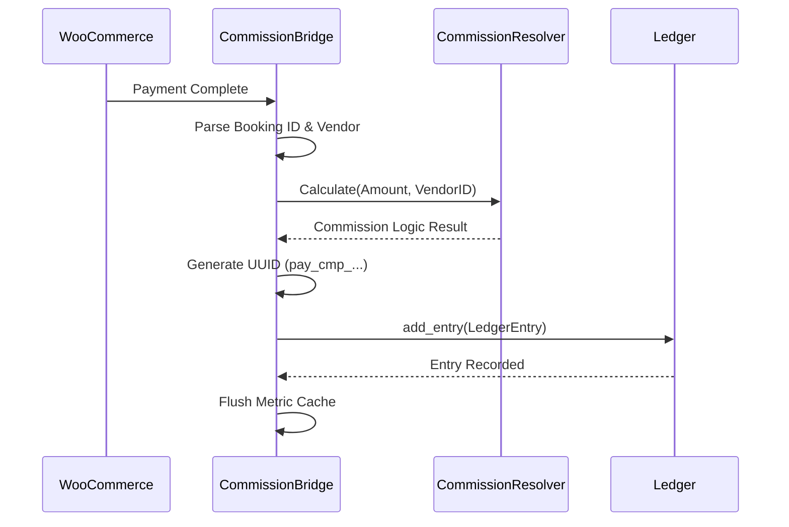

  

:::info Pro-Funktion
Diese Seite dokumentiert eine Funktion des Add-ons **MHM Rentiva Pro**. Sie ist nicht Teil der kostenlosen
Lite-Edition auf WordPress.org und erfordert, dass Pro zusätzlich zu Lite installiert ist, sowie eine gültige Lizenz.
Die vollständige Aufteilung findest du unter [Editionen — Lite vs. Pro](/docs/), Pro erhältst du unter [wpalemi.com/rentiva](https://wpalemi.com/rentiva/).
:::

:::info Zweck
Diese Seite beschreibt, wie die Komponente `CommissionBridge` den Datenfluss zwischen WooCommerce-Bestellungen und dem Finanzkern von Rentiva (Ledger) steuert.
:::

# 🌉 WooCommerce-Provisionsbrücke

`CommissionBridge` fungiert als Übersetzer zwischen der E-Commerce-Ebene (WooCommerce) und der Ebene der Finanzbuchung (Ledger). Sie lauscht auf Bestellereignisse und wandelt sie in finanzielle Ledger-Einträge um.

## 🚀 Auslösende Ereignisse (Hooks)

Die Brücke arbeitet, indem sie die folgenden kritischen WooCommerce-Ereignisse überwacht:

- **`woocommerce_payment_complete`**: Wird ausgelöst, wenn die Zahlung erfolgreich abgeschlossen wurde.
- **`woocommerce_order_status_completed`**: Wird ausgelöst, wenn eine Bestellung manuell oder automatisch als abgeschlossen markiert wird.
- **`woocommerce_order_refunded`**: Wird verwendet, um bei Erstattungsvorgängen einen Storno-Eintrag zu erstellen.

---

## 🔄 Ablauf der Finanzverarbeitung

Wenn eine Bestellung bezahlt wird, durchläuft das System folgende Schritte:

---

## 🛠️ Wichtige Funktionen und Logik

### 1. Idempotenz (Vermeidung doppelter Einträge)
Für jeden Eintrag wird eine eindeutige **UUID** im Format `pay_cmp_{order_id}_{booking_id}` erzeugt. Selbst wenn WooCommerce dasselbe Ereignis mehrfach auslöst, verhindert die Klasse `Ledger` dank dieser UUID doppelte Einträge.

### 2. Behandlung von Erstattungen und Storno-Einträgen
Wenn eine Bestellung erstattet wird (`on_order_refunded`), löscht das System den bestehenden Eintrag nicht, sondern erstellt einen neuen **Erstattungseintrag** mit umgekehrten Werten (`-` Saldo). Dies ist für die Integrität des finanziellen Prüfpfads erforderlich.

### 3. Synchronisierung der Kennzahlen
Sobald ein Finanzeintrag in den Ledger geschrieben wird, wird `MetricCacheManager` ausgelöst, damit die anbieter- und fahrzeugbezogenen Leistungsdiagramme sofort aktualisiert werden.

---

## 📋 Datenzuordnung

| WooCommerce-Feld | Ledger-Feld | Beschreibung |
| :--- | :--- | :--- |
| `order_id` | `parent_id` / `source_id` | Gibt an, dass die Quelle eine WC-Bestellung ist. |
| `order_total` | `gross_amount` | Gesamtbetrag einschließlich Steuern. |
| `currency` | `currency` | Währung der Bestellung. |
| `_mhmrentiva_booking_id` | `reference_id` | Rentiva-Buchungsreferenz. |

## Zusammenfassung des Abschnitts
- `CommissionBridge` wandelt WooCommerce-Ereignisse in finanzielle Transaktionsstrukturen um.
- Die **Storno-Logik** verhindert das Löschen von Daten.
- Die Verwendung von **UUIDs** gewährleistet Datenkonsistenz (Idempotenz).

## Änderungsprotokoll
| Datum | Version | Hinweis |
|---|---|---|
| 23.04.2026 | 4.27.2 | Englische Übersetzung hinzugefügt. |
| 19.03.2026 | 4.21.2 | Seite um Erstattungslogik und Details zur Idempotenz ergänzt. |
