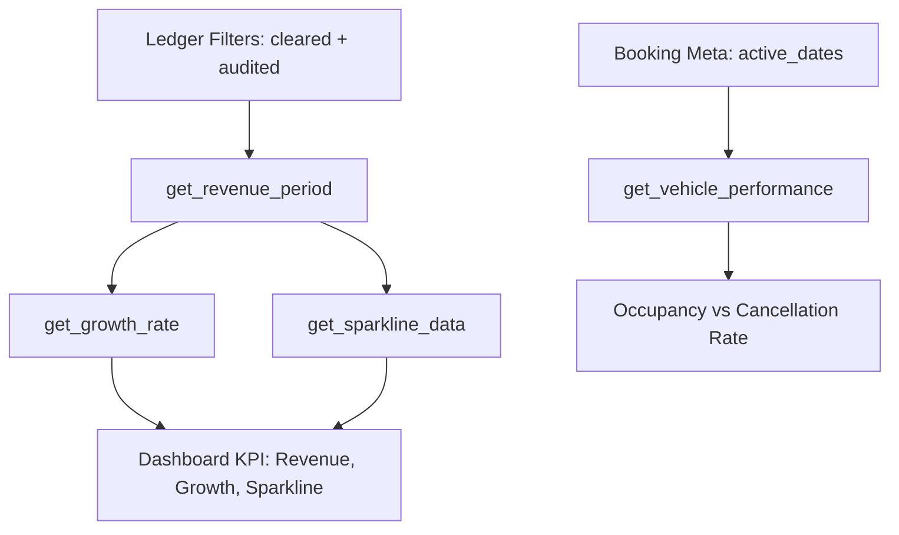

  

:::info Pro-Funktion
Diese Seite dokumentiert eine Funktion des Add-ons **MHM Rentiva Pro**. Sie ist nicht Teil der kostenlosen
Lite-Edition auf WordPress.org und erfordert, dass Pro zusätzlich zu Lite installiert ist, sowie eine gültige Lizenz.
Die vollständige Aufteilung findest du unter [Editionen — Lite vs. Pro](/docs/), Pro erhältst du unter [wpalemi.com/rentiva](https://wpalemi.com/rentiva/).
:::

:::info Zweck
Diese Seite beschreibt die Logik und die Datenquellen hinter den finanziellen und operativen Metriken, die von `AnalyticsService` berechnet werden.
:::

# 📊 Analyse- und Finanzmetriken

MHM Rentiva verwendet ausschließlich die Tabelle `mhmrentiva_ledger` als **Single Source of Truth** (einzige verlässliche Datenquelle) für Finanzmetriken. Operative Metriken (Auslastungsquote usw.) werden mit Buchungsmetadaten kombiniert.

## 🛠️ Grundprinzipien

- **Nur das Ledger zählt:** Umsatzberechnungen stammen immer aus der Ledger-Tabelle, niemals aus der Bestelltabelle.
- **UTC-Normalisierung:** Alle Zeitfenster werden auf UTC normalisiert und verwenden sich nicht überschneidende Zeiträume.
- **Bereinigung:** Metrikabfragen enthalten immer die Filter `status = 'cleared'` und `type IN ('commission_credit', 'commission_refund')`.

---

## 📈 Finanzmetriken

Wichtige Finanzkennzahlen, die das System berechnet:

| Metrik | Methode | Berechnungslogik |
| :--- | :--- | :--- |
| **Nettoumsatz** | `get_revenue_period()` | `Sum(commission_credit) - Sum(commission_refund)` |
| **Wachstumsrate** | `get_growth_rate()` | `((Current - Previous) / Previous) * 100` |
| **Durchschn. Buchung** | `get_avg_booking_value()` | `Total_Net / Unique_Booking_Count` |
| **Sparkline** | `get_sparkline_data()` | Auf Tagesbasis normalisierte Saldenpunkte. |

---

## ⚙️ Operative Metriken

Metriken für die fahrzeug- und anbieterbezogene Leistungsanalyse:

### 1. Auslastungsquote
Wird über die Methode `get_vehicle_performance()` berechnet. Das Verhältnis der Tage, an denen das Fahrzeug gebucht war (completed, confirmed, in_progress), zur Gesamtzahl der Tage im angegebenen Zeitfenster.

### 2. Stornoquote
Der prozentuale Anteil der Datensätze mit `cancelled` und `refunded` an allen Buchungen.

---

## 🔄 Ablauf der Metrikberechnung

---

## 🛡️ Wichtige Details

- **NULL vs. 0.0:** Wenn in `get_growth_rate()` für den vorherigen Zeitraum keine Daten vorliegen, gibt das Ergebnis `NULL` zurück. So wird in der Finanzberichterstattung zwischen „keine Veränderung“ (0.0) und „unzureichende Daten“ (NULL) unterschieden.
- **Sparkline-Auffüllung:** Für Tage ohne Aktivität fügt das System automatisch `0.0` ein, damit die Diagramme keine Lücken haben.
- **Bankensichere Rundung:** Für alle Prozentberechnungen wird `PHP_ROUND_HALF_UP` verwendet, um die finanzielle Genauigkeit zu wahren.

## Zusammenfassung des Abschnitts
- Finanzmetriken stützen sich ausschließlich auf die **Ledger**-Tabelle.
- Operative Metriken sind durch Zeitfenster-Prüfungen (Window Intersection) abgesichert.
- Alle Daten werden UTC-basiert und konsistent (idempotent) erzeugt.

## Änderungsprotokoll
| Datum | Version | Hinweis |
|---|---|---|
| 23.04.2026 | 4.27.2 | Englische Übersetzung hinzugefügt. |
| 19.03.2026 | 4.21.2 | Seite aktualisiert, um die Ledger- und operative Metrikstruktur des AnalyticsService abzubilden. |
