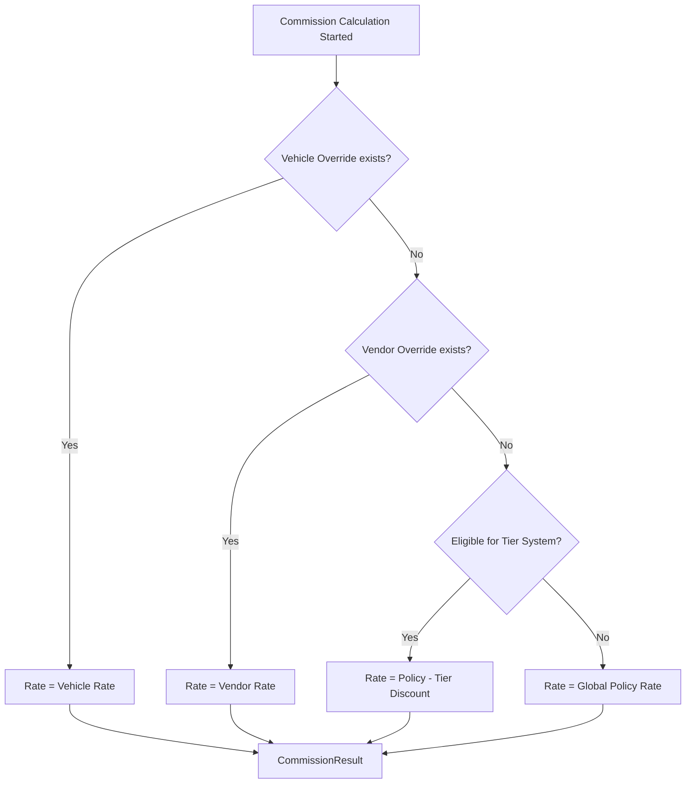

  

:::info Pro-Funktion
Diese Seite dokumentiert eine Funktion des Add-ons **MHM Rentiva Pro**. Sie ist nicht Teil der kostenlosen
Lite-Edition auf WordPress.org und erfordert, dass Pro zusätzlich zu Lite installiert ist und eine gültige Lizenz vorliegt.
Die vollständige Aufteilung findest du unter [Editionen – Lite vs. Pro](/docs/), Pro erhältst du unter [wpalemi.com/rentiva](https://wpalemi.com/rentiva/).
:::

:::info Zweck
Diese Seite dokumentiert, wie Provisionssätze ermittelt werden, wie versionierte Richtlinien (`PolicyService`) funktionieren und wie Leistungsanreize (`TierService`) arbeiten.
:::

# 🏷️ Provisions- und Richtliniensystem

MHM Rentiva verwendet zur Berechnung der Provisionssätze eine mehrstufige, deterministische **Hierarchie zur Provisionsermittlung**. Das System unterstützt sowohl globale Regeln als auch individuelle kommerzielle Vereinbarungen (Overrides).

## 📉 Ermittlungshierarchie

`CommissionResolver` bestimmt anhand einer 4-stufigen Prüfung – von der spezifischsten zur allgemeinsten –, welcher Satz für eine Buchung gilt:

| Priorität | Ebene | Meta / Quelle | Beschreibung |
| :--- | :--- | :--- | :--- |
| **1** | **Fahrzeug-Override** | `_mhmrentiva_vendor_commission_rate` | Wenn dem Fahrzeug selbst ein bestimmter Satz zugewiesen ist, hat dieser die höchste Priorität. |
| **2** | **Anbieter-Override** | `_mhmrentiva_vendor_commission_rate` | Wenn dem Anbieter-Benutzer ein bestimmter Satz zugewiesen ist (und kein Fahrzeug-Override existiert), gilt dieser. |
| **3** | **Stufen-Anreiz** | `TierService` | Basierend auf der Leistung des Anbieters in den letzten 30 Tagen wird zusätzlich zum globalen Satz ein Rabatt angewendet. |
| **4** | **Globale Richtlinie** | `CommissionPolicy` | Wenn keine andere Regel zutrifft, wird der Standardsatz der Systemrichtlinie angewendet. |

---

## 🌳 Entscheidungsbaum zur Provisionsermittlung

---

## 📜 Versionierung und Prüfung von Richtlinien

Jeder Provisionssatz im System ist an ein **Richtlinien**-Objekt (`MHMRentiva\Core\Financial\CommissionPolicy`) gebunden.

- **Unveränderlicher Hash:** Bei jeder Änderung einer Richtlinie wird ein eindeutiger `version_hash` erzeugt.
- **Prüfungskonsistenz:** Beim Anlegen eines Ledger-Eintrags werden die aktuellen Werte `policy_id` und `version_hash` im Datensatz festgehalten. So lässt sich auch noch 2 Jahre später nachweisen, warum ein bestimmter Satz verwendet wurde.
- **Zeitbasierte Ermittlung:** Die Methode `PolicyService::resolve_policy_at()` findet die Richtlinie, die zum Zeitpunkt der Erstellung der Buchung aktiv war. Rückwirkende Aktualisierungen beschädigen alte Datensätze nicht.

---

## 💎 Stufen- und Anreizsystem

`TierService` ist darauf ausgelegt, Anbieter mit hohem Verkaufsvolumen zu belohnen:
- **Prüfung des Nettoumsatzes:** Berechnet aus dem Saldo „Abgerechnet“ der letzten 30 Tage.
- **Zusätzlicher Rabatt:** Der Stufenrabatt gilt nur zusätzlich zur **Globalen Richtlinie**. Anbieter mit einer individuellen Vereinbarung (Override) können nicht zusätzlich vom Stufenrabatt profitieren.

## Zusammenfassung des Abschnitts
- Ermittlungsreihenfolge: **Fahrzeug > Anbieter > Stufe > Global**.
- Alle Entscheidungen basieren auf **deterministischen** und **versionierten** Richtlinien.
- Bei jeder Berechnung wird für die Finanzprüfung ein Schnappschuss der Richtlinie erfasst.

## Änderungsprotokoll
| Datum | Version | Hinweis |
|---|---|---|
| 23.04.2026 | 4.27.2 | Englische Übersetzung hinzugefügt. |
| 19.03.2026 | 4.21.2 | Seite mit 4-stufiger Hierarchie und Logik des Stufenrabatts aktualisiert. |
