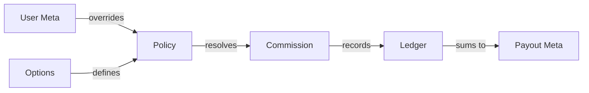

  

:::info Pro-Funktion
Diese Seite dokumentiert eine Funktion des Add-ons **MHM Rentiva Pro**. Sie ist nicht Teil der kostenlosen
Lite-Edition auf WordPress.org und erfordert, dass Pro zusätzlich zu Lite installiert ist, sowie eine gültige Lizenz.
Siehe [Editionen — Lite vs. Pro](/docs/) für die vollständige Aufteilung oder hol dir Pro unter [wpalemi.com/rentiva](https://wpalemi.com/rentiva/).
:::

:::info Zweck
Diese Seite ist die Standard-Referenzdokumentation für alle Schlüsselwörter, Datenbankfelder und technischen Definitionen, die im Finanzmodul von MHM Rentiva verwendet werden.
:::

# 📖 Finanzdaten-Wörterbuch

Finanzdaten werden im Rentiva-Ökosystem in drei Hauptebenen gespeichert: **Globale Einstellungen (Options)**, **Benutzerinformationen (User Meta)** und **Transaktionsdetails (Auszahlungs-/Buchungs-Meta)**.

## ⚙️ Globale Einstellungen (Options)
Systemweite Finanzkonfigurationen, die in der Tabelle `wp_options` gespeichert werden:

| Schlüssel | Typ | Beschreibung |
| :--- | :--- | :--- |
| `mhmrentiva_min_payout_amount` | `float` | Mindestguthaben, das ein Anbieter haben muss, um eine Auszahlung anzufordern. |
| `mhmrentiva_global_payout_freeze` | `bool` | Notschalter, der alle Auszahlungen systemweit stoppt. |
| `mhmrentiva_payout_webhook_secret`| `string` | HMAC-signierter geheimer Schlüssel, der für Auszahlungsbenachrichtigungen verwendet wird. |
| `mhmrentiva_commission_tiers` | `json` | Schwellenwerte, die die Rabattsätze abhängig vom Verkaufsvolumen bestimmen. |

---

## 👤 Finanzdaten der Anbieter (User Meta)
Daten, die pro Anbieter in der Tabelle `wp_usermeta` gespeichert werden:

| Schlüssel | Typ | Beschreibung |
| :--- | :--- | :--- |
| `_mhmrentiva_vendor_commission_rate` | `float` | Fester Provisionssatz, der speziell für diesen Anbieter festgelegt ist (Override). |
| `_mhmrentiva_vendor_payout_freeze` | `bool` | Sperrstatus, der nur diesen Anbieter vom Erhalt von Auszahlungen ausschließt. |
| `_mhmrentiva_vendor_tier_id` | `string` | Die Leistungsstufe, der der Anbieter aktuell angehört. |

---

## 💰 Auszahlungsdaten (Post Meta)
Metadaten, die unter dem Beitragstyp `mhmrentiva_payout` gespeichert werden:

| Schlüssel | Typ | Beschreibung |
| :--- | :--- | :--- |
| `_mhmrentiva_payout_amount` | `float` | Angeforderter oder ausgezahlter Nettobetrag. |
| `_mhmrentiva_payout_status` | `string` | Status: `pending`, `processing`, `completed`, `rejected`. |
| `_mhmrentiva_payout_external_ref` | `string` | Referenznummer der Bank oder des Zahlungsanbieters (Stripe usw.). |
| `_mhmrentiva_payout_rejection_reason` | `string` | Begründungstext, der für abgelehnte Anfragen eingegeben wird. |

---

## 🔑 Berechtigungen (Capabilities)
WordPress-Berechtigungen, die zur Verwaltung von Finanzvorgängen erforderlich sind:

- **`mhmrentiva_approve_payout`**: Berechtigung, Auszahlungsanfragen zu genehmigen.
- **`mhmrentiva_freeze_payout`**: Berechtigung, Auszahlungen einzufrieren/zu sperren.
- **`mhmrentiva_view_financial_audit`**: Berechtigung, Audit-Logs und Ledger-Details einzusehen.

---

## 🔄 Datenbeziehungskarte

## Zusammenfassung des Abschnitts
- Alle Finanzschlüssel werden mit dem Präfix `_mhmrentiva_` gespeichert (private Meta).
- Kritische Vorgänge (z. B. `payout_status`) können nur von berechtigten Benutzern (Capabilities) geändert werden.
- Informationen zu den Feldern der Ledger-Tabelle findest du auf der Seite [Ledger-Modell](./financial-ledger-model).

## Änderungsprotokoll
| Datum | Version | Hinweis |
|---|---|---|
| 23.04.2026 | 4.27.2 | Englische Übersetzung hinzugefügt. |
| 19.03.2026 | 4.21.2 | Seite aktualisiert, um die aktuellen Meta- und Option-Schlüssel des Plugins widerzuspiegeln. |
