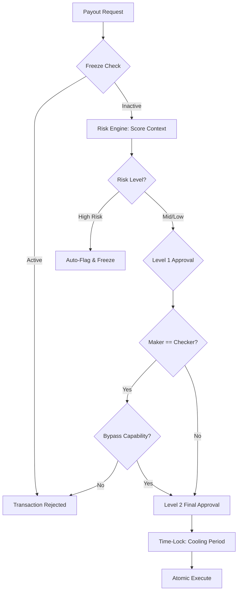

  

:::info Pro-Funktion
Diese Seite dokumentiert eine Funktion des Add-ons **MHM Rentiva Pro**. Sie ist nicht Teil der kostenlosen
Lite-Edition auf WordPress.org und setzt voraus, dass Pro zusammen mit Lite installiert ist und eine gültige Lizenz vorliegt.
Eine vollständige Gegenüberstellung findest du unter [Editionen – Lite vs. Pro](/docs/), Pro erhältst du unter [wpalemi.com/rentiva](https://wpalemi.com/rentiva/).
:::

:::info Zweck
Diese Seite beschreibt die Risikoanalyse, die Genehmigungshierarchie und die Audit-Mechanismen im finanziellen Auszahlungsprozess.
:::

# ⚖️ Governance-Kontrollen

`GovernanceService` ist eine intelligente Governance-Schicht, die die Korrektheit und Sicherheit finanzieller Transaktionen gewährleisten soll. Unabhängig von der finanziellen Abwicklung beantwortet sie nur eine Frage: „Wer darf was genehmigen, und mit welchem Risiko?“

## 🛡️ Zentrale Sicherheitsebenen

### 1. Sperrkontrollen
Bevor eine Transaktion eingeleitet wird, führt das System eine zweistufige Sperrprüfung durch:
- **Globale Sperre:** Ist die Einstellung `mhmrentiva_global_payout_freeze` aktiv, werden alle Auszahlungen sofort gestoppt.
- **Anbieter-Sperre:** Anfragen von Anbietern mit dem Meta-Wert `_mhmrentiva_vendor_payout_freeze` werden abgelehnt.

### 2. Risiko-Engine (deterministische Risikoanalyse)
Das System ermittelt für jede Auszahlungsanfrage einen Risikowert anhand folgender Kriterien:
- **Anbieteralter:** Neuere Anbieter erhalten einen höheren Risikowert.
- **Stornoquote:** Anbieter mit einer hohen Erstattungs-/Stornoquote werden zur Prüfung markiert.
- **Betragsgrenze:** Auszahlungen oberhalb bestimmter Schwellenwerte werden automatisch als „Hohes Risiko“ markiert.

### 3. Maker-Checker (Vier-Augen-Prinzip)
Um internen Betrug zu verhindern, kann kein Administrator eine Auszahlung, die er selbst eingeleitet oder erstellt hat, eigenmächtig genehmigen:
- **Maker:** Die Person, die die Anfrage erstellt oder die erste Prüfung durchgeführt hat.
- **Checker:** Eine andere berechtigte Person, die die endgültige Genehmigung erteilt.
- *Ausnahme:* Nur leitende Administratoren mit der Berechtigung `mhmrentiva_override_maker_checker` können diese Regel umgehen (die Aktion wird im forensischen Protokoll festgehalten).

---

## 🔄 Governance-Workflow

---

## 🏛️ Audit-Trail

Alle Governance-Entscheidungen werden **unveränderlich** in der Tabelle `wp_mhmrentiva_payout_audit` gespeichert:
- **IP-Hash:** Die IP-Spur des Handelnden wird zum Schutz der Privatsphäre als SHA-256 gespeichert.
- **Aktionskonstanten:** Aktionen wie `submit_payout`, `review_payout`, `finalize_payout`, `bypass_time_lock` werden protokolliert.
- **Metadaten-JSON:** Der aktuelle Risikowert, der Workflow-Status und kontextbezogene Details werden bei jedem Ereignis festgehalten.

---

## ⏳ Zeitsperren
Genehmigte Auszahlungen mit hohem Betrag werden in die Phase `STATE_TIME_LOCKED` versetzt. In diesem Zeitraum sind die Mittel reserviert, werden aber nicht sofort an den Zahlungskanal (Webhook) gesendet. Diese „Abkühlphase“ ist die letzte Verteidigungslinie, um fehlerhafte oder verdächtige Transaktionen rückgängig zu machen.

## Zusammenfassung des Abschnitts
- Sicherheitshierarchie: **Sperre > Risiko-Engine > Maker-Checker > Zeitsperre**.
- Alle Entscheidungen sind in der Tabelle **payout_audit** dauerhaft nachvollziehbar.
- `GovernanceService` verhindert Prozessmissbrauch, nicht finanzielle Fehler.

## Änderungsprotokoll
| Datum | Version | Hinweis |
|---|---|---|
| 23.04.2026 | 4.27.2 | Englische Übersetzung hinzugefügt. |
| 19.03.2026 | 4.21.2 | Seite aktualisiert, um die Risiko-Engine und die Maker-Checker-Struktur von GovernanceService abzubilden. |
