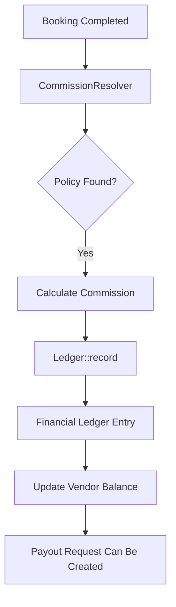

  

:::info Pro-Funktion
Diese Seite dokumentiert eine Funktion des Add-ons **MHM Rentiva Pro**. Sie ist nicht Teil der kostenlosen
Lite-Edition auf WordPress.org und erfordert, dass Pro zusätzlich zu Lite installiert ist, sowie eine gültige Lizenz.
Siehe [Editionen – Lite vs. Pro](/docs/) für die vollständige Aufteilung oder hol dir Pro unter [wpalemi.com/rentiva](https://wpalemi.com/rentiva/).
:::

:::info Zweck
Diese Seite fasst den Finanzkern (Financial Core) von MHM Rentiva, die Logik der Provisionsberechnung und die Datensicherheitsstandards zusammen.
:::

# 💰 Überblick über das Finanzsystem

Das Finanzsystem im Herzen von MHM Rentiva basiert auf hochpräzisen Berechnungen und einer prüfbaren Datenstruktur. Das System erfasst jede Transaktion nach dem Ansatz eines **unveränderlichen Hauptbuchs (Immutable Ledger)**.

## 🏗️ Kernkomponenten

Finanzvorgänge werden über die folgenden Engines verwaltet:

| Komponente | Aufgabe |
| :--- | :--- |
| `CommissionResolver` | Entscheidungs-Engine, die die am besten geeignete Provisionsrichtlinie für eine Buchung bestimmt. |
| `Ledger` | Dienst, der alle Geldbewegungen atomar in die Tabelle `wp_mhmrentiva_ledger` schreibt. |
| `PayoutService` | Schicht, die die Einnahmen der Anbieter berechnet und Auszahlungsanfragen verwaltet. |
| `GovernanceService` | Prüft finanzielle Limits, Risikokontrollen und Berechtigungen. |
| `PolicyRepository` | Speichert versionierte Provisionsrichtlinien und Unternehmensvereinbarungen. |

---

## 🔄 Finanzdatenfluss

Wenn eine Buchung abgeschlossen ist, wird das Finanzsystem in der folgenden Reihenfolge ausgelöst:

---

## 📉 Hierarchie der Provisionsermittlung (Entscheidungsreihenfolge)

Das System bestimmt anhand der folgenden Prioritätsreihenfolge, welcher Satz auf eine Buchung angewendet wird:

1.  **Fahrzeugbasiert (Vehicle Override):** Wenn in den Fahrzeugeinstellungen ein individueller Provisionssatz festgelegt ist, wird dieser verwendet.
2.  **Anbieterbasiert (Vendor Override):** Wenn für den Anbieter eine individuelle Vereinbarung besteht, wird diese angewendet.
3.  **Stufensystem (Tier Discount):** Abhängig von der Leistung des Anbieters kann ein Abschlag oder Aufschlag angewendet werden.
4.  **Globale Richtlinie (Global Policy):** Wenn keine Regel zutrifft, wird der Standardsatz aus den globalen Systemeinstellungen angewendet.

---

## 🛡️ Finanzielle Sicherheitsprinzipien (Invarianten)

- **Unveränderlichkeit:** Ein Eintrag in der Tabelle `ledger` wird niemals gelöscht oder per `UPDATE` geändert. Fehlerhafte Transaktionen werden über eine „Gegenbuchung“ (Offsetting Entry) korrigiert.
- **Atomare Vorgänge:** Die Provisionsberechnung und das Schreiben ins Hauptbuch (Ledger) erfolgen als eine Einheit (atomare Transaktion).
- **Prüfpfad (Audit Trail):** Jede Finanzbewegung wird mit dem ausführenden Benutzer und einem Zeitstempel signiert.
- **Idempotenz:** Das Anlegen doppelter Provisionseinträge für dieselbe Buchung wird auf Anwendungsebene verhindert.

## Zusammenfassung des Abschnitts
- Das Finanzsystem arbeitet nach dem Prinzip **Ledger-first**.
- Entscheidungen werden hierarchisch durch den modularen `CommissionResolver` getroffen.
- Alle Daten werden gemäß den Anforderungen der Finanzprüfung gespeichert.

## Änderungsprotokoll
| Datum | Version | Hinweis |
|---|---|---|
| 23.04.2026 | 4.27.2 | Englische Übersetzung hinzugefügt. |
| 19.03.2026 | 4.21.2 | Finanzübersicht aktualisiert, um die Hierarchie und Ledger-Architektur von v1.9 abzubilden. |
