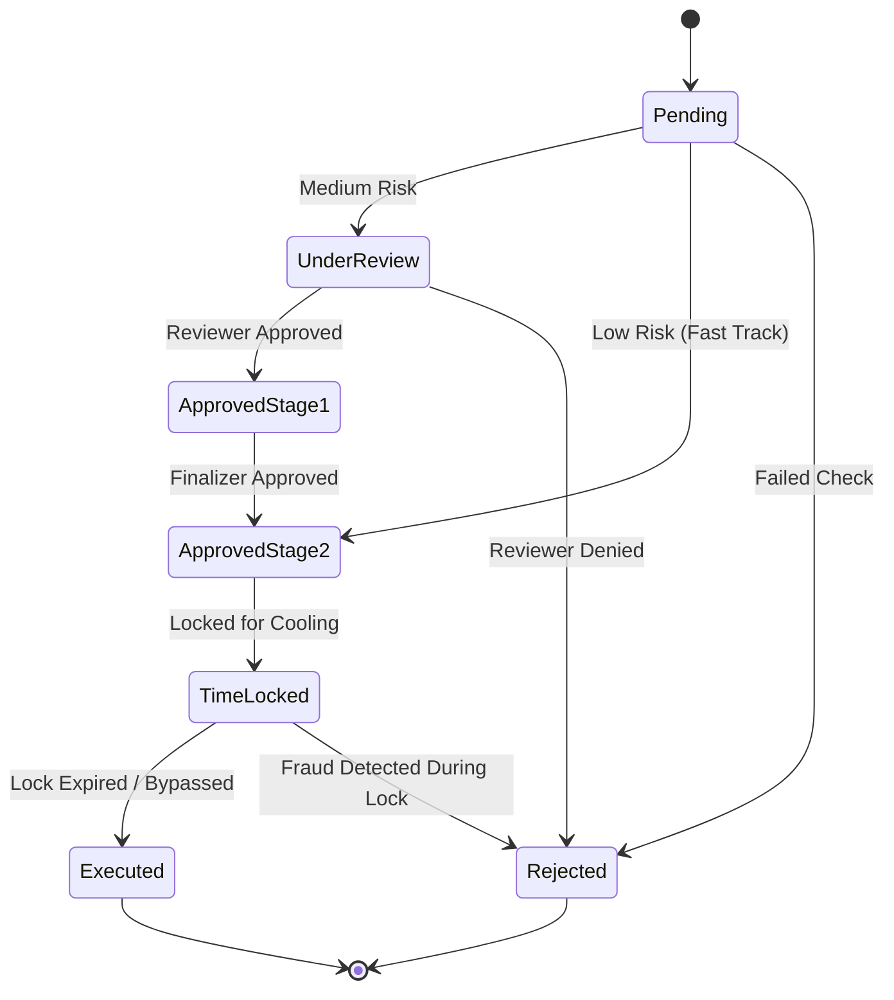

  

:::info Pro-Funktion
Diese Seite dokumentiert eine Funktion des Add-ons **MHM Rentiva Pro**. Sie ist nicht Teil der kostenlosen
Lite-Edition auf WordPress.org und erfordert, dass Pro zusätzlich zu Lite installiert ist, sowie eine gültige Lizenz.
Siehe [Editionen – Lite vs. Pro](/docs/) für die vollständige Aufteilung oder hol dir Pro unter [wpalemi.com/rentiva](https://wpalemi.com/rentiva/).
:::

:::info Zweck
Diese Seite beschreibt die Workflow-Zustände, Übergangsregeln und Sicherheitsbarrieren, die eine Auszahlungsanfrage von der Erstellung bis zum Abschluss durchläuft.
:::

# 🔄 Lebenszyklus einer Auszahlung

MHM Rentiva verwendet einen strikten **Genehmigungs-Zustandsautomaten** (Approval State Machine), um Auszahlungsprozesse zu verwalten. Jeder Übergang unterliegt sowohl der Risikobewertung des Systems als auch menschlichem Eingreifen (Vier-Augen-Prinzip, Maker-Checker).

---

## 🏗️ Zustände

Jede Auszahlungsanfrage im System befindet sich in einem der folgenden Zustände:

| Zustand | Code | Beschreibung |
| :--- | :--- | :--- |
| **Ausstehend** | `pending` | Anfrage wurde gerade erstellt und wartet auf die Risikoanalyse. |
| **In Prüfung** | `under_review` | Manuelle Prüfungsphase für Anfragen mit mittlerem Risiko. |
| **Genehmigt Stufe 1** | `approved_stage_1` | Genehmigung der ersten Stufe erteilt (Prüfung abgeschlossen). |
| **Genehmigt Stufe 2** | `approved_stage_2` | Phase der endgültigen Genehmigung (Abschluss). |
| **Zeitgesperrt** | `time_locked` | Genehmigt, wartet aber innerhalb der „Karenzzeit“. |
| **Ausgeführt** | `executed` | Auszahlung erfolgreich abgeschlossen (Ledger geschlossen). |
| **Abgelehnt** | `rejected` | Anfrage abgelehnt, Guthaben wird an den Anbieter zurückgegeben. |

---

## 🌳 Zustandsübergangsdiagramm

---

## 🛡️ Übergangsregeln

### 1. Maker-Checker-Trennung
Die Person, die eine Auszahlung genehmigt (`Checker`), darf nicht dieselbe Person sein, die sie angestoßen oder vorbereitet hat (`Maker`). Diese Regel wird auf Code-Ebene (`ApprovalStateMachine::validate_transition`) durchgesetzt, um internes Fehlverhalten zu verhindern.

### 2. Fast-Track
Anfragen mit einer **NIEDRIGEN** Risikobewertung (LOW) können direkt von `Pending` zu `Approved Stage 2` wechseln und dabei `Under Review` überspringen. Dies ist eine Erleichterung für vertrauenswürdige Anbieter, um den operativen Aufwand zu verringern.

### 3. Atomare Aktualisierungen
Zustandsübergänge werden in der Datenbank **atomar** ausgeführt. Die Abfrage `UPDATE ... WHERE current_state = old_state` verhindert, dass zwei Administratoren gleichzeitig an derselben Auszahlungsanfrage arbeiten (Race Condition).

---

## ⏳ Zeitsperre und Abschluss
Wenn `Approved Stage 2` erteilt wird, wird das Guthaben atomar als `payout_debit` vom Ledger abgezogen, die eigentliche Zahlung wird aber noch nicht gesendet. Die Mittel warten im Status `Time Locked`. Wenn die Sperrfrist abläuft, versetzt das System die Auszahlung automatisch in `Executed`.

## Zusammenfassung des Abschnitts
- Zustandsübergänge sind durch **eine strikte Matrix** eingeschränkt; beliebige Übergänge sind nicht möglich.
- **Maker-Checker** ist die grundlegende Sicherheitssäule des Systems.
- Die **Zeitsperre** bietet eine Möglichkeit zum „Zurücksetzen“ bei fehlerhaften Transaktionen.

## Änderungsprotokoll
| Datum | Version | Hinweis |
|---|---|---|
| 23.04.2026 | 4.27.2 | Englische Übersetzung hinzugefügt. |
| 19.03.2026 | 4.21.2 | Seite um die Zustandsmatrix der ApprovalStateMachine und die Zeitsperren-Logik aktualisiert. |
