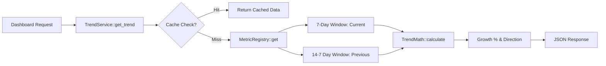

  

:::info Pro-Funktion
Diese Seite dokumentiert eine Funktion des Add-ons **MHM Rentiva Pro**. Sie ist nicht Teil der kostenlosen
Lite-Edition auf WordPress.org und erfordert, dass Pro zusätzlich zu Lite installiert ist und eine gültige Lizenz vorliegt.
Die vollständige Aufteilung findest du unter [Editionen – Lite vs. Pro](/docs/), Pro erhältst du unter [wpalemi.com/rentiva](https://wpalemi.com/rentiva/).
:::

:::info Zweck
Diese Seite erklärt, wie Wachstumsraten, Trenddaten und periodische Metriken, die im Dashboard angezeigt werden, berechnet werden. `TrendService` fungiert als „Analytics Intelligence“ des Systems.
:::

# 📈 TrendService und Metrik-Infrastruktur

`TrendService` ist eine zentrale Engine, die dynamische Metriken (Buchungen, Nachrichten, Abholungen usw.) innerhalb bestimmter Zeitfenster analysiert.

---

## 🏗️ Architektur

Das System bietet eine erweiterbare Metrikstruktur:
1.  **MetricRegistry:** Jede Metrik (z. B. `total_bookings`) wird im System als Klasse registriert, die ihre eigene Berechnungslogik enthält.
2.  **TrendService:** Verwendet die registrierten Metriken, um „Letzte Woche“ mit „Diese Woche“ zu vergleichen.
3.  **TrendMath:** Wandelt die Vergleichsergebnisse in prozentuales (%) Wachstum und Richtungsangaben (Aufwärts/Abwärts) um.

---

## 🔄 Ablauf der Metrikberechnung

---

## ⏱️ Zeitfenster (Windowing)

`TrendService` verwendet für die vergleichende Analyse zwei **7-Tage**-Fenster:
-   **Aktueller Zeitraum:** Die letzten 7 Tage (einschließlich heute).
-   **Vorheriger Zeitraum:** Die 7 Tage davor (von vor 14 Tagen bis vor 7 Tagen).

So erhalten Benutzer Angaben wie „X % Wachstum/Rückgang im Vergleich zur letzten Woche“.

---

## 📋 Verfügbare Metriktypen

| Metrikschlüssel | Kontext | Beschreibung |
| :--- | :--- | :--- |
| `total_bookings` | `customer` | Gesamtzahl und Anzahl der Buchungen des Benutzers im letzten Zeitraum. |
| `upcoming_pickups`| `customer` | Anzahl der Fahrzeugabholungen in den nächsten 7 Tagen. |
| `unread_messages` | `customer` | Trend der ungelesenen Nachrichten von Anbietern. |
| `net_revenue` | `vendor` | Wachstumstrend der Einnahmen des Anbieters (Ledger-basiert). |

---

## ⚡ Performance und Caching

Metrikberechnungen können bei großen Datenbanken `WP_Query`-Last erzeugen. Dank `MetricCacheManager`:
-   Berechnete Trends werden **1 Stunde** lang als Transients gespeichert.
-   Cache-Schlüssel basieren auf `context`, `metric` und `subject_id` (Benutzer-ID/E-Mail).
-   Wenn eine neue Buchung oder Nachricht eingeht, wird der betreffende Cache automatisch invalidiert.

## Zusammenfassung des Abschnitts
-   Trends arbeiten immer auf Basis eines **7-Tage-Vergleichs**.
-   Neue Metriktypen lassen sich einfach über `MetricRegistry` hinzufügen.
-   Alle Daten werden über eine virtualisierte **Cache-Schicht** bereitgestellt.

## Änderungsprotokoll
| Datum | Version | Hinweis |
|---|---|---|
| 23.04.2026 | 4.27.2 | Englische Übersetzung hinzugefügt. |
| 19.03.2026 | 4.21.2 | Seite komplett neu geschrieben, um die Architektur von TrendService und MetricRegistry abzubilden. |
