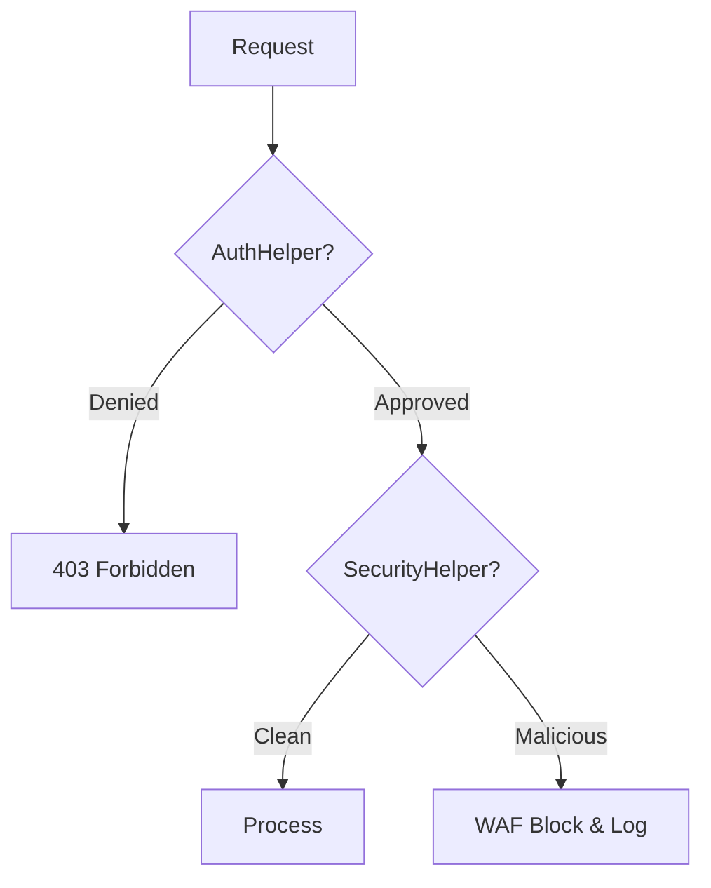

  

:::info Pro-Funktion
Diese Seite dokumentiert eine Funktion des Add-ons **MHM Rentiva Pro**. Sie ist nicht Teil der kostenlosen
Lite-Edition auf WordPress.org und erfordert, dass Pro zusätzlich zu Lite installiert ist, sowie eine gültige Lizenz.
Die vollständige Aufteilung findest du unter [Editionen – Lite vs. Pro](/docs/), Pro erhältst du unter [wpalemi.com/rentiva](https://wpalemi.com/rentiva/).
:::

:::info Zweck
Diese Anleitung behandelt den Datenschutz in der Rentiva-Infrastruktur, die DSGVO-/KVKK-Konformität und die Prozesse zur Reaktion auf Sicherheitsvorfälle.
:::

# 🔒 Sicherheits- und Datenschutzbetrieb

Rentiva arbeitet nach dem Prinzip „Security by Design“ und behält die strikte Kontrolle über Daten vom Moment ihrer Erhebung bis zu ihrer Vernichtung.

---

## 🛡️ Sicherheitsebenen und Werkzeuge

### 🔑 Zugriffskontrolle (`AuthHelper`)
Jeder Admin- und API-Zugriff läuft über `AuthHelper::verify_request()`.
- **Berechtigungsprüfungen:** Betriebliche Aktionen können statt mit `manage_options` mit der benutzerdefinierten Berechtigung `rentiva_financial_manager` eingeschränkt werden.
- **Rotation der API-Schlüssel:** API-Schlüssel sollten als Vorsichtsmaßnahme gegen eine mögliche Kompromittierung alle 90 Tage rotiert werden.

### 🛡️ Eingabesicherheit (`SecurityHelper`)
Jeder Wert, der in die Datenbank gelangt, durchläuft `SecurityHelper::validate_*`-Methoden:
- **XSS-Schutz:** HTML-Inhalte werden über `wp_kses` anhand einer Whitelist gefiltert.
- **SQLi-Schutz:** Rohes SQL ist untersagt; alle Abfragen werden mit `$wpdb->prepare()` parametrisiert.

---

## ⚖️ Datenschutz (Privatsphäre & DSGVO)

### 🧹 Datenanonymisierung
Wenn ein Benutzerkonto gelöscht wird oder die gesetzliche Aufbewahrungsfrist abläuft:
- wird `PrivacyManager::anonymize_user_data()` ausgelöst, das Namen, E-Mail-Adressen und IP-Adressen als `deleted_u_{id}` maskiert.
- **Regel:** Finanzielle `Ledger`-Datensätze werden anonymisiert, aber nicht gelöscht, um die Integrität der Buchhaltung zu wahren.

### 📅 Richtlinie zur Datenaufbewahrung
- **Web-Logs:** Werden nach 30 Tagen automatisch gelöscht.
- **Audit-Logs:** Werden gemäß gesetzlicher Vorgabe 2 Jahre lang schreibgeschützt aufbewahrt.

---

## 🚨 Protokoll zur Reaktion auf Sicherheitsvorfälle

Wenn eine Datenpanne oder eine Anomalie erkannt wird:
1. **Isolierung:** Betroffene IP-Adressen werden über `RateLimiter` global gesperrt.
2. **Snapshot:** Der aktuelle Zustand der Datenbank wird für die forensische Analyse gesichert.
3. **Analyse:** `AdvancedLogger`-Datensätze werden durchsucht, um das Ausmaß der Datenpanne zu ermitteln.
4. **Benachrichtigung:** Betroffene Benutzer und Behörden werden innerhalb der gesetzlichen Frist benachrichtigt (72 Stunden gemäß DSGVO).

---

## 🔄 Diagramm des Sicherheitsablaufs

## Zusammenfassung des Abschnitts
- Sicherheitsabläufe folgen dem Prinzip der „minimalen Rechtevergabe“ (Least Privilege).
- `Ledger`-Daten sind der sensibelste Teil des Systems; direkte Eingriffe sind untersagt.
- Datenschutz und Sicherheit werden durch kontinuierliche Überwachung gewährleistet.

## Änderungsprotokoll
| Datum | Version | Hinweis |
|---|---|---|
| 23.04.2026 | 4.27.2 | Englische Übersetzung hinzugefügt. |
| 19.03.2026 | 4.21.2 | Seite mit SecurityHelper und Anonymisierungsprotokollen aktualisiert. |
