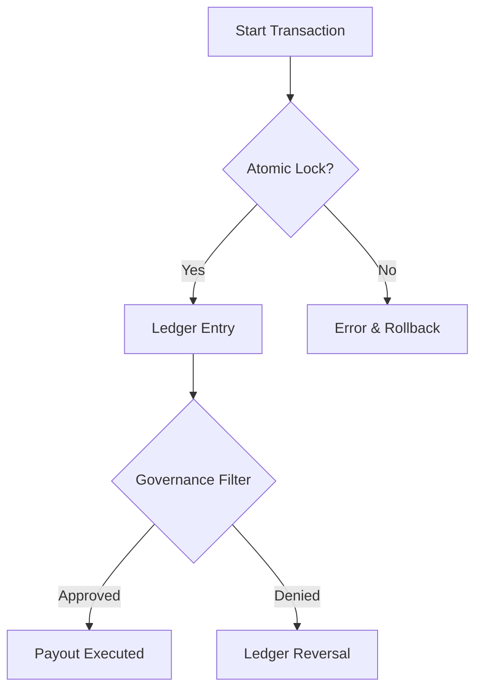

  

:::important Kritische Warnung
Tests in der Finanzschicht müssen mit 100 % Abdeckung bestehen. Jeder Fehlschlag führt dazu, dass das gesamte Zahlungssystem gesperrt wird.
:::

# 🛡️ Finanzielle Teststrategie

Die Rentiva-Finanzschicht nutzt eine mehrstufige Teststrategie, um Geldflüsse nachzuverfolgen und fehlerhafte Transaktionen zu verhindern. Die Grundprinzipien dieser Strategie sind **Unveränderlichkeit** und **Atomarität**.

---

## 🏗️ Testebenen

### 1. Ledger-Tests
`LedgerTest.php` überprüft, dass Ledger-Einträge niemals gelöscht oder aktualisiert werden können.
- **Regel:** Nur `INSERT`-Operationen sind zulässig.
- **Überprüfung:** Prüfungen auf negative Salden und Konsistenz des Gesamtsaldos (Prüfsumme).

### 2. Atomarität und Regression (`AtomicPayoutServiceTest`)
Stellt sicher, dass das System konsistent bleibt, wenn eine Zahlungstransaktion unterbrochen wird (Race Condition).
- **Testszenario:** Die Transaktion wird vollständig zurückgesetzt, wenn die Datenbankverbindung abbricht.
- **Idempotenz:** Dieselbe Zahlungsanfrage kann nicht zweimal verarbeitet werden.

### 3. Mandantenisolierung (`TenantIsolationTest`)
Überprüft, dass sich Transfer- und Zahlungsdaten verschiedener Anbieter (Mandanten) niemals vermischen.
- **Kontrolle:** Der Zugriff von `vendor_a` auf die Ledger-Daten von `vendor_b` wird blockiert.

---

## 🔒 Tests zur Sicherheitshärtung (Forensic Hardening)

`ForensicHardeningTest.php` prüft die Datensicherheit nach forensischen Standards:
- **Manipulationserkennung:** Erkennung jeglicher unbefugter Änderungen an historischen Einträgen.
- **Audit-Konsistenz:** Ob Governance-Entscheidungen mit den forensischen Protokollen übereinstimmen.

---

## 🧪 Governance- und Sperrtests

Die Klassen `GovernanceFreezeTest.php` und `GovernanceAuthorizationTest.php` überprüfen:
- **Sperre:** Sofortige Blockierung von Zahlungsanfragen eines Anbieters mit hohem Risiko.
- **Autorisierung:** Dass das Vier-Augen-Prinzip (Maker-Checker, keine Selbstgenehmigung möglich) nicht verletzt wurde.

---

## 🔄 Testablaufdiagramm

## Zusammenfassung des Abschnitts
- Alle Finanztests befinden sich im Verzeichnis `tests/Core/Financial`.
- **Forensic Hardening** bewahrt den forensischen Beweiswert des Systems.
- Regressionstests laufen vor jedem Release automatisch.

## Änderungsprotokoll
| Datum | Version | Hinweis |
|---|---|---|
| 23.04.2026 | 4.27.2 | Englische Übersetzung hinzugefügt. |
| 19.03.2026 | 4.21.2 | Seite gemäß den Tests zu Forensic Hardening und Mandantenisolierung aktualisiert. |
