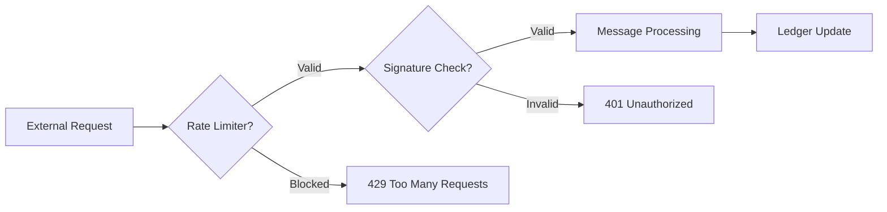

  

:::info Pro-Funktion
Diese Seite dokumentiert eine Funktion des Add-ons **MHM Rentiva Pro**. Sie ist nicht Teil der kostenlosen
Lite-Edition auf WordPress.org und erfordert, dass Pro zusätzlich zu Lite installiert ist, sowie eine gültige Lizenz.
Siehe [Editionen – Lite vs. Pro](/docs/) für die vollständige Aufteilung oder hol dir Pro unter [wpalemi.com/rentiva](https://wpalemi.com/rentiva/).
:::

:::info Zweck
Diese Seite dokumentiert die Testprozesse für das asynchron arbeitende Transfer-Modul von Rentiva und die nach außen bereitgestellten Webhook-Endpunkte.
:::

# 🛰️ Testmodell für Transfer & Webhooks

Die Transfer- und Webhook-Schichten sind die kritischsten Endpunkte, über die das System mit der Außenwelt kommuniziert. Aus diesem Grund basieren die Testszenarien auf dem Prinzip „Safe Reject“ (sicheres Ablehnen).

---

## 🛣️ Transfer- und Standorttests

Tests, die über `HybridLocationTest.php` ausgeführt werden, überprüfen die Logik für standortbasierte Suche und Routenberechnung:
- **Hybride Datenlogik:** Überprüft, dass Standorte sowohl aus Metadaten als auch aus benutzerdefinierten Tabellen konsistent abgerufen werden.
- **Routenintegrität:** Testet, ob das System für nicht definierte Routen den korrekten „Fallback“ (Fehlermeldung oder alternative Route) liefert.
- **Asynchrone Suche:** Führt Performance- und Genauigkeitstests für standortbasierte Suchanfragen aus dem Frontend durch.

---

## 🛡️ Webhook-Sicherheit und Rate Limiting

Benachrichtigungen aus externen Quellen (Bank, Zahlungsanbieter usw.) werden mit `WebhookRateLimiterTest.php` einer strengen Prüfung unterzogen:
- **Rate Limiting:** Sofortige Blockierung ungewöhnlicher Traffic-Spitzen (DDoS- oder Brute-Force-Versuche) von derselben IP-Adresse oder Quelle.
- **Payload-Validierung:** Signaturprüfung (HMAC) und JSON-Schema-Validierung der eingehenden Daten.
- **Idempotenz:** Verhinderung der doppelten Verarbeitung derselben Webhook-Benachrichtigung.

---

## ⚠️ Negativszenarien (Grenzfälle)

Die folgenden Situationen werden immer getestet, um die Belastbarkeit des Systems zu messen:
- **Streckenübergreifender Konflikt:** Der Versuch, ein Fahrzeug gleichzeitig auf zwei verschiedenen Transferrouten zu buchen.
- **Ungültige Webhook-Signatur:** Anfragen mit falschen oder abgelaufenen Signaturen müssen `401 Unauthorized` zurückgeben.
- **Fehlender Parameter:** Behandlung von Anfragen, bei denen während der Routenberechnung Koordinaten- oder Stadtdaten fehlen.

---

## 📊 Testablaufdiagramm (Webhook)

## Zusammenfassung des Abschnitts
- Webhook-Tests stellen die Sicherheit in den Mittelpunkt.
- Transfer-Tests validieren die „Hybrid Location“-Architektur.
- Beide Module durchlaufen Belastbarkeitstests gegen asynchrone Fehler (Timeout, Race Condition).

## Änderungsprotokoll
| Datum | Version | Hinweis |
|---|---|---|
| 23.04.2026 | 4.27.2 | Englische Übersetzung hinzugefügt. |
| 19.03.2026 | 4.21.2 | Seite gemäß den Standards von HybridLocationTest und WebhookRateLimiterTest aktualisiert. |
