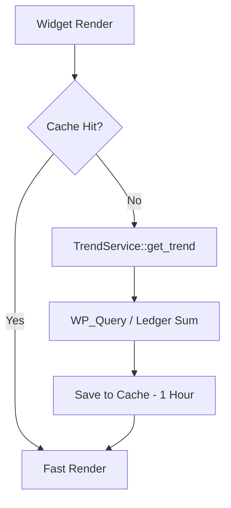

  

:::info Zweck
Diese Seite beschreibt die Architektur der KPI-Karten, Widgets und Analytics-Komponenten, die sowohl im WordPress-Adminbereich als auch in den Frontend-Benutzer-Dashboards verwendet werden.
:::

# Architektur der Dashboard-Widgets

In der Rentiva-Dokumentation bezeichnet „Widget“ unabhängige UI-Blöcke, die Daten visualisieren und Interaktionen anbieten. Diese Blöcke arbeiten in zwei Hauptebenen: **Frontend (Elementor)** und **Admin (Custom List Tables)**.

---

## 1. Frontend-Widget-Ebene (Elementor)

Alle visuellen Komponenten in den Frontend-Bereichen (Kunde/Anbieter) werden über die Klasse `ElementorIntegration` verwaltet.

### Zentrale KPI-Widgets
Alle KPI-Karten laden ihre Daten asynchron über `TrendService`:
- **Widget „Meine Buchungen“:** Zeigt die Anzahl aktiver Buchungen und Wachstumstrends.
- **Widget „Zahlungsverlauf“:** Stellt die Einnahmen und den Zahlungsverlauf des Anbieters als Tabelle dar.
- **Widget „Meine Nachrichten“:** Zeigt die Anzahl ungelesener Nachrichten in Echtzeit an.

---

## 2. Admin-Widget-Ebene

Die Widgets im Adminbereich werden von den Klassen `DashboardPage.php`, `Reports.php`, `Messages.php` und `RevenueReport.php` verwaltet.

### Statistik-Widget (Stats)
- **Design:** 2×2-Raster-Layout mit Icons und Farben über Inline-CSS.
- **Cache:** Cache-Schlüssel-Präfix `mhmrentiva_dashboard_stats` (in v4.23.0 korrigiert; vorheriges falsches Präfix: `mhm_dashboard_stats`).
- **Datei:** `Reports.php`

### Umsatzdiagramm
- **Datumsformat:** Lokalisierte Datumsangaben über `date_i18n(get_option('date_format'))`.
- **Stornierungs-Datensatz:** Stornierte Buchungen werden separat mit einer roten gestrichelten Linie angezeigt.
- **Zeitzone:** Verwendet `wp_date('Y-m-01')` statt `gmdate('Y-m-01')` (für die Datumsangaben des Monatsumsatzes).
- **Dateien:** `RevenueReport.php` + `reports-charts.js`

### Anstehende Vorgänge
- **Zeitanzeige:** `start_date + start_time` werden kombiniert und angezeigt (früherer 00:00-Fehler behoben).
- **Anzeige-ID:** Die WC-Bestell-ID wird über `mhmrentiva_get_display_id()` mit einem anklickbaren Link angezeigt.
- **Datei:** `Reports.php`

### Neueste Buchungen
- **ID-Anzeige:** Kompatibilität mit der WC-Bestell-ID über `mhmrentiva_get_display_id()`.
- **Dateien:** `recent-bookings.php` + `transfer-widget.php`

### Nachrichten-Widget
- **Design:** Eigenständiges Inline-CSS, Badge für ungelesene Nachrichten, Avatar-Initialen und „vor X Zeit“-Format.
- **Datei:** `Messages.php`

### Kalender-Popup
- **Zeitanzeige:** `_mhmrentiva_start_time`/`_mhmrentiva_end_time`-Felder über `get_post_meta()` (statt SQL JOIN).
- **Datei:** `BookingColumns.php`

### Auszahlungs-Listentabelle (`PayoutListTable.php`)
Die zentrale Tabelle für Finanzvorgänge mit folgenden Inhalten:
- **Analytics-Spalten:** Aktueller Saldo, Angeforderter Betrag und Transaktionsstatus.
- **Massenaktionen:** Genehmigung ausstehender Zahlungen per Klick in einem Schritt.
- **Bank-Kompatibilität:** Aktualisiert Transaktionsstatus (Bestätigt / Fehlgeschlagen) in Echtzeit aus der Processor-Ebene.

---

## 3. Lite-/Pro-Zugriffssteuerung für Widgets

Kein Admin-Dashboard-Widget ist Pro vorbehalten:

| Widget | Zugriff | Absicherung |
|---|---|---|
| Statistik-Widget | Lite + Pro | — |
| Neueste Buchungen | Lite + Pro | — |
| Umsatzdiagramm | Lite + Pro | — |
| Anstehende Vorgänge | Lite + Pro | — |
| Pro-Schnellaktionen (Berichte, Anbieter, Nachrichten, Export) | Pro | jeweils an ein eigenes Lizenz-Feature gebunden, über den Filter `mhmrentiva_dashboard_quick_actions` |

---

## 4. Zeitzonen- und Datumsverarbeitung

Seit v4.23.0 verwenden alle Dashboard-Widgets die WordPress-Zeitzone:

| Vorher (falsch) | Aktuell (korrekt) | Beschreibung |
|---|---|---|
| `time()` | `current_time('timestamp')` | Countdown-Berechnungen |
| `strtotime('today')` | `strtotime(wp_date('Y-m-d'))` | Tagesbeginn |
| `gmdate('Y-m-01')` | `wp_date('Y-m-01')` | Datumsangaben des Monatsumsatzes |

**Dateien:** `DashboardPage.php`, `upcoming-operations.php`, `Reports.php`

---

## 5. Status-Synchronisierung

`update_post_meta`-Aufrufe lösen den Hook `save_post` nicht aus. Es wurden zusätzliche Hooks hinzugefügt, damit das Dashboard den Status korrekt wiedergibt:
- `updated_post_meta` — wenn sich vorhandene Metadaten ändern
- `added_post_meta` — wenn neue Metadaten hinzugefügt werden

**Datei:** `DashboardPage.php`

---

## 6. WooCommerce-Integration

- **Fahrzeugbild in E-Mails:** Der Filter `woocommerce_order_item_thumbnail` fügt WC-Bestell-E-Mails ein Fahrzeugbild hinzu.
- **Datei:** `WooCommerceBridge.php`

---

## 7. Datenfluss und Performance

Widgets verwenden eine **Tier-1-Cache**-Ebene, um die Datenbanklast zu minimieren:

---

## 8. Sicherheitsregeln

- **Datenisolierung:** Ein Anbieter kann nur seine eigenen Daten sehen (Abgleich über `post_author`).
- **Berechtigungsprüfung:** Die Schaltfläche für die Massengenehmigung auf `PayoutListTable` ist nur für Benutzer mit der Berechtigung `mhmrentiva_approve_payout` sichtbar.
- **Nonce-Sicherheit:** Alle AJAX-Anfragen über Elementor-Widgets werden mit dem Nonce-Schlüssel `mhmrentiva_elementor` verifiziert.

## Zusammenfassung des Abschnitts
- Frontend-Widgets basieren auf **Elementor** und verwenden `TrendService`.
- Admin-Widgets werden von den Klassen `DashboardPage`, `Reports`, `Messages` und `RevenueReport` verwaltet.
- Umsatzdiagramm und Anstehende Vorgänge funktionieren in Lite; Pro fügt seinen eigenen Bildschirmen lediglich Schnellaktions-Verknüpfungen hinzu.
- Alle Widgets verwenden die WordPress-Zeitzone (`current_time`, `wp_date`).
- Cache-Schlüssel-Präfix: `mhmrentiva_dashboard_stats`.

## Änderungsprotokoll
| Datum | Version | Hinweis |
|---|---|---|
| 09.11.2026 | 6.3.1 | Korrektur: Umsatzdiagramm und Anstehende Vorgänge sind nicht nur in Pro verfügbar; die nicht überprüfbare Zeile zum Nachrichten-Widget wurde entfernt und die Pro-Schnellaktionen wurden hinzugefügt. |
| 23.04.2026 | 4.27.2 | Englische Übersetzung hinzugefügt. |
| 27.03.2026 | 4.23.0 | 12 Korrekturen an Dashboard-Widgets dokumentiert: Zeitzone, Status-Synchronisierung, Kalenderzeit, ID-Kompatibilität, Bild in WC-E-Mails, Nachrichten-Design, Umsatzdiagramm, Statistik-Cache, Lite/Pro-Beschränkung. |
| 19.03.2026 | 4.21.2 | Seite aktualisiert, um die Elementor-Integration und die TrendService-KPI-Struktur abzubilden. |
