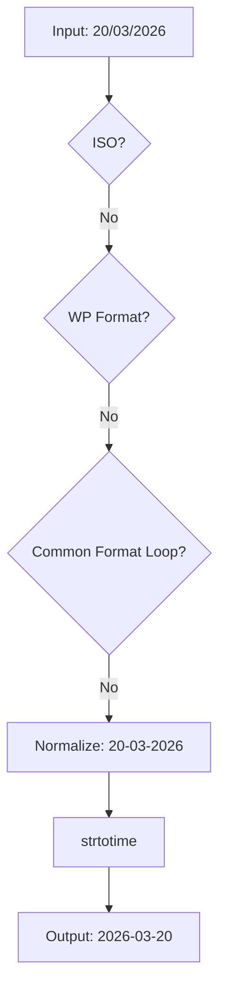

  

:::info Zweck
Dieses Dokument erklärt die Funktionsweise der Methode `SecurityHelper::validate_date` und die Standards zur Datumsnormalisierung, die im gesamten Rentiva-Ökosystem verwendet werden.
:::

# 📅 Datumsvalidierung und -normalisierung

Datumsangaben können in Rentiva in verschiedenen Formaten ankommen (UI, API, DatePicker). Die Methode `SecurityHelper::validate_date` fungiert als „sicheres Tor“, das alle diese Eingaben in das Standardformat **ISO (YYYY-MM-DD)** umwandelt.

---

## 🛠️ Validierungshierarchie

Die Methode versucht, eingehende Daten in folgender Reihenfolge zu normalisieren:

1.  **ISO-Prüfung:** Liegt der Wert bereits im Format `YYYY-MM-DD` vor, wird er direkt zurückgegeben.
2.  **WP-Datumsformat:** Versucht, den Wert anhand von `date_format` aus den WordPress-Einstellungen zu parsen (z. B. `d/m/Y`).
3.  **Gängige Formate:** Durchläuft `d/m/Y`, `m/d/Y`, `d-m-Y`, `Y/m/d` in einer Schleife.
4.  **Normalisierung & Fallback:** Wandelt Trennzeichen (`.`, `/`, ` `) in `-` um und unternimmt einen letzten Versuch mit `strtotime`.

---

## 🔄 Ablaufdiagramm



---

## 💻 Anwendungsbeispiel

```php
use MHMRentiva\Admin\Core\SecurityHelper;

try {
    // Validation with different formats
    $date1 = SecurityHelper::validate_date('2026-01-01'); // Returns '2026-01-01'
    $date2 = SecurityHelper::validate_date('31/12/2025'); // Returns '2025-12-31'
    $date3 = SecurityHelper::validate_date('2025.05.20'); // Returns '2025-05-20'
} catch (\InvalidArgumentException $e) {
    // Invalid format handling
    AdvancedLogger::error('Invalid date attempt: ' . $e->getMessage());
}
```

---

## 🛡️ Sicherheit und Fehlerbehandlung

-   **Strikte Validierung:** Passt kein Format, wirft die Methode eine `InvalidArgumentException`.
-   **Null-Sicherheit:** Ist die Eingabe leer oder null, wird sie über `sanitize_text_field_safe` bereinigt und eine Exception geworfen.
-   **Zeitzone:** Die endgültige Ausgabe wird über `gmdate('Y-m-d')` immer UTC-basiert erzeugt.

## Zusammenfassung des Abschnitts
-   Alle Datumseingaben müssen den Filter `validate_date` durchlaufen.
-   Die Ausgabe ist immer ein String im Format **ISO (YYYY-MM-DD)**.
-   Bei einem Fehler wird eine `Exception` geworfen, die den Anwendungsablauf unterbricht.

## Änderungsprotokoll
| Datum | Version | Hinweis |
|---|---|---|
| 23.04.2026 | 4.27.2 | Englische Übersetzung hinzugefügt. |
| 19.03.2026 | 4.21.2 | Aktualisiert, um die Normalisierungs- und Fallback-Logik von SecurityHelper::validate_date abzubilden. |
