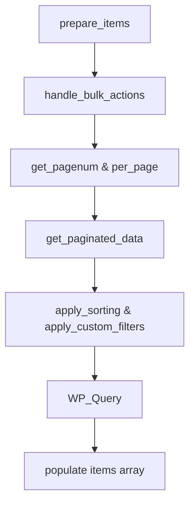

  

:::info Zweck
Diese Seite beschreibt die Klasse `AbstractListTable` – die Grundlage aller Tabellen im Rentiva-Adminbereich – sowie die Standards für Datenlisten, die sie durchsetzt.
:::

# 📋 Standards für Listentabellen

Rentiva verwendet eine **abstrakte** Schicht, die die in WordPress integrierte Klasse `WP_List_Table` modernisiert und doppelten Code vermeidet.

---

## 🏗️ Architektur von AbstractListTable

`AbstractListTable` verwaltet zentral die gemeinsamen Anforderungen aller Untertabellen (Zahlungen, Kunden, Nachrichten usw.):
- **Automatische Paginierung:** Verwaltung von Limit und Offset über `set_pagination_args`.
- **Sortierung:** Automatische Anwendung der spaltenbasierten ASC/DESC-Logik.
- **Suche:** Integration der globalen Suche über den Parameter `s`.
- **Sicherheit (Nonce):** Automatische Nonce-Prüfung für Massenaktionen.

---

## 🛠️ Eine Listentabelle erstellen

Um dem System eine neue Tabelle hinzuzufügen, erweitere die Klasse `AbstractListTable` und implementiere die folgenden Methoden:

| Methode | Aufgabe |
| :--- | :--- |
| `get_singular_name()` | Name im Singular (z. B. `payout`). |
| `get_plural_name()` | Name im Plural (z. B. `payouts`). |
| `get_data_query_args()` | Argumente für den Datenabruf (kompatibel mit `WP_Query`). |
| `get_total_count()` | Gesamtzahl der Datensätze (für die Paginierung). |
| `process_bulk_action()` | Logik für Massenaktionen (Genehmigen, Löschen usw.). |

---

## 🔄 Ablauf der Datenaufbereitung

---

## 🧩 Integrierte Hilfsmethoden

Unterklassen können integrierte Methoden statt komplexer HTML-Strukturen verwenden:
- **`render_status_badge()`:** Wandelt Statuscodes in farbige Badges um.
- **`format_price()`:** Formatiert Währungen und Tausendertrennzeichen.
- **`render_row_actions()`:** Erzeugt Schnellaktions-Links wie Bearbeiten/Löschen.
- **`create_view_link()`:** Liefert einen sicheren Link zur Detailseite eines Eintrags.

## 🛡️ Sicherheitsprotokoll

- **Nonce-Pflicht:** Alle Massenaktionen werden über `mhmrentiva_listtable_nonce` geprüft.
- **Weiterleitungen:** Nach Massenaktionen wird `wp_safe_redirect` verwendet, um Fehler durch „erneutes Senden des Formulars“ zu verhindern.
- **Bereinigung:** Alle Filterparameter, die an die Tabelle übergeben werden, durchlaufen `sanitize_text_field_safe`.

## Zusammenfassung des Abschnitts
- Neue Tabellen müssen immer die Klasse `AbstractListTable` verwenden.
- Die Logik für den Datenabruf muss in `get_data_query_args` gekapselt sein.
- `safe_output` oder die Escaping-Funktionen von WordPress sind auf allen Ausgabeebenen erforderlich.

## Änderungsprotokoll
| Datum | Version | Hinweis |
|---|---|---|
| 23.04.2026 | 4.27.2 | Englische Übersetzung hinzugefügt. |
| 19.03.2026 | 4.21.2 | Seite komplett neu geschrieben, um die zentrale Architektur von AbstractListTable abzubilden. |
