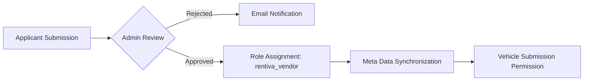
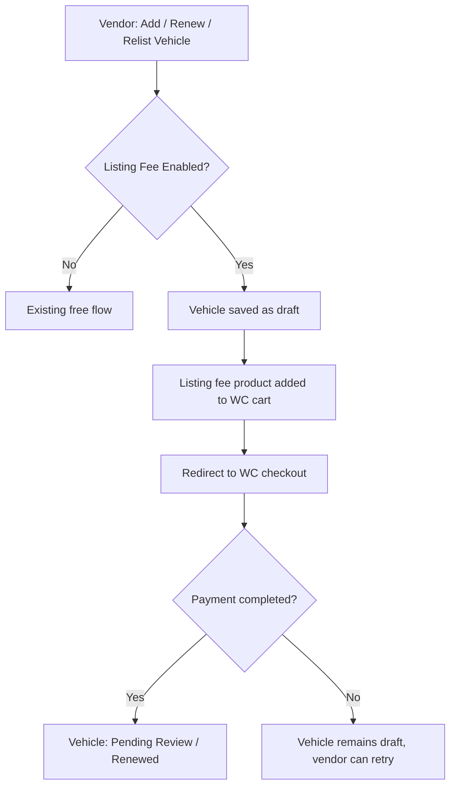

  

:::info Pro-Funktion
Diese Seite dokumentiert eine Funktion der Erweiterung **MHM Rentiva Pro**. Sie ist nicht Teil der kostenlosen
Lite-Edition auf WordPress.org und erfordert, dass Pro zusätzlich zu Lite installiert ist, sowie eine gültige Lizenz.
Siehe [Editionen – Lite vs. Pro](/docs/) für die vollständige Aufteilung oder hol dir Pro unter [wpalemi.com/rentiva](https://wpalemi.com/rentiva/).
:::

:::info React-SPA – Admin-Seite (seit v4.40.0)
Die Admin-Seite **Anbieterverwaltung** wurde in v4.40.0 auf eine **React-SPA** umgestellt. `VendorManagementRestController` registriert 7 REST-Routen unter `/wp-json/mhm-rentiva/v1/vendor-management/*`. Komponenten: `VendorManagementPage`, `ApplicationTable`, `VendorTable`, `VendorDetailPanel`, `ActionBar`. Die Daten werden clientseitig abgerufen – kein vollständiges PHP-Rendering der Seite.
:::

:::info Zweck
Rentiva kann von einem zentralisierten Fahrzeugvermietungssystem zu einem Multi-Anbieter-Marktplatz werden. Dieses Dokument erklärt den Lebenszyklus eines Anbieters im technischen Detail.
:::

# 🤝 Anbieterverwaltung

Die Phasen, die ein Benutzer durchlaufen muss, um im System Anbieter zu werden, sowie die technischen Strukturen hinter diesem Prozess sind im Folgenden zusammengefasst.

---

## 🏗️ 1. Anbieterrolle & Berechtigungen

### `rentiva_vendor`-Rolle
Jedem freigegebenen Anbieter wird diese Rolle zugewiesen, die mit den folgenden Berechtigungen verbunden ist:
- `edit_posts`: Kann eigene Fahrzeuge hinzufügen.
- `upload_files`: Kann Fahrzeugbilder hochladen.
- `read`: Kann auf das Anbieter-Dashboard zugreifen.

### 🛡️ Durchsetzung der Eigentümerschaft (`VendorOwnershipEnforcer`)
Der Filter `user_has_cap` verhindert, dass Anbieter auf die Fahrzeuge oder Buchungen anderer Anbieter zugreifen:
- Ein Anbieter kann nur `mhmrentiva_vehicle`-Datensätze bearbeiten, bei denen der Wert `post_author` mit seiner eigenen `user_id` übereinstimmt.
- Die Liste „Alle Fahrzeuge“ im Admin-Bereich ist so gefiltert, dass nur die eigenen Datensätze des Anbieters angezeigt werden.

---

## 📋 2. Bewerbungsverwaltung (`mhmrentiva_vendor_app`)

Die Daten von Anbieter-Bewerbern werden im Custom Post Type (CPT) `mhmrentiva_vendor_app` gespeichert:
- **Onboarding-Ablauf:** `Pending` → `Approved` / `Rejected`.
- **Datensicherheit:** Die bei der Bewerbung erfassten IBAN-Daten werden mit `VendorApplicationManager::encrypt_iban()` nach dem Verfahren **AES-256-CBC** verschlüsselt.
- **Dokumentenverfolgung:** Ausweis, Führerschein und Adressnachweis werden über die Meta-Schlüssel `_vendor_doc_*` mit der WordPress-Mediathek verknüpft.

---

## ⚙️ 3. Betriebliche Steuerung

### Freigabe & Meta-Synchronisierung (`VendorOnboardingController`)
Wenn ein Administrator eine Bewerbung freigibt:
1. Telefon-, Stadt- und IBAN-Daten aus dem `mhmrentiva_vendor_app`-Datensatz werden in die Meta-Tabellen des Benutzers (WP_User) kopiert.
2. Die Rolle des Benutzers wird von `customer` auf `rentiva_vendor` hochgestuft.
3. Der Hook `mhmrentiva_vendor_approved` wird ausgelöst und eine Willkommens-E-Mail wird versendet.

### Profilverwaltung (`VendorProfileExtension`)
Die WordPress-Profilseite (`wp-admin/profile.php`) wird um anbieterspezifische Felder erweitert:
- **Shop-Informationen:** Bio, Steuernummer und Servicegebiete.
- **Finanzinformationen:** Maskierte IBAN-Anzeige (z. B. TR***5678).

### Anbieter-Einstellungsseite (v4.23.1)

Die Einstellungsseite im Anbieter-Dashboard (`vendor-settings.php`) wurde in v4.23.1 komplett neu gestaltet:

- **CSS-Architektur:** Alle Inline-Styles wurden entfernt und mit der CSS-Klassenstruktur `.mhm-vendor-form__*` nach `vendor-forms.css` verschoben.
- **Neue Felder:** Die Felder „Kontoinhaber“ und „Finanzamt“ wurden hinzugefügt.
- **Stadtauswahl:** Verwendet die SelectWoo-Komponente (`CityHelper::render_select()`) statt eines Texteingabefelds.
- **Benachrichtigungssystem:** Erfolgs- und Fehlermeldungen wurden mit der Klassenstruktur `mhm-vendor-notice` vereinheitlicht.

:::tip Technischer Hinweis
Alle Formularfelder auf der Anbieter-Einstellungsseite werden mit BEM-ähnlichen Klassen wie `.mhm-vendor-form__group`, `.mhm-vendor-form__label`, `.mhm-vendor-form__input` gestaltet. Verwende dieselbe Klassenstruktur, wenn du neue Felder hinzufügst.
:::

---

## Zusammenfassung des Lebenszyklus

---

## 🚐 5. Transfer-Standort- & Routenverwaltung für Anbieter (v4.23.0)

Mit v4.23.0 können Anbieter Standorte und Routen für Transferdienste auswählen:

### Stadtbasierte Filterung
Im Formular zum Einreichen von Anbieterfahrzeugen (`[rentiva_vehicle_submit]`) werden nur **Standorte** und **Routen** innerhalb der Stadt aufgelistet, die in der Bewerbung des Anbieters angegeben wurde. Dies ist Teil der Hierarchie **Stadt → Punkt**.

### Preise pro Route
- Der Anbieter wählt die Routen aus, die er bedienen möchte.
- Für jede Route gibt er seinen eigenen Preis innerhalb des vom Administrator festgelegten Bereichs `min_price` – `max_price` ein.
- Kapazitätsangaben (Passagiere, Gepäck) werden auf Fahrzeugebene festgelegt.

### Meta-Struktur
- `_mhmrentiva_transfer_locations`: Vom Anbieter bediente Standorte (Array)
- `_mhmrentiva_transfer_routes`: Vom Anbieter bediente Routen (Array)
- `_mhmrentiva_transfer_route_prices`: Anbieterpreise pro Route (JSON)

### Admin-Ansicht
Auf dem Bearbeitungsbildschirm des Fahrzeugs (`VehicleTransferMetaBox`) werden die Stadt des Anbieters und seine ausgewählten Standorte/Routen angezeigt.

---

## 🔄 Verwaltung des Fahrzeug-Lebenszyklus (v4.24.0) {#-vehicle-lifecycle-management-v4240}

In v4.24.0 wurde ein umfassendes System für den Fahrzeug-Lebenszyklus eingeführt:

| Funktion | Detail |
|---------|-------|
| **Status** | Aktiv / Pausiert / Zurückgezogen / Abgelaufen / Prüfung ausstehend |
| **Inseratsdauer** | 90 Tage (vom Administrator konfigurierbar), vom Anbieter verlängerbar |
| **Stornierungs-Strafsystem** | Gestaffelte Strafpunkte (2. Rückzug 10 %, ab dem 3. 25 %) |
| **Zuverlässigkeitswert** | Leistungsbewertung von 0–100 |
| **Sperrfrist** | 7-tägige Wartezeit nach einem Rückzug |
| **Missbrauchsschutz** | Termine stornierter Buchungen werden für 30 Tage gesperrt |

### Anzeige der Restlaufzeit auf Anbieter-Fahrzeugkarten (v4.24.1)

Jede Fahrzeugkarte im Anbieter-Dashboard zeigt die verbleibende Inseratsdauer an:

| Status | Anzeige | Farbe |
|-------|----------|------|
| > 50 % Restzeit | „Verbleibend: X Tage“ | 🟢 Grün |
| 20 %–50 % Restzeit | „Verbleibend: X Tage“ | 🟡 Gelb |
| < 20 % Restzeit | „Verbleibend: X Tage“ | 🔴 Rot |
| Abgelaufen | Badge „Abgelaufen“ | — |

**CSS-Klassen:** `.mhm-vendor-listing-card__remaining` mit den Varianten `.is-green`, `.is-yellow`, `.is-red`.

---

## 💰 System für kostenpflichtige Inserate (v4.24.1) {#-paid-listing-system-v4241}

Anbieter können verpflichtet werden, über WooCommerce zu bezahlen, um ein Fahrzeuginserat zu veröffentlichen. Diese Funktion kann vom Administrator ein- und ausgeschaltet werden.

### Admin-Einstellungen (Einstellungen → Anbieter-Marktplatz → Inseratsgebühr)

| Einstellung | Typ | Standard | Beschreibung |
|------|-----|-----------|----------|
| Inseratsgebühr aktivieren | Checkbox | Aus | Aktiviert/deaktiviert das System für kostenpflichtige Inserate |
| Gebührenmodell | Auswahl | Einmalig | `one_time` oder `per_period` (alle 90 Tage) |
| Betrag der Inseratsgebühr | Zahl | 0 | Gebührenbetrag in der Shop-Währung |

### Zahlungsablauf

### Auslösepunkte

| Aktion | Kostenloser Ablauf | Kostenpflichtiger Ablauf |
|-------|---------------|-------------|
| **Neues Fahrzeug** | Formular → Prüfung ausstehend | Formular → Entwurf → WC-Zahlung → Prüfung ausstehend |
| **Verlängerung** (abgelaufen) | AJAX → Verlängerung im Lebenszyklus | AJAX → WC-Zahlung → Verlängerung im Lebenszyklus |
| **Erneut inserieren** (zurückgezogen) | AJAX → Erneutes Inserieren im Lebenszyklus | AJAX → WC-Zahlung → Erneutes Inserieren im Lebenszyklus |

### WooCommerce-Produkt

- **Typ:** `WC_Product_Simple` (virtuell, ausgeblendet)
- **Artikelnummer (SKU):** `mhm-rentiva-listing-fee`
- **Sichtbarkeit:** Im Shop ausgeblendet (wird nicht im Shop oder in Suchergebnissen angezeigt)
- **Preis:** Wird dynamisch aus den Admin-Einstellungen gelesen
- **Warenkorb-Meta:** `_mhmrentiva_listing_vehicle_id`, `_mhmrentiva_listing_action` (new/renew/relist)
- **Automatische Erstellung:** Wird automatisch erstellt, wenn die Funktion zum ersten Mal aktiviert wird

### Bestandsschutzregel

- Bestehende aktive Fahrzeuge sind nicht betroffen, wenn die Funktion aktiviert wird
- Nach Ablauf der 90-tägigen Inseratsdauer ist eine Verlängerungszahlung erforderlich
- Es werden keine Gebühren rückwirkend erhoben

### Verhältnis zur Provision

Inseratsgebühr und Provision sind **voneinander unabhängig:**
- Der Anbieter zahlt die Inseratsgebühr (im Voraus, pro Inserat)
- Der Anbieter zahlt Provision (prozentual, pro Buchung)
- Es gibt keinen Rabatt und keine Verrechnung zwischen beiden

### Technische Klasse

**`ListingFeeManager`** (`src/Admin/Vehicle/ListingFeeManager.php`):
- `is_enabled()` — Prüft, ob die Funktion aktiv ist
- `requires_payment(string $action)` — Ermittelt, ob für die jeweilige Aktion eine Zahlung erforderlich ist
- `get_or_create_product()` — Erstellt das WC-Produkt oder gibt das vorhandene zurück
- `add_to_cart(int $vehicle_id, string $action)` — Legt das Produkt in den Warenkorb und gibt die Zahlungs-URL zurück
- `on_order_completed()` — Veröffentlicht das Fahrzeug, wenn die Bestellung abgeschlossen ist

---

## 🔗 WooCommerce „Mein Konto“ – Menülink zum Anbieter-Dashboard (v4.24.1)

Benutzer mit der Anbieterrolle sehen auf der WooCommerce-Seite „Mein Konto“ in der Seitenleiste einen Menülink **„Anbieter-Dashboard“**. Dieser Link leitet zu `/panel/` weiter.

| Benutzerrolle | Menüpunkt | URL |
|----------------|------------|-----|
| `rentiva_vendor` | Anbieter-Dashboard | `/panel/` |
| Andere Rollen (Kunde usw.) | Anbieter werden | `/hesabim/vendor-apply/` |

**Technische Details:**
- `WooCommerceIntegration::add_menu_items()` — Der Menüpunkt wird anhand einer Prüfung der Anbieterrolle umgeschaltet
- `WooCommerceIntegration::vendor_panel_endpoint_url()` — Leitet den Endpunkt `vendor-panel` auf die Seite `/panel/` weiter
- Der URL-Slug der Anbieterbewerbung ist über die Funktion `_x()` übersetzbar (SEO-kompatibel)

---

## 🔓 Aktion „Sperre aufheben“ (v4.43.0)

Administratoren können die **Sperre** eines Anbieters jetzt direkt auf der Admin-Seite „Anbieterverwaltung“ **aufheben**, ohne zum Benutzerprofil wechseln zu müssen. Die Aktion „Sperre aufheben“:

- Stellt die Rolle `rentiva_vendor` des Anbieters wieder her (aus dem gesperrten Zustand).
- Veröffentlicht alle Fahrzeuge erneut, deren Veröffentlichung bei der Sperrung aufgehoben wurde.
- Sendet dem Anbieter eine E-Mail zur Reaktivierung.
- Protokolliert die Aktion im Provisions-Prüfprotokoll.

**REST-Endpunkt:** `POST /wp-json/mhm-rentiva/v1/vendor-management/unsuspend` (erfordert `manage_options`).

---

## 📋 Provisions-Prüfprotokoll (v4.43.0)

Jede Provisionstransaktion wird jetzt in ein dauerhaftes Prüfprotokoll geschrieben, das über das Detailpanel der Anbieterverwaltung zugänglich ist. Jeder Eintrag erfasst:

| Feld | Beschreibung |
| :--- | :--- |
| `event_type` | `commission_applied`, `commission_reversed`, `vendor_suspended`, `vendor_unsuspended`, `penalty_applied`, `penalty_deferred` |
| `vendor_id` | Benutzer-ID des Anbieters |
| `booking_id` | Zugehörige Buchung (falls zutreffend) |
| `amount` | Provisions- oder Strafbetrag (vorzeichenbehafteter Float) |
| `note` | Notiz des Administrators oder vom System erzeugte Notiz |
| `created_at` | Zeitstempel |
| `admin_user_id` | Administrator, der das Ereignis ausgelöst hat (NULL bei Systemereignissen) |

Das Prüfprotokoll ist ausschließlich erweiterbar – Einträge werden niemals gelöscht oder geändert. Nutze es, um Streitfälle nachzuvollziehen, Auszahlungen zu überprüfen und automatisierte Strafereignisse zu prüfen.

**REST-Endpunkt:** `GET /wp-json/mhm-rentiva/v1/vendor-management/{vendor_id}/audit-log`

---

## React-Komponenten (ab v4.40.0)

| Komponente | Zweck |
| :--- | :--- |
| `VendorManagementPage` | Root – Tab-Navigation (Bewerbungen / Anbieter / Prüfung) |
| `ApplicationTable` | Paginierte Liste ausstehender Bewerbungen mit Aktionen zum Freigeben/Ablehnen |
| `VendorTable` | Liste aktiver Anbieter mit Suche und Statusfilter |
| `VendorDetailPanel` | Einblendbares Panel: IBAN (maskiert), Dokumente, Prüfprotokoll, Aktionen |
| `ActionBar` | Schnellaktionszeile für Sperren / Sperre aufheben / Bearbeiten |

**REST-Namespace:** `GET/POST /wp-json/mhm-rentiva/v1/vendor-management/*`

---

## Bekannte Probleme (entdeckt in v4.23.1)

| Problem | Detail | Status |
|-------|-------|-------|
| Fahrzeug-Statusfilter | `_mhmrentiva_vehicle_status` wird in Suchabfragen nicht geprüft – Fahrzeuge in Wartung sind sichtbar. | Entdeckt |
| Anbietersperre | `VendorOnboardingController::suspend()` hebt die Veröffentlichung der Anbieterfahrzeuge nicht auf. | Entdeckt |

---

## Zusammenfassung des Abschnitts
- Die Datenisolierung wird durch `VendorOwnershipEnforcer` gewährleistet.
- Alle kritischen Bewerbungsdaten werden verschlüsselt gespeichert.
- `rentiva_vendor`-Berechtigungen gelten nur für Beiträge, die dem Anbieter gehören.
- Anbieter können nur auf Standorte und Routen in ihrer eigenen Stadt zugreifen. *(v4.23.0)*
- Die Anbieter-Einstellungsseite wurde mit einer BEM-ähnlichen CSS-Klassenstruktur neu gestaltet. *(v4.23.1)*
- Die Stadtauswahl verwendet in allen Formularen die SelectWoo-Komponente. *(v4.23.1)*
- System für den Fahrzeug-Lebenszyklus (90-tägiges Inserat, Pausieren, Verlängerung, Rückzug) eingeführt. *(v4.24.0)*
- System für kostenpflichtige Inserate: Zahlungsschranke über den WooCommerce-Checkout, vom Administrator konfigurierbar. *(v4.24.1)*
- Anzeige der Restlaufzeit auf Anbieter-Fahrzeugkarten (farbcodiert). *(v4.24.1)*
- Link „Anbieter-Dashboard“ für Anbieter im WC-Menü „Mein Konto“ hinzugefügt. *(v4.24.1)*

## Änderungsprotokoll
| Datum | Version | Hinweis |
| :--- | :--- | :--- |
| 07.05.2026 | 4.43.0 | Aktion „Sperre aufheben“ (Wiederherstellung der Rolle + erneute Veröffentlichung der Fahrzeuge + E-Mail). Provisions-Prüfprotokoll (nur erweiterbar, 6 Ereignistypen). |
| 06.05.2026 | 4.40.0 | Vollständige Migration zur React-SPA. VendorManagementRestController (7 REST-Routen). Komponenten VendorManagementPage, ApplicationTable, VendorTable, VendorDetailPanel, ActionBar. |
| 23.04.2026 | 4.27.2 | Englische Übersetzung hinzugefügt. |
| 01.04.2026 | 4.24.1 | System für kostenpflichtige Inserate (ListingFeeManager), Anzeige der Restlaufzeit, Menülink „Anbieter-Dashboard“ in WC „Mein Konto“, 18 neue Tests. |
| 29.03.2026 | 4.24.0 | System für den Fahrzeug-Lebenszyklus eingeführt (Phasen 0-4, 6-7). Pausieren, Verlängerung, Rückzug, Zuverlässigkeitswert. |
| 28.03.2026 | 4.23.1 | Neugestaltung der Anbieter-Einstellungsseite, Felder „Kontoinhaber“ und „Finanzamt“, Umstellung der Stadtauswahl auf SelectWoo. |
| 26.03.2026 | 4.23.0 | Transfer-Standort-/Routenverwaltung für Anbieter, Hierarchie Stadt→Punkt und Preise pro Route hinzugefügt. |
| 19.03.2026 | 4.21.2 | Details zu CPT, Enforcer und Onboarding hinzugefügt. |
