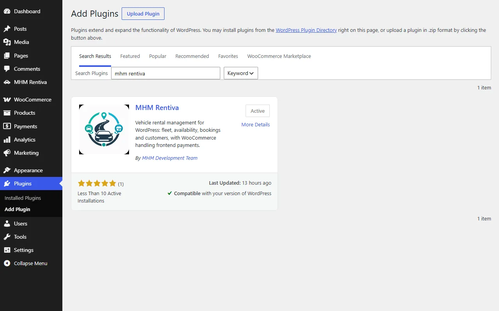
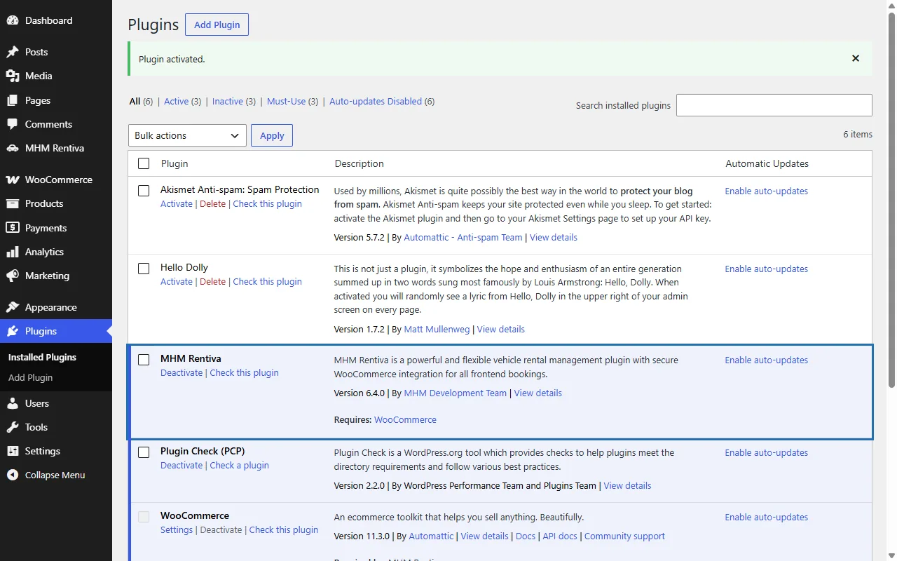

  

MHM Rentiva es un plugin profesional diseñado para convertir tu sitio WordPress en una potente plataforma de alquiler de vehículos. Esta guía te explica cómo instalar el plugin desde cero y completar los pasos de configuración inicial.

:::tip Vídeo tutorial
Haz clic en el recuadro del vídeo de abajo para ver paso a paso cómo se realiza la instalación.

  
<strong>🎥 Vídeo tutorial próximamente</strong>

  <small>Estará disponible aquí en cuanto se publique en nuestro canal oficial de YouTube.</small>

:::

---

## 1. Requisitos del sistema

Para un funcionamiento estable, tu servidor y tu instalación de WordPress deben cumplir los siguientes requisitos mínimos:

| Requisito | Versión mínima | Notas |
| :-- | :-- | :-- |
| **WordPress** | 7.0+ | Se recomienda la última versión estable. |
| **PHP** | 8.1+ | Obligatorio por motivos de seguridad y rendimiento. |
| **WooCommerce** | Activo, versión actual | **Obligatorio** para todos los flujos de pago en la parte pública. El plugin no se activará sin él. |
| **Rentiva Pro** (opcional) | MHM Rentiva 6.4.0+ | Pro 6.5.0 necesita MHM Rentiva 6.4.0 o posterior; con una versión anterior de MHM Rentiva, Pro se desactiva por sí solo y muestra un aviso en la administración. |
| **Certificado SSL** | HTTPS | Obligatorio para que funcionen las pasarelas de pago (Stripe, iyzico, etc.). |
| **Estructura de enlaces permanentes** | Nombre de la entrada | Se recomienda `%postname%` para el SEO y el enrutamiento. |

---

## 2. Instalación paso a paso

MHM Rentiva está publicado en el [directorio de plugins de WordPress.org](https://wordpress.org/plugins/mhm-rentiva/), así que la vía habitual es la que ofrece el propio WordPress. Los otros dos métodos sirven para instalar una **compilación concreta** en lugar de la versión actual.

### Método A: Desde el directorio de WordPress.org (recomendado)
1. Desde tu escritorio de WordPress, ve a **Plugins > Añadir nuevo**.
2. Busca **MHM Rentiva**.
3. Haz clic en **Instalar ahora** y, cuando termine el proceso, haz clic en **Activar**.

A partir de aquí, WordPress mantiene el plugin actualizado igual que cualquier otro plugin del directorio; no necesitas volver a descargar nada a mano.

---

*Captura de pantalla que muestra los resultados de búsqueda de Plugins > Añadir nuevo con MHM Rentiva en la lista*

---

### Método B: Subir un archivo ZIP
Usa este método cuando necesites una compilación concreta (por ejemplo, una versión de la [página de versiones de GitHub](https://github.com/MaxHandMade/mhm-rentiva/releases)) en lugar de la que está actualmente en el directorio.

1. Ve a **Plugins > Añadir nuevo** y haz clic en el botón **Subir plugin**.
2. Elige el archivo ZIP y haz clic en **Instalar ahora**.
3. Cuando termine el proceso, haz clic en **Activar plugin**.

---

*La pantalla que muestra el botón «Activar plugin» tras una subida correcta*

---

### Método C: Mediante FTP/SFTP
1. Extrae el archivo ZIP del plugin en una carpeta de tu ordenador.
2. Conéctate a tu servidor con un cliente FTP (como FileZilla).
3. Sube la carpeta extraída al directorio `/wp-content/plugins/`.
4. Activa el plugin desde tu escritorio de WordPress.

---

## 3. Acciones automáticas tras la instalación

Al activar el plugin, se ejecutan automáticamente en segundo plano las siguientes acciones:

1. **Tablas de la base de datos:** Se crean tablas funcionales como `payment_log`, `sessions` y `transfer_routes`.
2. **Registro de CPT:** Se registran los tipos de contenido personalizados `mhmrentiva_vehicle`, `mhmrentiva_booking` y `mhmrentiva_addon` y sus taxonomías relacionadas.
3. **Rol de cliente:** Se añade un rol de usuario personalizado llamado `mhmrentiva_customer`.
4. **Reglas de reescritura:** Los enlaces permanentes se actualizan automáticamente para las páginas de vehículos.

---

## 4. Asistente de configuración inicial

La primera vez que activas el plugin, el sistema te redirige automáticamente al **Asistente de configuración**. Este asistente:
- Comprueba tu servidor (PHP, WordPress, WooCommerce, HTTPS, WP-Cron, envío de correos electrónicos).
- Crea automáticamente las páginas necesarias (Formulario de reserva, Búsqueda, Resultados de búsqueda, Detalles del vehículo, Lista de vehículos, Formulario de contacto).
- Establece los datos del remitente de los correos electrónicos y los valores predeterminados básicos de visualización y de días de alquiler.

:::info Acceso manual
Si el asistente no se abre automáticamente, puedes iniciarlo manualmente desde **MHM Rentiva > Asistente de configuración** en el menú de administración de WordPress.
:::

---

## Detalles técnicos (para desarrolladores)

Durante la activación, el plugin utiliza `register_activation_hook` para lanzar la función `mhmrentiva_single_site_activation()`. Esa función mantiene actualizado el esquema de la base de datos a través de la clase `DatabaseMigrator`.

Cuando `WP_DEBUG` está activado durante el desarrollo, los errores de instalación aparecerán en los registros de PHP o en los avisos de error de la parte superior de la pantalla.

---

## Actualización

WordPress actualiza MHM Rentiva como cualquier plugin del directorio. Si también usas **Rentiva Pro**, actualiza primero MHM Rentiva (Lite) y después Pro.

:::info Cambiado en 6.4.0
MHM Rentiva ahora requiere WordPress 7.0 o posterior (antes era 6.7). Después de actualizar, **vacía la caché de páginas** (la de tu alojamiento, LiteSpeed Cache, WP Rocket, etc.): una página almacenada en caché con la 6.3.x conserva el marcado antiguo del formulario de reserva y del calendario, y los nuevos scripts no se ejecutarán en ella. La caché de corta duración propia de Rentiva se actualiza sola.
:::

---

### Resumen de la sección
- Se requieren **WordPress 7.0+**, **PHP 8.1+** y **WooCommerce**.
- Hay que completar el **Asistente de configuración** después de la instalación.
- Las tablas de la base de datos se crean automáticamente al activar el plugin.

### Registro de cambios
| Fecha | Versión | Nota |
| :--- | :--- | :--- |
| 18.11.2026 | 6.4.0 | Versión mínima de WordPress elevada a 7.0; añadidos el requisito de Pro y las notas de actualización (caché de páginas); actualizada la descripción del asistente. |
| 23.08.2026 | 6.0.7 | La instalación ahora empieza en el directorio de WordPress.org; identificadores posteriores a la activación actualizados por los cambios de nombre de la 6.0.0. |
| 23.04.2026 | 4.27.2 | Documentación sincronizada con la versión actual del plugin. |
| 18.03.2026 | 4.21.2 | Revisión del diseño y contenido ampliado. |
| 26.02.2026 | 4.21.0 | Creación de la versión inicial. |
