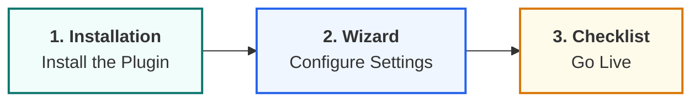

import Link from '@docusaurus/Link';

  

# 🚀 Guía de inicio y hoja de ruta

¡Bienvenido a la documentación de MHM Rentiva! Te recomendamos seguir los pasos que se indican a continuación en orden para instalar y configurar el plugin de la forma más eficiente posible.

:::tip CONFIGURACIÓN RÁPIDA
Usa las tarjetas de abajo para acceder rápidamente a los documentos clave para empezar: la instalación, el asistente y la lista de comprobación.
:::

---

  

    

      <h3 className="cardTitle">📦 1. Instalación y requisitos</h3>
      
Comprobación de compatibilidad del servidor, instalación del plugin y pasos para activar la licencia.

      <Link className="button button--secondary button--block" to="/docs/getting-started/installation">Guía de instalación</Link>
    

  

  

    

      <h3 className="cardTitle">🧙 2. Asistente de configuración</h3>
      
Una guía paso a paso del asistente de configuración que deja tu sistema listo en pocos minutos.

      <Link className="button button--secondary button--block" to="/docs/getting-started/setup-wizard">Iniciar el asistente</Link>
    

  

  

    

      <h3 className="cardTitle">✅ 3. Lista de comprobación previa al lanzamiento</h3>
      
Haz una revisión final para asegurarte de que todo está en su sitio antes de ponerlo en marcha.

      <Link className="button button--secondary button--block" to="/docs/getting-started/post-install-checklist">Lista de comprobación</Link>
    

  

---

## 📈 Mapa visual del proceso

---

### Resumen de la sección
- Esta guía está optimizada para que tu sistema esté en funcionamiento lo antes posible.
- Cada paso se basa en la configuración del paso anterior.

## Registro de cambios
| Fecha | Versión | Nota |
|---|---|---|
| 23.04.2026 | 4.27.2 | Se ha añadido la traducción al inglés. |
| 19.03.2026 | 4.21.2 | Se ha creado una hoja de ruta premium con estilo de tarjetas para la guía de inicio. |
