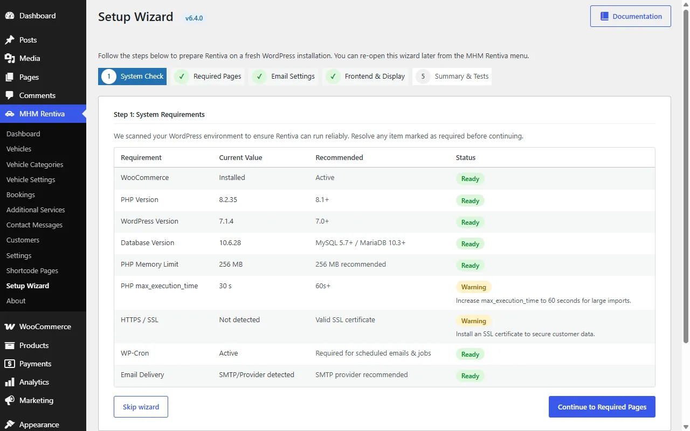

  

Cuando activas MHM Rentiva por primera vez, un **Asistente de configuración** interactivo te guía por los pasos esenciales de configuración. El asistente te permite completar los ajustes críticos necesarios para que el plugin funcione sin problemas con tu sitio, todo en cuestión de minutos. Cada paso es una tarjeta numerada; los pasos aparecen en la parte superior de la pantalla.

---


*Captura de pantalla ancha que muestra los pasos numerados y la tarjeta Comprobación del sistema*

---

## Pasos del asistente

El Asistente de configuración consta de 5 pasos:

### 1. Comprobación del sistema
El primer paso verifica que tu servidor está preparado para ejecutar MHM Rentiva.
- Se comprueban el estado de WooCommerce, la **versión de PHP**, la **versión de WordPress**, la versión de la base de datos, el límite de memoria de PHP, `max_execution_time`, HTTPS, WP-Cron y el envío de correos electrónicos.
- Las versiones mínimas de PHP y WordPress que se muestran son las que requiere el propio plugin. Si no se cumple algún requisito, recibes un aviso antes de continuar.
- Puedes salir del asistente en cualquier momento con **Omitir asistente**.

### 2. Páginas necesarias
El plugin necesita páginas específicas para funciones como la búsqueda, el listado, los detalles y la reserva de vehículos.
- Con un **solo clic** (**Crear páginas que faltan**), puedes crear automáticamente todas las páginas necesarias junto con sus shortcodes. Se comprueban un total de **6 páginas necesarias**: Formulario de reserva, Búsqueda unificada, Resultados de búsqueda, Detalles del vehículo, Lista de vehículos y Formulario de contacto.
- Si estas páginas ya existen, el asistente las detecta y las marca como «Presente».
- **Nota:** Las páginas Cuadrícula de vehículos (`rentiva_vehicles_grid`) y Comparación de vehículos (`rentiva_vehicle_comparison`) son opcionales y el asistente no las exige.

### 3. Ajustes de correo electrónico
Configura los datos del remitente para las confirmaciones de reserva y las comunicaciones con los clientes.
- Aquí se configuran el **Nombre del remitente**, el **Correo electrónico del remitente** y la **Dirección de respuesta**.
- El **Modo de prueba** envía todos los correos electrónicos únicamente a la **Dirección de correo electrónico de prueba** hasta que estés listo para pasar a producción.
- **Automatización:** activa o desactiva el envío de correos electrónicos, el envío automático y el registro de correos electrónicos.
- **Nota sobre SMTP:** Se recomienda encarecidamente usar un plugin SMTP externo (WP Mail SMTP o Fluent SMTP) para evitar problemas de entrega de correos electrónicos en tu sitio.

### 4. Página pública y visualización
Define los valores por defecto de los formularios de reserva y las tarjetas de vehículos de tu sitio.
- **Moneda y posición de la moneda:** Si WooCommerce está instalado, WooCommerce gestiona estos valores y se muestran a título informativo; cámbialos en los ajustes de WooCommerce. El asistente no cambia la moneda.
- **Días de alquiler por defecto, mínimos y máximos:** Las duraciones de alquiler que se usan en los formularios y los límites.
- **Color de acento:** El mismo ajuste que **Ajustes > Página pública y visualización > Colores** (Automático o Personalizado).

### 5. Resumen y pruebas
Se muestra una lista de comprobación final con el estado de cada paso.
- Si los enlaces permanentes de WordPress están configurados como «Simple», un aviso te pide que cambies a una estructura como «Nombre de la entrada», porque las páginas públicas la necesitan.
- Usa **Abrir ajustes**, **Revisar páginas de shortcodes** o **Enviar correo electrónico de prueba** para una última comprobación y, después, **Completar configuración** (o **Ir al escritorio**).

:::info Licencia
El asistente no tiene ningún paso de licencia. Si usas Rentiva Pro, activa tu clave desde la página **Licencia**.
:::

---

## Reiniciar el asistente

Si crees que te has equivocado en los ajustes después de completar el asistente, o si quieres volver a crear páginas que faltan:

1. Ve a **MHM Rentiva > Asistente de configuración** en el panel de administración de WordPress.
2. Sigue de nuevo los pasos desde el principio para actualizar la configuración.

:::important Aviso de pérdida de datos
Volver a ejecutar el asistente **no** borra tus datos existentes (vehículos, reservas); solo actualiza los ajustes generales y las asignaciones de páginas.
:::

---

## Nota técnica: redirección automática (para desarrolladores)

Cuando el plugin se instala por primera vez, establece la opción `mhmrentiva_setup_redirect` en `1`. El hook `admin_init` comprueba esta opción, redirige al usuario al asistente y borra la opción. La redirección se omite cuando se activan varios plugins a la vez.

Para comprobar el estado del asistente mediante programación:
```php
$is_completed = get_option('mhmrentiva_setup_completed'); // '1' means completed
```

---

### Resumen de la sección
- El Asistente de configuración consta de **5 pasos**.
- La función de **creación automática de páginas** agiliza el proceso de configuración.
- El asistente puede cerrarse una vez completada la configuración.

### Registro de cambios
| Fecha | Versión | Nota |
| :--- | :--- | :--- |
| 18.11.2026 | 6.4.0 | Nuevo aspecto con pasos numerados; color de acento añadido al paso Página pública y visualización; interruptores de las tarjetas de vehículos eliminados; pasos enumerados como en el plugin (sin paso de licencia). |
| 23.04.2026 | 4.27.2 | Traducción al inglés añadida. |
| 27.03.2026 | 4.22.1 | Lista de páginas necesarias actualizada: se añade `rentiva_vehicle_details` y se eliminan `rentiva_vehicles_grid` y `rentiva_vehicle_comparison` (ahora opcionales). 7 → 6 páginas. |
| 18.03.2026 | 4.21.2 | Contenido actualizado al modelo híbrido (usuario + técnico). |
| 26.02.2026 | 4.21.0 | Versión inicial creada. |
