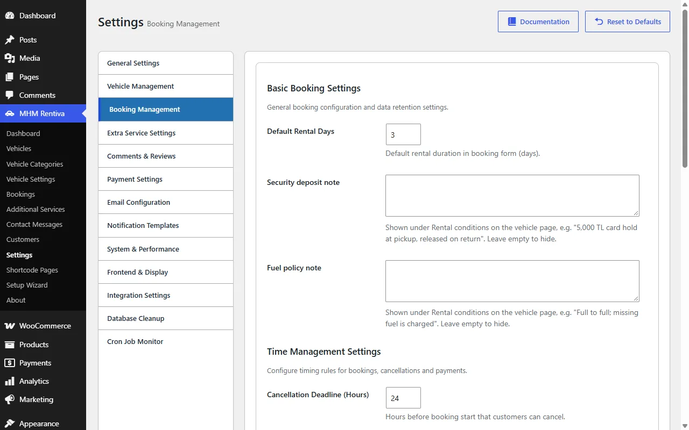

  

La pestaña Gestión de reservas es donde configuras las reglas de tiempo del proceso de alquiler, los mecanismos de cancelación automática y las preferencias de notificaciones por correo electrónico. Accede a ella desde **MHM Rentiva > Ajustes > Gestión de reservas**.

---

## 📋 Ajustes básicos de reserva

- **Días de alquiler predeterminados:** La duración de alquiler predeterminada que aparece preseleccionada en el formulario de reserva del frontend antes de elegir una fecha (p. ej., 1 día).

---

## ⏳ Ajustes de gestión del tiempo

Aquí se gestionan el ciclo de vida y los plazos operativos de las reservas.

- **Plazo de cancelación (horas):** Define cuántas horas antes de la hora de inicio de la reserva conserva el cliente el derecho a cancelar (p. ej., 24 horas).
- **Plazo de pago (minutos):** El tiempo permitido para completar el pago después de crear una reserva. Si introduces `0`, se desactiva el límite de tiempo.
- **Activar cancelación automática:** Pasa automáticamente al estado «Cancelado» las reservas cuyo plazo de pago ha vencido.
- **Tiempo de margen (minutos):** Un intervalo de «preparación y limpieza» que se inserta entre dos reservas. Durante este periodo, el vehículo aparece como ocupado en el calendario.

---

*Ajustes > pestaña Gestión de reservas, campos de plazo de cancelación y de pago*

---

## 🔔 Ajustes de notificaciones

Controla las notificaciones automáticas por correo electrónico que se envían en los pasos clave del proceso.

- **Enviar correos de confirmación:** Envía al cliente una notificación automática cuando se confirma una reserva.
- **Enviar correos de recordatorio:** Envía al cliente un correo de recordatorio antes de la hora de inicio de la reserva.
- **Notificaciones al administrador:** Envía al administrador del sitio una notificación por correo electrónico cuando se crea una nueva reserva.
- **Enviar correo de cancelación automática:** Avisa al cliente cuando una reserva se cancela automáticamente por haber vencido el plazo de pago.

---

## 📜 Contrato de alquiler

Un contrato que el cliente lee y acepta en el formulario de reserva antes de reservar.

- **Exigir contrato de alquiler:** Si está activado, los clientes deben aceptar el contrato antes de reservar. La hora y la versión del texto que aceptaron se guardan con la reserva. Está desactivado por defecto, para que un sitio que se actualiza mantenga su formulario de reserva tal como estaba.
- **Texto del contrato:** Déjalo vacío para usar la plantilla integrada (siete secciones, traducida para sitios en turco). La plantilla es un punto de partida, no asesoramiento legal: revísala y adáptala a tu negocio y a la legislación local. Formato: `# Heading`, `**bold**`, `- list item`, línea `---`.

Qué ocurre cuando está activado:

- El formulario de reserva muestra un cuadro desplazable **Contrato de alquiler** debajo de los servicios adicionales, con una casilla «He leído y acepto el contrato de alquiler.». Se rechaza cualquier reserva sin la casilla marcada, tanto en el navegador como en el servidor. Consulta [Formulario de reserva](../03-features-usage/shortcodes/booking-form.md).
- Si cambias el texto, a un cliente cuya página estuviera abierta o en caché antes del cambio se le pide que recargue la página y revise el nuevo texto.
- En la pantalla de edición de la reserva, el cuadro **Cuenta del cliente** muestra «Contrato de alquiler: Aceptado» con la fecha y la versión. Una reserva que hayas introducido a mano muestra «Sin aceptación (reserva del administrador)».
- La aceptación se incluye en la exportación de datos personales (como «Contrato de alquiler aceptado»).
- El contrato no se muestra en las reservas de transferencia.

---

## 💡 Notas técnicas

:::important Dependencia de Cron
Las funciones «Cancelación automática» y «Correos de recordatorio» requieren que el sistema Cron de WordPress esté activo. Puedes supervisar estas tareas desde la pestaña **Ajustes > Monitor de tareas Cron**.
:::

---

### Resumen de la sección
- Usa **Gestión del tiempo** para aclarar las reglas de pago y cancelación.
- Usa **Tiempo de margen** para dejar tiempo a la preparación operativa.
- Usa **Notificaciones automáticas** para automatizar la comunicación entre clientes y administradores.

### Registro de cambios
| Fecha | Versión | Nota |
| :--- | :--- | :--- |
| 18.11.2026 | 6.4.0 | Se ha añadido la sección Contrato de alquiler. |
| 23.04.2026 | 4.27.2 | Se ha añadido la traducción al inglés. |
| 19.03.2026 | 4.21.2 | Documentación de Gestión de reservas actualizada a partir de una captura del panel y del análisis del código. |
